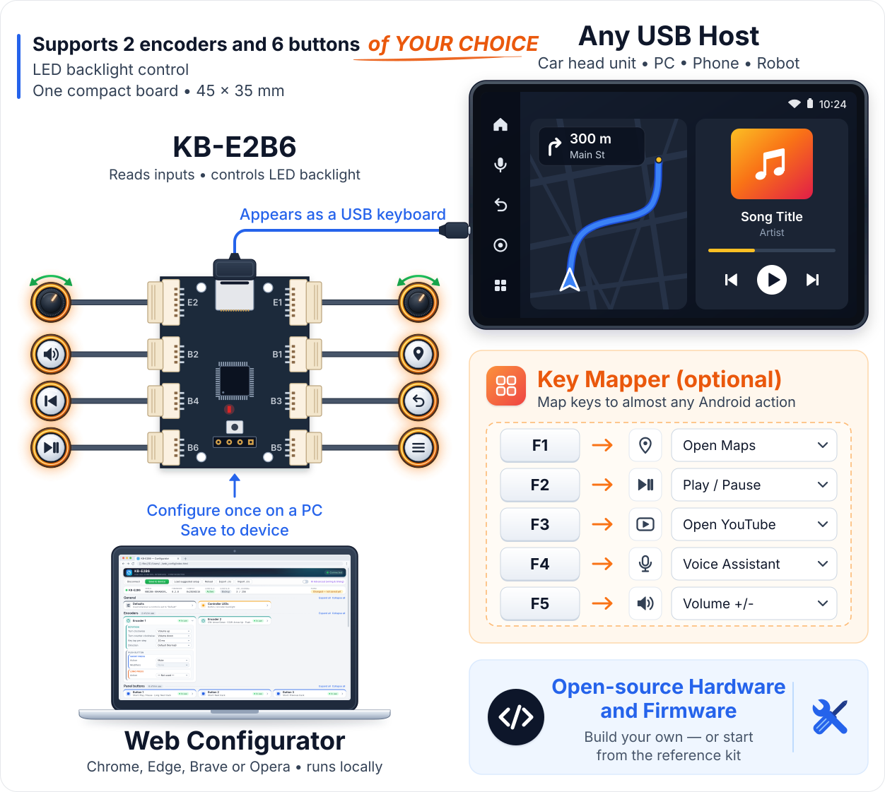
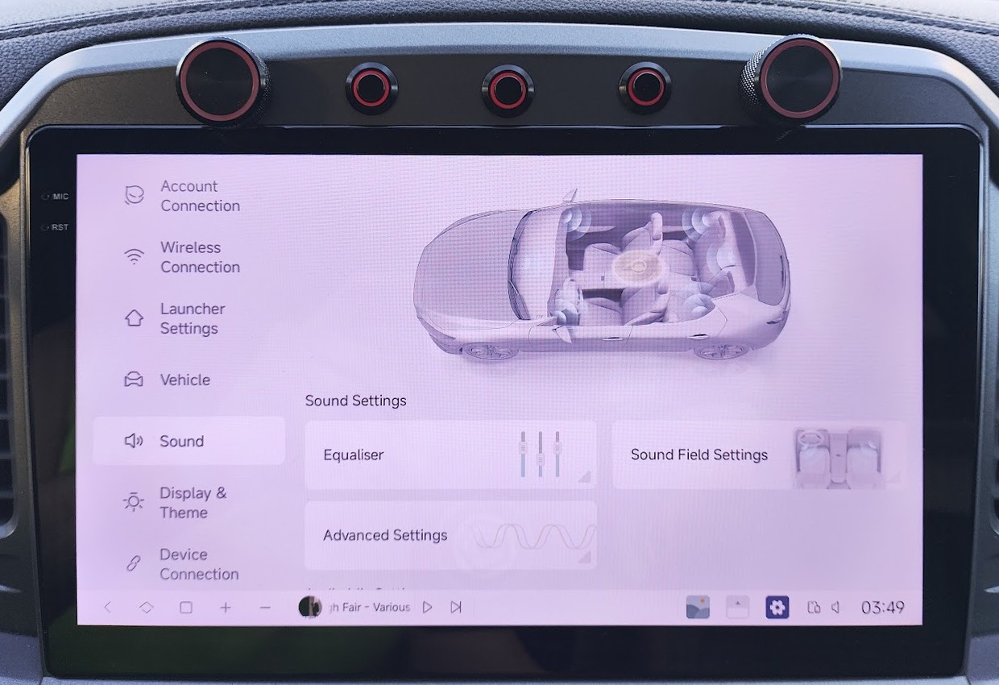
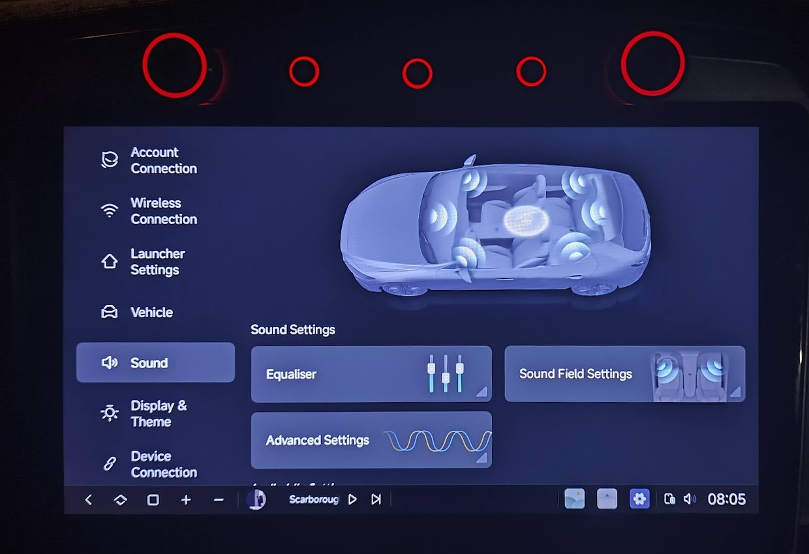
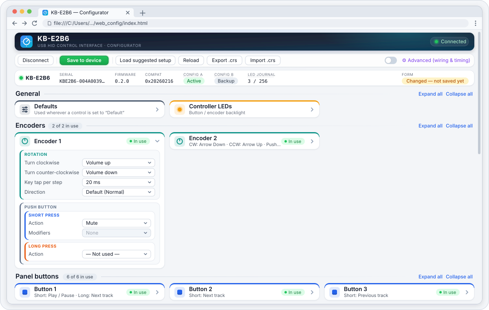
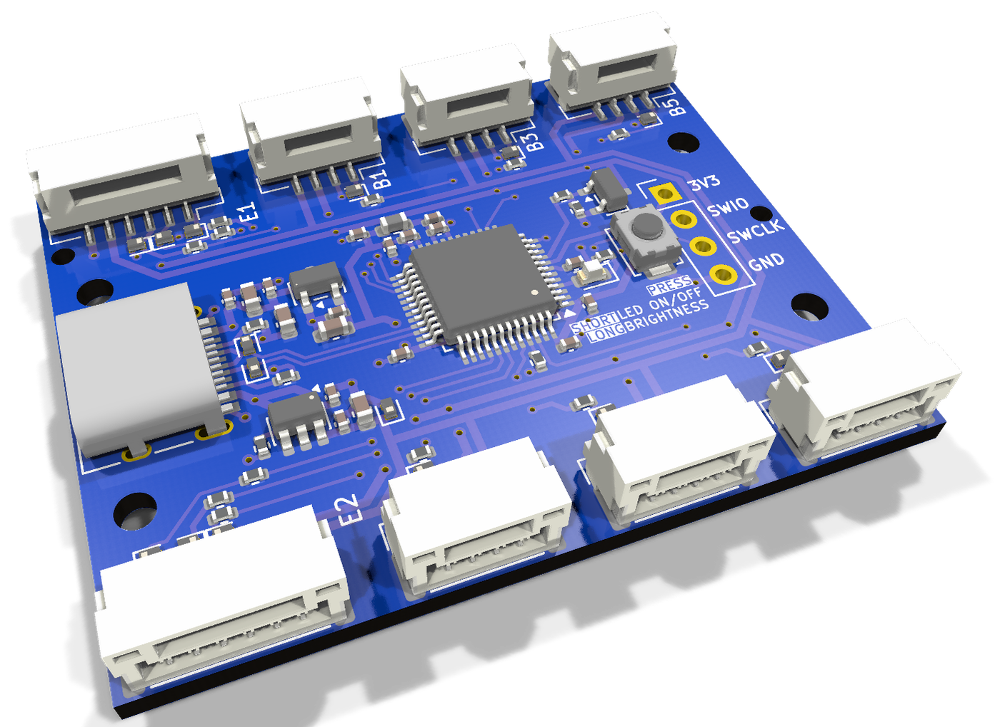
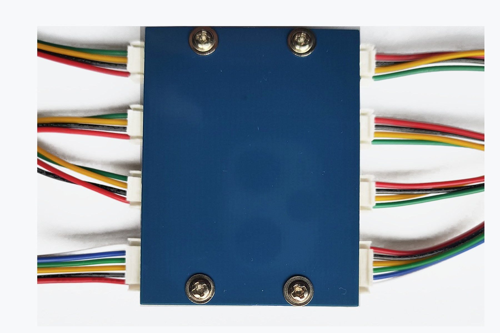
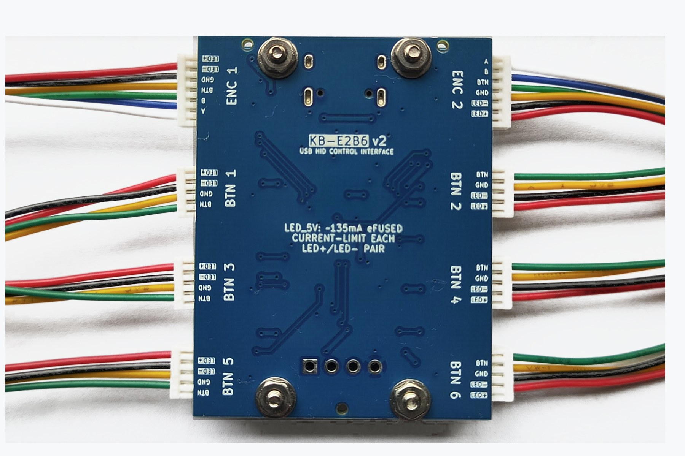
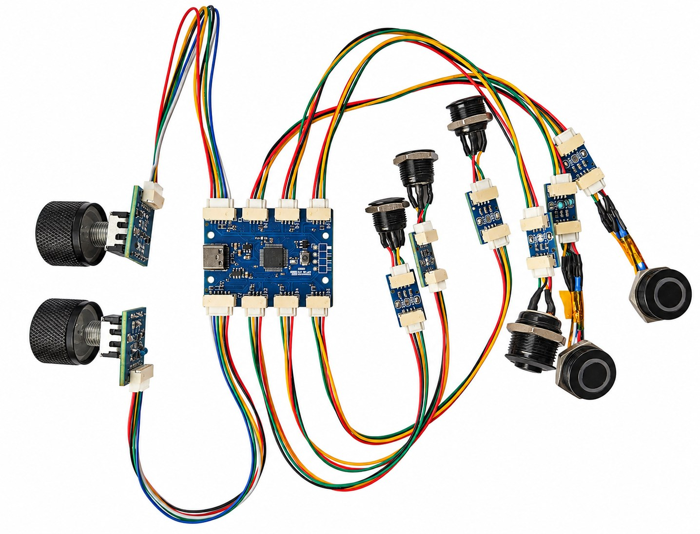
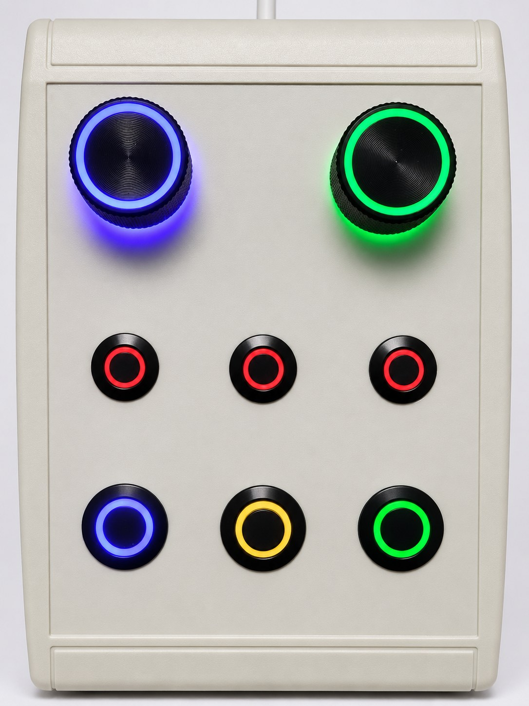
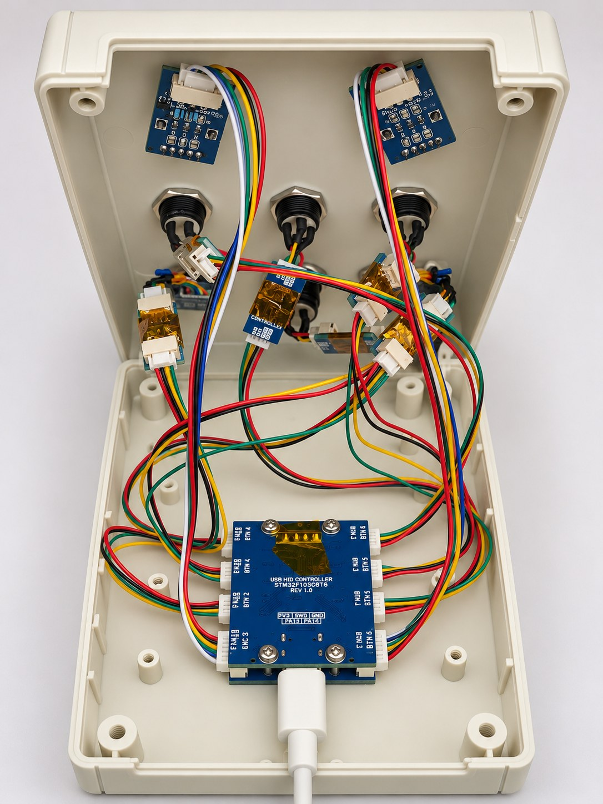

# KB-E2B6: your own illuminated controls, as a USB keyboard


> [!NOTE]
> **This project is still a work in progress.** Some materials are missing (photos, measurements, a few sections of the docs). Everything still open is marked:
>
> -  a missing piece, with a note in italics on what will go there;
> - the **WORK IN PROGRESS** bar at the top of a page: that page still has open items.

[](firmware/README.md) [](docs/hardware.md) [](#license)

KB-E2B6 is a small (45 × 35 mm) open-source controller for physical controls. You connect up to two rotary encoders with push switches and six push buttons, all of them backlit if you like, and run one USB cable to the host. The host sees an ordinary USB keyboard. You choose once, in a web page (the configurator), what each control sends, and the controller remembers this setup.

You can bring your own encoders and buttons, or start from the **[REFERENCE KIT](docs/kit.md)**: the controller with the encoders, buttons, adapter boards and cables I use myself, tested together, so you have everything you need to hook it up.

I built it for the Android head unit in my car, but nothing about it is car-specific. It should work with anything that accepts a USB keyboard: a PC or media centre, a phone or tablet, a Raspberry Pi, a robot, a simulator panel, or any project that needs a few good physical controls.

> Just want to use it? → **[GETTING STARTED](docs/getting-started.md)**.



**How it fits together.** Up to two backlit rotary encoders and six backlit push buttons plug into the 45 × 35 mm controller. One USB cable goes to the host (a car head unit, PC, phone or robot), which sees an ordinary keyboard. You set it up once from a computer with the configurator; on Android, the optional Key Mapper app turns the keys into app actions, such as F1 → open the maps app.

## Why I built it

When the infotainment system of my 2020 KIA Sorento died, I replaced it with a 10" Android head unit: big screen, modern UI, and not a single physical button. Head units with buttons exist, but they usually have only one or a few, the buttons take space away from the screen, and the units cost more. What I really wanted were controls that look like they came with the car: built into the dashboard, backlit like the originals, sized to fit the tight frame around the new unit, and doing exactly what I want.

Android already understands a USB keyboard, so the controls didn't need a custom app or driver. What was missing was a small controller that reads encoders and buttons, drives their backlight, runs from the head unit's USB port and is easy to set up. For the actions a plain key press can't reach, I use the open-source **[KEY MAPPER](https://github.com/keymapperorg/KeyMapper)** app on the head unit.

Key Mapper turned out to matter for a second reason. Once the controller is installed behind the dashboard, getting it back out to plug into a laptop is a real job, however easy the configurator is. So some of my buttons send plain F-keys, and Key Mapper on the head unit decides what they do. When I change my mind about a button, I remap it on the screen in a minute, without touching the dash. → [The full story](docs/story.md)

<p align="center">
  
  
</p>

**The head unit with the KB-E2B6 behind the dashboard.** Day and night, real photos.

## At a glance

- **Inputs:** 2 rotary encoders with push switch and 6 push buttons. Use as many as you need; unused ports do nothing.
- **Backlight:** every control can be lit, softly enough for night driving. All the LEDs share one supply that the controller dims together. The button on the board turns them on or off and steps the brightness, and the level is remembered. Your own controls do this only if you give them backlight actions (I use long presses).
- **Adapter boards:** small boards that connect the reference kit's encoders and buttons (or your own) to the controller with ready-made cables (an encoder sits on its adapter; a button's adapter sits in its cable). Their solder jumpers (pairs of pads you join with solder) set each control's LED current up or down, so different LEDs can be matched in brightness and none gets brighter than you set.
- **Gestures:** short press, long press and repeat-while-held on every push button and encoder push switch; one action per detent in each direction on encoders with as many pulses as detents.
- **Actions:** keyboard and media keys from a curated list: volume, mute, play/pause, next/previous, Home, Back, Menu, screen brightness, arrows, Enter, Esc, F1–F24, letters and digits, with Ctrl/Shift/Alt/Win combinations, plus backlight actions (on/off, brighter, dimmer).
- **Configuration:** a plain web page you open from disk in Google Chrome, Microsoft Edge, Brave or Opera (other Chromium-based browsers should work too) on a Linux (with a udev rule), Windows or Mac computer (Windows and Mac not tested yet). Pick actions from dropdowns, click **Save to device**. No app, driver, account or internet connection.
- **Power:** from the USB port it plugs into: 17 mA for the board alone, about 30 mA with the 8 controls of my [control box](#the-hardware) lit for daylight.

## Car-minded details

The car shaped a few decisions:

- ESD protection diodes on all 12 input lines and on the USB data lines.
- The LED rail goes through a current-limited switch, an "eFuse" (TPS2553, about 135 mA). A shorted LED cable should be current-limited instead of dragging down the USB supply.
- Flash holds two setup slots: the current setup and the previous one. A save goes to the spare slot, which is read back and checked before the board switches to it, so a power cut in the middle of a save should leave the previous setup in place.
- There's no built-in fallback mapping. If the newest saved setup is damaged, the board should fall back to the previous one you saved, if there is one; **if there's no usable setup at all, the controls stay silent**.
- It runs from 5 V USB only. It is **not** for direct connection to a car's 12 V, and it is not certified automotive equipment.

## Get going in 3 steps

1. **Connect the controls.** Encoders go to `ENC 1` / `ENC 2`, buttons to `BTN 1` … `BTN 6` (names on the back of the board; the top shows E1, E2, B1–B6). The reference encoders and buttons sit on small adapter boards with ready-made cables, and the plugs only fit one way: plug each cable so its red wire is on `LED+` at both ends ([why](docs/wiring.md#cables-to-the-adapter-boards)). You can also wire up your own controls. **Using an RGB encoder? Solder its colour jumper first** (see [the hardware](#the-hardware)).
2. **Configure it once, on a computer.** Download the project ([on GitHub](https://github.com/dmitry-lif/kb-e2b6): green *Code* button → *Download ZIP*), unzip it, open `web_config/index.html` in Chrome, Edge, Brave or Opera, plug the board in, click **Connect device**, choose what each control does and click **Save to device**. **A new board does nothing until you've done this.** Use a USB cable that carries data. (Firefox, Safari and phone or head-unit browsers can't do this step.) **On Linux, once, before you connect**, run this in a terminal from the unzipped folder:

   ```bash
   web_config/linux/install-udev-rule.sh
   ```

   Still can't connect on Linux: [this check](docs/troubleshooting.md#linux-still-cant-connect).

3. **Plug it into your head unit, PC or tablet.** The red status LED should show its heartbeat (two short flashes every second) and your controls should work. Fast blinking means there's no saved setup: back to [step 2](#get-going-in-3-steps).

> Step by step, with what you should see at each point: **[GETTING STARTED](docs/getting-started.md)**.



**The configurator.** The web page connected to a board: the toolbar with **Save to device**, the status strip (serial number, firmware version, *Config A* / *Config B*) and cards for the general settings, the encoders and the buttons, each set with dropdowns. The labels match the real page; the layout in this picture is approximate.

## The hardware

The controller works with any encoders and buttons that switch to ground. The adapter boards make the reference parts plug-and-play and set their LED current with solder jumpers. Everything is in [`hardware/`](hardware/): KiCad 9 projects plus Gerber, BOM and pick-and-place files for JLCPCB in each `manufacturing/` folder (Gerbers only for the cover plate).

| Board | What it is | KiCad project |
|---|---|---|
| **KB-E2B6 controller** | 45 × 35 mm, STM32G474, USB-C, 2 × 6-pin encoder ports, 6 × 4-pin button ports, on-board button (LED on/off and brightness), status LED, 4-pin SWD header | [`hardware/kb_e2b6_hw_v2.kicad_pro`](hardware/kb_e2b6_hw_v2.kicad_pro) |
| **Encoder adapter** | Holds an EC12 encoder with a single-colour LED; jumpers set the LED current | [`hardware/encoder_db/`](hardware/encoder_db/) |
| **RGB encoder adapter** | Holds an EC12 RGB encoder; jumpers set the LED current and the colour. **No colour is selected from the factory** (see below) | [`hardware/encoder_rgb_db/`](hardware/encoder_rgb_db/) |
| **Button adapter** | Sits in the cable between the controller and an LED push button; jumpers set the LED current | [`hardware/button_db/`](hardware/button_db/) |
| **Cover plate** | 45 × 35 mm PCB lid for the controller | [`hardware/cover/`](hardware/cover/) |

> [!IMPORTANT]
> **RGB encoder adapter: choose the colour before you install it.** Its three colour jumpers (R, G, B) all come open, so the encoder's LED stays dark until you bridge one of them with a soldering iron. Bridge one only: colours can't be mixed. Which jumper is which: [Hardware notes](docs/hardware.md#rgb-encoder-adapter).

> [!NOTE]
> One detail worth a look is the RGB encoder adapter. The RGB encoders I use as reference parts share one pin between the switch and the LEDs, so the usual dimming (switching the LED's minus side) can't work. A small P-MOSFET on the adapter, driven by the controller's dimmed LED pair, switches the LED supply instead: same cable, same port, no firmware change.

> How the boards work, part by part, with the trade-offs: **[Hardware notes](docs/hardware.md)**. Making your own: **[Building your own](docs/building.md)**.



**The controller, rev 2.1.** KiCad 3D render of the 45 × 35 mm board: the 6-pin encoder ports (E1, E2) and 4-pin button ports (B1–B6) along the two long edges, the STM32 in the middle, the USB-C socket on the left edge, and the status LED, the on-board button and the SWD connection (3V3, SWIO, SWCLK, GND) on the right.

<p align="center">
  
  
</p>

**The real controller, all eight ports cabled.** Left: with the cover plate screwed on. Right: the back, where the silkscreen names every port (`ENC 1`, `ENC 2`, `BTN 1` … `BTN 6`) and its pins.



**The controller with its controls.** Two encoders sit on their adapter boards; each of the six push buttons connects through a button adapter in its cable. Every control has one cable to its port.

<p align="center">
  
  
</p>

**A control box built around the controller.** Left: the front panel, with two backlit encoders and six backlit buttons in different colours, at a brightness clearly visible in daylight: the whole box draws about 30 mA ([Specs](#specs)). Right: the box opened, with the controller at the bottom, the encoders and buttons with their adapter boards in the lid, and the cables between them. One example of what you can build; the box and these controls are not part of the [reference kit](docs/kit.md).

## Firmware and configurator

The firmware is Rust on [Embassy](https://embassy.dev): `no_std`, no heap, and an input scan loop that never waits on anything. Its settings are a fixed-size, CRC-checked binary validated by the same Rust code in the firmware and in the `crs-pack` command-line tool. A setup only takes effect at boot, so **Save to device** writes the spare setup slot and restarts the board (a couple of seconds). That keeps a single, well-trodden startup path instead of a second "apply live" path.

The configurator is plain HTML and JavaScript with no build step. It talks to the board over WebHID (the USB access built into Chromium-based browsers) through a separate vendor-defined HID interface, next to the keyboard.

- Build, flash, recovery: [`firmware/README.md`](firmware/README.md)
- How the firmware is organised, and why: [`firmware/docs/ARCHITECTURE.md`](firmware/docs/ARCHITECTURE.md)
- Using the configurator, with screenshots and example setups: [`docs/configuring.md`](docs/configuring.md); its files: [`web_config/README.md`](web_config/README.md)

## Status

This is the first public snapshot: controller rev 2.1, adapter boards rev 2.0, firmware 2.1.0.

## Specs

| | |
|---|---|
| Inputs | 2 rotary encoders (with push switch), 6 push buttons, 1 on-board button (LED on/off and brightness) |
| Output to host | USB HID keyboard + consumer (media) keys; also a serial debug console (CDC) and a WebHID configuration interface |
| Host connector | USB-C (USB 2.0 full speed) |
| Control connectors | JST GH-compatible 1.25 mm: 2 × 6-pin (encoders), 6 × 4-pin (buttons) |
| Programming | 4-pin 2.54 mm SWD header (no reset pin) |
| Power | 5 V from USB only. **Not** for direct connection to a car's 12 V |
| LEDs | One shared 5 V rail, current-limited (TPS2553, ~135 mA nominal), PWM-dimmed together at 1 kHz |
| Consumption | 17 mA for the board alone. With 8 controls lit (2 encoders, 6 buttons): about 19 mA at the lowest brightness, about 30 mA at a brightness clearly visible in daylight, as in the [control box photo](#the-hardware). Measured on that box; other LEDs not tested |
| MCU | STM32G474CBT6, 170 MHz, 128 KiB flash, no crystal |
| Size | 45 × 35 mm, 4 × M2 mounting holes |
| Configure with | Google Chrome, Microsoft Edge, Brave or Opera (Chromium-based browsers) on a Linux (needs a udev rule), Windows or Mac computer (Windows and Mac not tested yet); the page runs locally |

## FAQ

**Does it work with my head unit?** If it accepts a USB keyboard, it should. Easy test before you buy: plug any USB keyboard with media keys into the head unit's USB port. If the volume and arrow keys work, the controller should work too. In my own car: a **10" Mekede DUDU 4 running Android 10**. Mapping some Android system actions with Key Mapper has limits: I was surprised to find that many trivial ones need extra permissions (easy to grant by following Key Mapper's in-app guides), and some even need further Android tweaks over the debug interface. I didn't go that far: for my use case the standard keys were enough.

**Does the backlight follow my car's dash dimmer?** No, the controller has no input for it. You set the level yourself and it stays there. You can also give your controls backlight actions (I put them on long presses, as a secondary function).

**Can I configure it on the head unit itself?** No. Browsers on Android (and Firefox and Safari anywhere) can't talk to USB devices this way. Use a computer once; the setup stays in the controller.

**Can I change what a button does after it's installed?** Yes: reconnect it to a computer and save a new setup, or give the controls arbitrary keys (say F-keys) once and remap them on the host, on Android with [Key Mapper](https://github.com/keymapperorg/KeyMapper), on a PC with any key-remapping tool. Backlight actions can only be assigned in the configurator. Details: [Getting started](docs/getting-started.md#4-plug-it-into-your-host).

**What if I mess up the setup?** By design, the board checks every setup before saving it, refuses an invalid one and keeps the old setup. Just fix it in the configurator and click **Save to device** again.

**Can I use my own encoders and buttons?** Yes. Encoders: any EC11/EC12-style one with as many pulses as detents. Buttons: any momentary type. Both must switch to ground. LEDs need their own series resistor (the adapter boards have them). What I learned picking mine: [choosing controls](docs/choosing-controls.md).

**Can I update the firmware over USB?** Not in 2.1.0. Firmware updates need an SWD probe; the configurator only changes the setup.

## Get one, build one, or get in touch

- **The reference kit:** the controller with tested encoders, buttons, adapter boards and cables. What's in it, what you supply and what you still do yourself: **[THE REFERENCE KIT](docs/kit.md)**.
- **Build your own:** order the boards from the files in `hardware/manufacturing/` and `hardware/*/manufacturing/` and flash the MCU ([Building your own](docs/building.md)), then prepare the controls ([Preparing and wiring the controls](docs/wiring.md)) and configure it ([Getting started](docs/getting-started.md)).
- **Feedback, bugs, ideas:** [open an issue](https://github.com/dmitry-lif/kb-e2b6/issues). It's a one-person hobby project, so replies may take a while, but I'd like to hear how you use it.

## Documentation

| | |
|---|---|
| [The reference kit](docs/kit.md) | What's in the kit, what you supply, what you still do |
| [Getting started](docs/getting-started.md) | Connecting the controls, configuring, the backlight, plugging into the host |
| [Troubleshooting, limitations and safety](docs/troubleshooting.md) | Symptoms, configurator messages, known limits, test status, safety |
| [Hardware notes](docs/hardware.md) | How the controller and the adapter boards work, and why |
| [Building your own](docs/building.md) | Ordering the boards, the SWD header, flashing the firmware, first checks |
| [Preparing and wiring the controls](docs/wiring.md) | Ports, wiring rules, soldering the controls onto the adapter boards, cables, bench checks: for the kit's controls and your own |
| [Configuring the controller](docs/configuring.md) | Quick start with screenshots, every option of the configurator, example setups |
| [Firmware](firmware/README.md) | Build, flash, architecture, specs, recovery |
| [The story](docs/story.md) · [Choosing controls](docs/choosing-controls.md) · [Car integration](docs/car-integration.md) | Background, parts I tried, putting it into a car |

## License

© 2026 Dmitry Lifshits. Code (firmware, tools, configurator): [MIT](LICENSE-MIT) or [Apache-2.0](LICENSE-APACHE). Hardware: [CERN-OHL-S-2.0](hardware/LICENSE): if you make and distribute boards based on a modified design, you share the modified design files under the same licence. Docs and images: [CC BY 4.0](docs/LICENSE.md), except a few third-party product images listed there. Third-party crates: [THIRD_PARTY_LICENSES.md](THIRD_PARTY_LICENSES.md).
