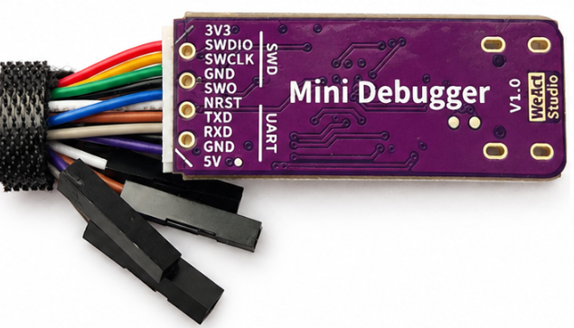

# Building your own

Making the boards yourself: order the PCBs and flash the firmware. You need some experience ordering PCBs and using an SWD probe (Serial Wire Debug, the STM32's programming port; e.g. a DAPLink or ST-LINK probe). After that, everything is the same as with the [reference kit](kit.md) (the controller with tested encoders, buttons, adapter boards and cables): [Preparing and wiring the controls](wiring.md), then [Getting started](getting-started.md).

---

## 1. Order the boards

Each KiCad project has a `manufacturing/` folder with files prepared for JLCPCB:

| Board | Folder | Files |
|---|---|---|
| Controller rev 2.1 | `hardware/manufacturing/` | Gerbers, BOM, pick-and-place |
| Encoder adapter rev 2.0 | `hardware/encoder_db/manufacturing/` | Gerbers, BOM, pick-and-place |
| RGB encoder adapter rev 2.0 | `hardware/encoder_rgb_db/manufacturing/` | Gerbers, BOM, pick-and-place |
| Button adapter rev 2.0 | `hardware/button_db/manufacturing/` | Gerbers, BOM, pick-and-place |
| Cover plate | `hardware/cover/manufacturing/` | Gerbers only |

- Upload the Gerber zip, choose PCB assembly, then upload the BOM and the pick-and-place file. The BOM lists LCSC part numbers for every part.
- Board options: 2 layers, 1.6 mm; colour and surface finish are up to you. The cover plate is a bare PCB: order it without assembly.
- Assembly options: **Assembly side: Top** (all SMD parts are on the top side of every board) and **Tooling holes: Added by Customer**. The boards already carry JLCPCB tooling holes (TH1–TH3 on the controller, TH1/TH2 on each adapter), so check this option when you order.
- The board house fits every SMD part, connectors included. It doesn't fit the through-hole parts: the SWD header J2 ([§2](#2-solder-the-swd-header)) and the encoders on the adapters ([Preparing and wiring the controls](wiring.md#preparing-controls-with-the-adapter-boards)).

**Check the part orientation in the assembly preview before you pay.** The pick-and-place files in the repo are already corrected for JLCPCB: several parts are rotated so that their pin 1 lands on the pin-1 mark of the PCB, and the USB-C connector is moved. Used as they are, they should just work; check the preview anyway. If you regenerate the pick-and-place file from KiCad, these corrections are lost: compare your file with the one in the repo, at least for these parts:

| Board | Part | In the repo file, compared with the KiCad layout |
|---|---|---|
| Controller | U1 (MCU) | Rotation 90° instead of 180° |
| Controller | U2 (3.3 V regulator), U3 (eFuse), Q1 (LED MOSFET) | Rotated by 180° |
| Controller | J1 (USB-C) | Moved 1.35 mm in X |
| RGB encoder adapter | Q1 (MOSFET) | Rotated by 180° |
| Button adapter, encoder adapter | None | No corrections |

All of this applies to JLCPCB, the only board house I have used. Others use their own rotation and origin conventions, so check their preview the same way.

## 2. Solder the SWD header

J2 on the controller takes a standard 2.54 mm (0.1 in) 1×4 pin header. It is in neither the BOM nor the pick-and-place file, so solder it yourself.

## 3. Flash the firmware

Everything for this step is in the firmware docs:

1. Install Rust and probe-rs: [firmware README → You need](../firmware/README.md#you-need).
2. Wire the SWD probe to the SWD header, with the board powered from USB: [recovery §1](../firmware/docs/recovery.md#1-what-you-need) (pinout, and which probe pin to leave open).
3. New chip, once: switch it to single-bank flash mode: [recovery §2](../firmware/docs/recovery.md#2-first-time-provisioning-set-single-bank-mode-dbank0).
4. Build and flash: [firmware README → Flash](../firmware/README.md#flash).

> [!CAUTION]
> **Don't skip step 3.** A new STM32G474CB is in dual-bank flash mode, and flashing it in that mode can leave the board stuck ([recovery §2](../firmware/docs/recovery.md#2-first-time-provisioning-set-single-bank-mode-dbank0)).

  

**The SWD probe I use:** a WeAct Studio Mini Debugger (DAPLink / ST-LINK firmware).

## 4. Check it

Plug the board into a computer and open the [configurator](configuring.md) (browser and, on Linux, the udev rule: [Before you start](configuring.md#before-you-start)).

| Check | Expected |
|---|---|
| Plug into a PC | Status LED: fast blink (about five times a second), i.e. no setup yet; a USB device **KB-E2B6** appears, with a serial port, a keyboard and the configuration interface |
| **Connect device** in the configurator ([how](configuring.md#2-connect)) | Firmware version, a unique serial `KBE2B6-…`, *Config A: None*, *Config B: None*: no setup yet, so the controls do nothing and the LEDs stay off |

From here on it's the same as with a kit: [Preparing and wiring the controls](wiring.md), then [Getting started](getting-started.md). If something fails here, [troubleshooting](troubleshooting.md) and [recovery](../firmware/docs/recovery.md) cover the usual causes.
