# Car integration guide

This guide is a compilation of everything I had to go through to install an aftermarket head unit, a Mekede DUDU 4, in my 2020 KIA Sorento. My KB-E2B6 controller is one part of that work ([what it is](../README.md), [why I built it](story.md)).

It's my car and my setup. Yours will differ in the details, so take this as a field report, not a manual.

Here's the route:

1. [Why an aftermarket head unit at all?](#1-why-an-aftermarket-head-unit-at-all) Prices, options and a swamp.
2. [The choice](#2-the-choice): how I picked the unit, and what I got.
3. [Prologue](#3-the-rabbit-hole-of-installation-prologue): the head unit side, the car side and the bezel.
4. [CAN box](#4-the-rabbit-hole-of-installation-can-box): the little box that makes it all work.
5. [Do your homework](#5-the-rabbit-hole-of-installation-do-your-homework): pinouts and a battle plan.
6. [Field test](#6-the-rabbit-hole-of-installation-field-test): into the dashboard.
7. [Setting up the HU](#7-the-rabbit-hole-of-installation-setting-up-the-hu): CAN box, camera, microphone.
8. [KB-E2B6, finally](#8-kb-e2b6-finally): buttons, at last.
9. [What I didn't get back](#9-what-i-didnt-get-back): the other 5%.

## 1. Why an aftermarket head unit at all?

I touched on this in [the story](story.md#it-started-with-a-dead-head-unit), so here are the numbers. A used original (**OEM**) unit sells on eBay for about \$80; they come from cars taken apart for parts, which is absolutely fine. The dealership quoted me almost ten times that for a new one, about \$700 plus three weeks of waiting, and even they said it probably wasn't worth it: get yourself an aftermarket unit, it'll be cheaper.

To be honest, a used one was my first thought. But before I settled on it, I took a look at aftermarket head units (**HUs**), and by then I was too deep in this *ahem*… research: aftermarket it was.

Aftermarket HUs promise a modern UI, big screens, cool features, etc., etc. My first stop was the brands I knew: Boss, Sony, Kenwood. That was the full extent of my car stereo knowledge back then. If you're in the US, a web search lands you on [crutchfield.com](https://www.crutchfield.com) pretty fast: shiny virtual shelves full of devices, wiring harnesses made for your car, installation guides. And if you don't dare to do it yourself, there are local installation shops.

Long story short, I didn't go the Crutchfield way:

1. **Shiny shelves come at a premium.** The big brand names are overpriced.
2. **The reasonably priced units are pretty poor** in performance and quality (I read a lot of reviews).
3. **The harness that keeps the factory features working costs as much as a whole stereo.** For example, an iDatalink Maestro module (it keeps the steering wheel controls and other factory features) plus an adapter for the factory microphone.

Pretty bad, isn't it?

Now try the other end: search Amazon, AliExpress or any other online shop for "car head unit". Welcome to the swamp: devices from \$50, all with a supposedly modern Android UI and whatnot.

So, what to choose? And then, how do you install it?

## 2. The choice

After soaking in that market for a while, I realized *how* to approach the search: exactly the way I'd choose a smartphone. A head unit is pretty much a smartphone in a different body: an embedded computer with hardware and software made for end users.

So you're after a brand (most likely an Asian one) that isn't overpriced yet, but has the resources and the will to sell. Easy as ABC, the brand:

- **must be strong**;
- **must have the resources** to keep supporting and improving its software;
- **must be fighting for its place** in the market.

A no-name brand won't stand behind its hardware or software, and won't push anything far enough to make customers happy. And boy, **software is concern #1**. Hardware is pretty secondary: these days you can manufacture literally anything, and cheaply. What's hard and expensive is keeping a team of developers polishing the software until it just works.

Yet every single HU (or smartphone, or anything similar) brags about its hardware, because hardware is easy to explain and seems easy to compare: "Hey, my CPU has more cores than that guy's, and mine has more memory than this guy's!"

Hardware is only half of the success. Brilliant specs can be ruined by bad software, ported in a hurry by a single guy and then forgotten. Modest hardware flies like a rocket with a real software team behind it. You want the middle ground.

So I focused on Asian brands that have already proven their quality and are open about how they support their software. I ended up looking at **Dasaita, Mekede, Joying, TEYES, Eonon and ATOTO**. There are more, but that list is enough. All of them do their own software work, and you can find out what they do and how.

Then came the hardware specs and the form factors that fit my KIA. There are two ways to put an aftermarket unit in:

| | Double-DIN (2-DIN) | 10" |
|---|---|---|
| **The factory bezel** | Stays | Is replaced by a new one |
| **What holds the unit** | A trim (dash kit) in place of the OEM head unit | The new bezel |
| **The unit** | Any standard 2-DIN unit: 180 × 100 mm (single-DIN: 180 × 50 mm) | A 10" unit |
| **Fits** | Most cars: older dashboards were built around these sizes, and for newer ones the trim adapts the factory opening | Bezels exist for the various KIA Sorento sub-models and years |

Both work in my KIA, but I went 10": it's a common size, a 10" bezel takes 10" units, and most head unit vendors make those.

  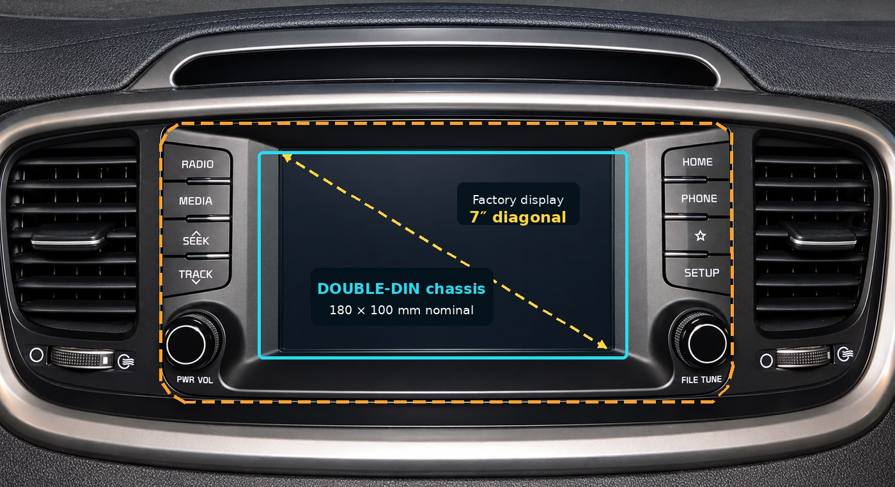
  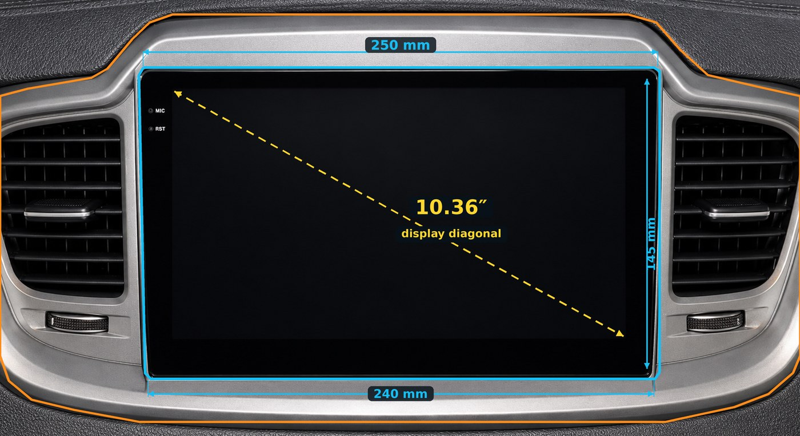

**The two ways, on my dashboard.** Left, double-DIN: the factory head unit with its 7" display. A trim replaces everything inside the orange outline (the unit's face with its buttons and knobs) and holds a 2-DIN unit (blue, 180 × 100 mm nominal); the silver bezel around it stays. Right, 10": the whole bezel (orange) is replaced, and the new one holds a 10.36" unit (blue, about 250 × 145 mm). These are the before and after photos from [the story](story.md#it-started-with-a-dead-head-unit), with the sizes marked.

### My pick: Mekede 10" DUDU 4

My choice was the Mekede 10" DUDU 4. Why?

- **Mekede** is a well-known and reliable head unit brand.
- **DUDU OS**, the Android-based system on DUDU units, is made by DuduAuto, a Chinese company with its own software team. It isn't open source, but it has a living community: an [official forum](https://forum.dudu-auto.com) with sections for bug reports and feature requests, where DuduAuto's own people answer, plus long threads on XDA. Outside China, Mekede sells and supports DuduAuto's units, hence "Mekede DUDU".
- **The DUDU 4 is LEGACY** (yes, you read that right: *old*) **and CHEAP**: about \$150 plus shipping and taxes, under \$200 delivered. When I bought mine, the DUDU 7 was already out, priced like the high-end units from Sony, Kenwood and the like.

Why a legacy product?

- **The CPU is still plenty for the job.** It needs active cooling (the fan on the back, see below), a drawback compared with newer models, but I can live with it.
- **Mature software.** The Android 10 integration bugs are probably fixed by now, while brand-new models may still be going through updates and patches. I can't prove it, but that's typical for any brand-new software.
- **And the price, of course!** Just keep in mind that you'll also need a **connection harness**, and it adds to the cost (more in [§3](#3-the-rabbit-hole-of-installation-prologue)).

  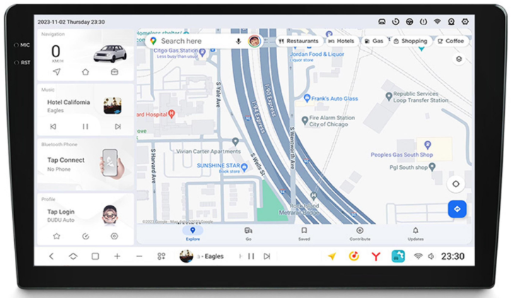
  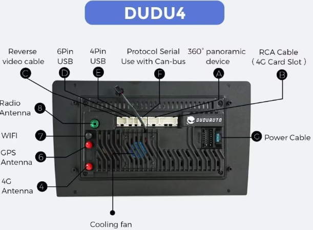

**The Mekede DUDU 4, front and back.** Front: the 10" screen with the built-in microphone (MIC) and the reset hole (RST) in the top-left corner. Back: the cooling fan sits in the middle of the heatsink, the antenna sockets (radio, Wi-Fi, GPS, 4G) are on the left and the power cable on the right. Along the top: reverse camera video, two USB ports (6-pin and 4-pin), the serial link to a CAN box, a 360° camera system and the RCA cable. 

I'm not disappointed with the unit. Yes, I found hardware and software issues, but they're minor, and I've worked around most of them:

| Issue | What happens | What I did |
|---|---|---|
| **Cooling fan** | It started to scratch the housing | Repositioned it a bit |
| **Date and time** | The unit doesn't keep them | Nothing: the GPS antenna that came with it fixes this, the time comes from GPS and is always precise |
| **Microphone gain** | No gain control for the microphones (built-in or external), and I really miss it. Newer DUDU OS versions have it (I checked) | Wired my own electret capsule to the HU's external mic input. The OEM microphone needs some hardware work you probably don't want to get into (I didn't; more in [§9](#9-what-i-didnt-get-back)) |
| **Wi-Fi** | The antenna is weak | My router is in the garage, and I can just about park close enough to download stuff. To be fair, my unit normally stays offline; the only things I ever downloaded were UI themes |
| **Phone calls** | DUDU's call screen duplicates my phone's CarPlay call controls: when a call comes in, both pop up | – |

## 3. The rabbit hole of installation: prologue

Before we dive into the details of the setup in my 2020 KIA Sorento LX, a little preface.

**The head unit side is (mostly) common.** Turn most aftermarket Android HUs of this class around, and they look just like mine. Why? Who made this a standard? Life, I believe. Vendors need to sell their stuff, and the HU is only half of your journey. Yes, you heard right: a box with a brand-new HU is just the beginning; you still have to install it. And boy, imagine the salad of harnesses we'd need if every vendor had its own set of ports! (The OEM world is different, mind you, and even some aftermarket HUs have a pretty unique port layout.) Which brings us to the next BIG area: the **connection harness**.

  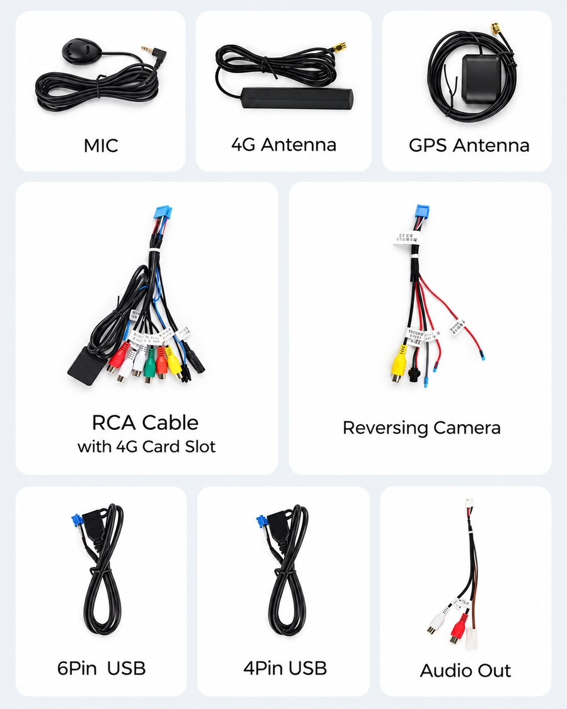

**The cables that come with the head unit.** This set is for my DUDU 4: microphone, 4G and GPS antennas, the RCA cable with the 4G SIM card slot, the reversing camera cable, two USB cables (6-pin and 4-pin) and an audio out cable. They plug into the back of the unit.

**The car side is a battlefield.** The connection harness is the middle layer: one end plugs into your HU (the side that, as we just saw, is common across many vendors), the other into YOUR car. And trust me, that's a true battlefield. Every car maker has its own connection layout, and even the same maker, same model, same year comes in different trims! One has the AC controlled from the HU, another a separate digital amplifier (yes, KIA Sorento, I'm looking at you; [more about it](#more-about-my-simple-soft-can-box)). The further apart the model years, the more everything differs, from the connectors to the shape of the bezel (remember, the HU has to fit into the dashboard too).

  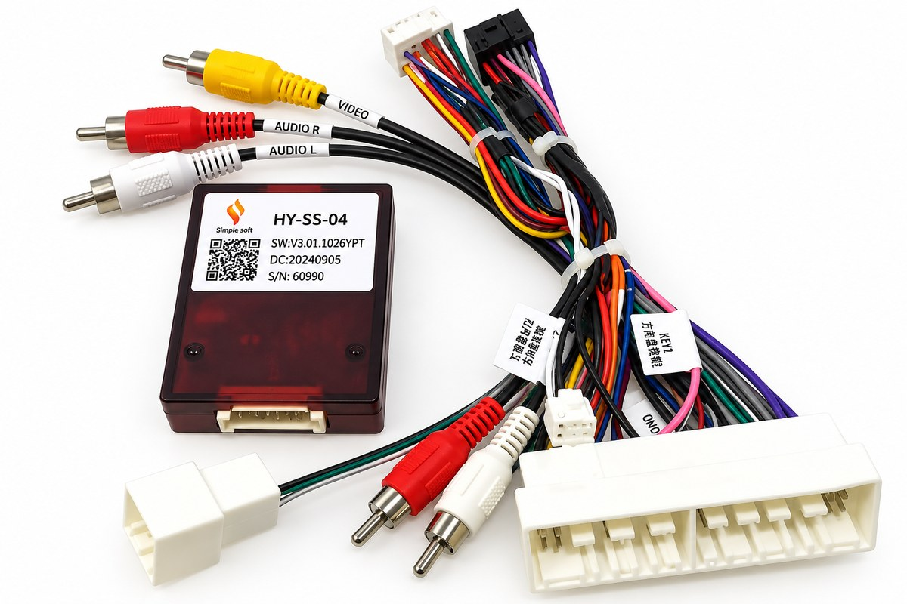
  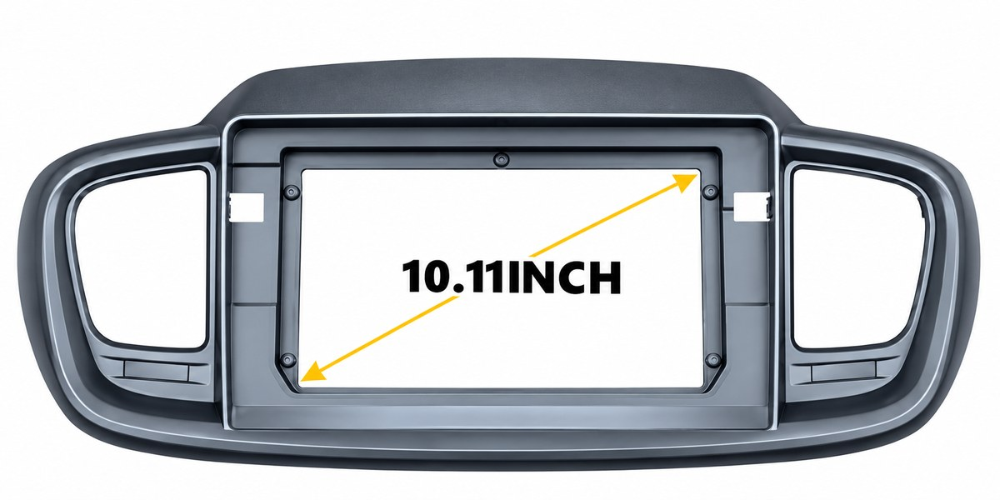

**The car-specific parts.** Left: my connection harness with its CAN box, a Simple Soft HY-SS-04 (the small box; more about CAN boxes later). The large white plug fits the car's factory connector; the black and white plugs at the top go to the head unit. Right: a 10" bezel for the KIA Sorento.

A few notes:

- **The bezel MUST fit your make, model and year.** Hard to be sure of from AliExpress or Amazon pictures, but doable. It's cheap, around \$20. Pick the variant for *your* steering wheel side too: bezels for left-hand-drive and right-hand-drive cars can differ a bit. Same for the colour: don't assume, look at the trim around your HU and the side vents.
- **Swapping the bezel** takes some tools (and courage…). A few YouTube videos helped me a lot.
- **The CAN box** gets the [next chapter](#4-the-rabbit-hole-of-installation-can-box) to itself. Stay focused: we're getting to the most complex and essential part of the story. Ideally, the box comes as a **kit** with your HU and the other accessories, and yes, there are shops that do exactly that. Some sell complete kits promised to fit together (HU, bezel, CAN box), and some charge a 4x premium for them over buying it all yourself (not kidding: check [smarty-trend.com](https://smarty-trend.com/), then close that tab; we're on our own journey here).

## 4. The rabbit hole of installation: CAN box

Meet my CAN box, a Simple Soft HY-SS-04, with its lid off:

  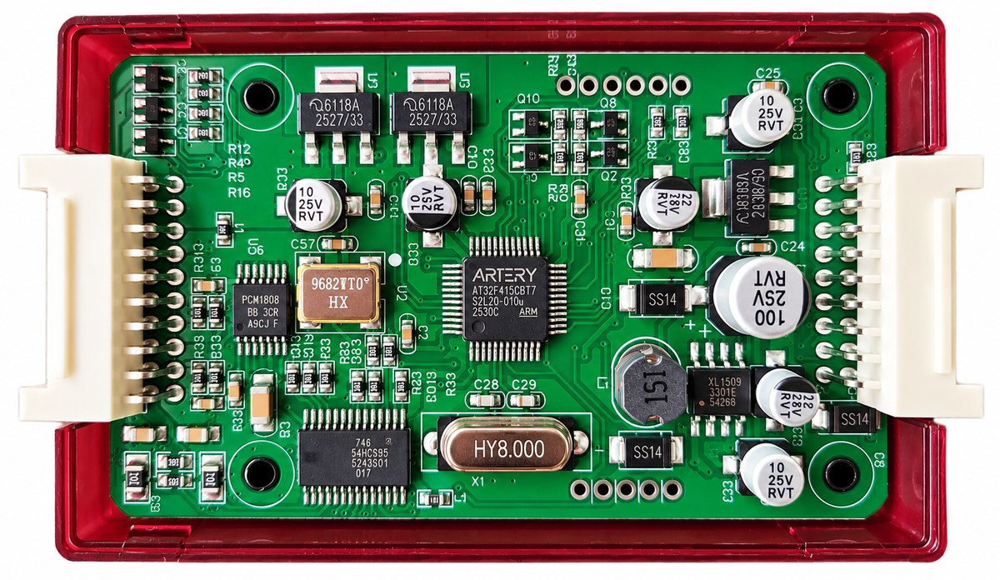

**Inside my Simple Soft HY-SS-04.** A small circuit board with a connector at each end; the ARM microcontroller in the middle (Artery AT32F415) runs the box's firmware.  *I still have to confirm the model and firmware version from the label on my own box; the harness picture in [§3](#3-the-rabbit-hole-of-installation-prologue) shows HY-SS-04, SW V3.01.1026YPT.*

They call it a **CAN box**, a CAN bus decoder or just an adapter (the wires around it are the harness). Whatever the name, it's **the core of your connection harness**. If it doesn't do its job, your brand-new HU, expensive or not, may still power up and play music, but the car's own features are gone: steering wheel buttons, car info, the automatic switch to the reversing camera. How much you lose depends on the car.

**The good news:** for many car models, a few Chinese vendors have it well covered, and the boxes are cheap. **The bad news:** it's all AliExpress style: poor descriptions, and it isn't always clear which car a box actually fits.

Why? The same box can be flashed with different firmware for different car models. Not by you, though: you just buy a box, and it comes with the firmware already in it. Mine is a good example: the label says HY-SS-04, and [Simple Soft's own site](http://www.ssinterface.com/show.php?id=772) lists the HY-SS-04 only for the 2010–2014 Sorento (the 2015–2020 one is listed under the HY-SS-06 and HY-SS-06A). Mine came with firmware that works with my car anyway. And that's the big problem: **the sellers do list the supported car models, but the lists can contradict each other and mislead you.** The same box (at least judging by the photos) is sold for different car models, blogs report (like mine) a box working in a car its seller doesn't list, and the listings disagree with the maker's own website. Weird, yes. But the boxes are cheap, and it's worth the risk.

Now, step by step. Your car talks to the infotainment system over two channels, and the CAN box sits on one of them:

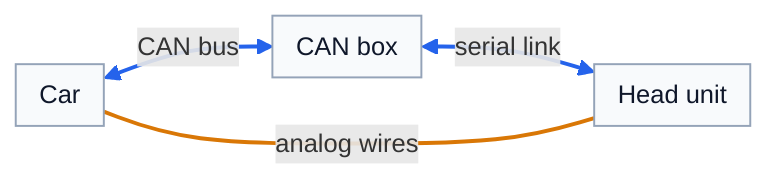

**Analog.** A voltage on a pin, or voltage steps, plus power in and out. It carries the basics: power, speakers, illumination, reverse and the steering wheel buttons. It's a well-established language, though not one single standard. Most Android HUs bring it out on a 16-pin plug that their vendors call the "16-pin ISO" port, although it isn't really ISO. It shows up again in my [connection plan](#putting-it-all-together).

**Digital: the CAN bus.** Some of those functions, and many, many more, go over the car's **CAN bus** (Controller Area Network), a digital automotive bus that has been around for a while: Bosch introduced it in the 1980s. It's very convenient for passing controls and status in and out of the infotainment system. The bus itself is well defined, but *what* a car says over it is up to each manufacturer. Think of it this way: one car speaks Korean, another speaks German, and your HU understands, say, Chinese. The CAN box is the translator. (The language analogy only shows the concept, of course.)

**HU ↔ CAN box.** This link isn't standardized either: every box vendor has its own proprietary protocol. It runs over a plain **serial link** (UART), even when the pins are labelled CAN TX/RX: the DUDU 4's back panel calls it "Protocol Serial", my box's pinout `MCU RXD`/`TXD`. HUs support several CAN box vendors (Raise, Hiworld, Simple Soft, the maker of mine, and others), and you pick yours in the HU's settings. How it works exactly, we don't know: they don't publish it. Enthusiasts on XDA have reverse-engineered parts of it.

**Two paths in parallel.** Don't be surprised to see the same wire from the car go two ways: one branch to the HU's 16-pin plug, the other into the CAN box, which reports to the HU over the serial link. That doesn't mean both control the HU independently, or that the HU referees between them: to some extent, you choose in the HU's settings which path it uses. I believe the CAN box makes the decisions about the car's control signals and unifies them over the serial link.

I believe modern cars control their own OEM head units mostly over the CAN bus, and most analog control pins are there for compatibility. Not everything, though: power always comes on wires, the speakers are analog unless there's a separate amplifier, and some cars still wire a few controls the old way, too. My Sorento most likely supports both for the same controls: CAN events and, in parallel, analog steering wheel buttons (resistive, see [§5](#5-the-rabbit-hole-of-installation-do-your-homework)). The CAN part is clear: I don't use the analog way, yet my buttons work. So the analog path is there as a backup, but don't fall back to it without a very good reason, like a CAN box that just won't work.

**CAN box ↔ car.** The box's firmware is made for the car's make and model: it knows how to read and send your car's CAN bus messages. So **buy a CAN box that matches YOUR car!** Sellers list the supported cars, but it isn't always 100% clear whether yours will work.

Premium interfaces like the iDatalink Maestro do the same job for 10x the price (and their full features only work with radios from the big brands). They keep a big database of car models, and you flash the firmware for your exact car from their website; it's all proprietary. That's what the premium buys: a documented match for your car, where you see in advance which features will work (with a proper installation, of course). Still no guarantee that every OEM function survives. You already know what I think about the Maestro ([§1](#1-why-an-aftermarket-head-unit-at-all)). My math: spend \$20, and with, say, a 90% chance you'll succeed and get back 95% of your OEM HU's functions (what I didn't get back in mine: [§9](#9-what-i-didnt-get-back)). These numbers are my rough estimates: my Simple Soft HY-SS-04 from AliExpress just worked, and I never had to try another one.

### More about my Simple Soft CAN box

First, to be clear: my Sorento LX has the simple setup. Its AC isn't controlled from the head unit, and there's no separate amplifier: the HU drives the speakers itself. The amplifier I mentioned in [§3](#3-the-rabbit-hole-of-installation-prologue) comes with the **Infinity premium sound system**, an option on the upper trims (SX and SX Limited) of the 2016–2020 Sorento: a factory amplifier plus a subwoofer. It takes the sound from the head unit as a digital **S/PDIF** signal, not as analog audio, so an aftermarket HU can't feed it directly.

My box looks ready for that amplifier anyway. Simple Soft lists "Retains SPDIF AMP" among its features, and the chips for it really are on the board:

- **Artery AT32F415:** the ARM microcontroller that runs the firmware;
- **PCM1808:** an audio ADC (analog audio in, digital out);
- **DIT4096:** an S/PDIF transmitter.

My guess at the audio path: the HU's analog audio on `L IN`/`R IN` → PCM1808 → DIT4096 → `SPDIF+`/`SPDIF−` → the factory amplifier.

Apart from that, the box does what you'd expect from a CAN box: it reads the car's CAN bus, has its own battery, ACC and ground connections, gives the reverse trigger (the camera video itself doesn't need the box), passes on the steering wheel buttons, the illumination and the parking brake, and talks to the HU over the serial link. Climate and trip information depend on the car. And not every signal in its pinout ([§5](#5-the-rabbit-hole-of-installation-do-your-homework)) goes through the box's brain: some wires just pass through the harness.

## 5. The rabbit hole of installation: do your homework

I was going to say the pinout is nice to have and keep in mind for when something doesn't work. Nope, wrong: you need to know, at least roughly, which wire goes where. Seen the picture of the CAN box wires? And the HU's ports? You'll have to match them. And NOT all of them: remember the different trims? The CAN box harness tries to cover as many trims and models as possible, so it comes with connectors you'll never use (the AC one if your AC isn't controlled from the HU, S/PDIF if you have no amplifier). KIA's OEM HU connectors vary too, so the harness carries both options.

Confession: I first studied the ports of my exact model and the supplied wires very carefully, AND then cut off half of them ;) I simply don't need them.

How do I know which ones? Let's go through the pinouts I found on the web.

> [!WARNING]
> **Not guaranteed.** All pinouts in this section are breadcrumbs: data I found all around the web and put together, plus the labels on the wires of my harness. I verified them on my Sorento, and they worked. I don't guarantee they will work for other KIA models, trims or years: check your own car before you connect anything, because a wrong wire can damage the HU or the car's electronics.

### Let's start with the Simple Soft CAN box

  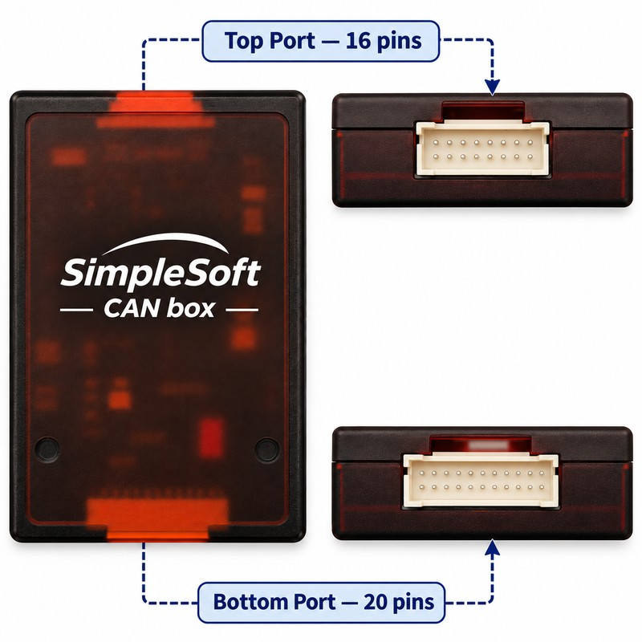

**The box's two ports.** The 16-pin port on top carries power (BATT/ACC/GND), the CAN bus (H/L), reverse, parking, camera, amplifier control and the serial link to the HU; the 20-pin port at the bottom carries the audio (L/R, S/PDIF), the steering wheel lines (SW1/SW2), illumination and detection.

A dash means unknown.

| Pin | 20-pin connector: steering wheel, illumination, audio | 16-pin connector: power, CAN bus, link to the HU |
|---|---|---|
| 1 | – | BATT |
| 2 | GND | GND |
| 3 | CODE SW1 A | CAN-L |
| 4 | CODE SW1 B | CAN-H |
| 5 | CODE SW2 A | ACC |
| 6 | CODE SW2 B | CAM power |
| 7 | ILL− | REVERSE |
| 8 | AGND | PARK |
| 9 | ILL+ | REMO AD |
| 10 | DET_IN | AMP_DET |
| 11 | – | AD1 |
| 12 | – | AD2 |
| 13 | – | AD4 / R_OUT |
| 14 | R IN | MCU RXD |
| 15 | – | MCU TXD |
| 16 | AGND | BACK |
| 17 | – |  |
| 18 | L IN |  |
| 19 | SPDIF− |  |
| 20 | SPDIF+ |  |

### Then the 2020 KIA Sorento LX

The factory radio has two connectors, A and B, plus a USB plug. My tables follow the [published pinout](https://pinoutguide.com/Car-Stereo-Hyundai-Kia/Kia_Sorento_2016-2017_MP3_pinout.shtml) of the base 2016–2017 Sorento radio (part number 96160-C6000WK) pin for pin, except A9, which is empty there.  *My own radio's part number will be added here.*

Other radios of the same generation differ, so **check the part number on your radio's label**:

- on some, B4 is empty and the steering wheel buttons go over the CAN bus;
- on some, B6, B7, B18 and B19 carry USB instead of the camera;
- navigation and Infinity units move ACC to B18.

  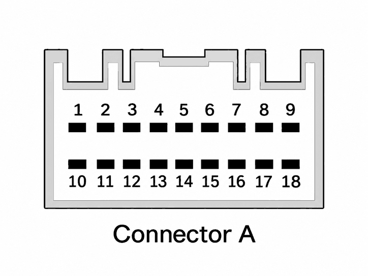
  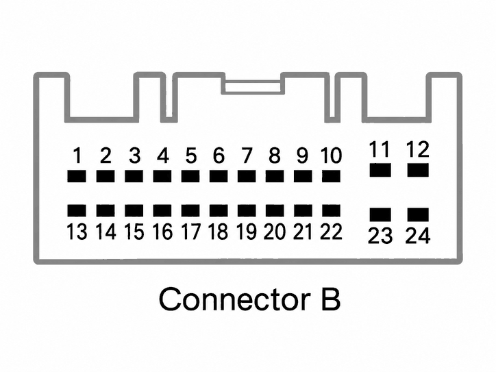
  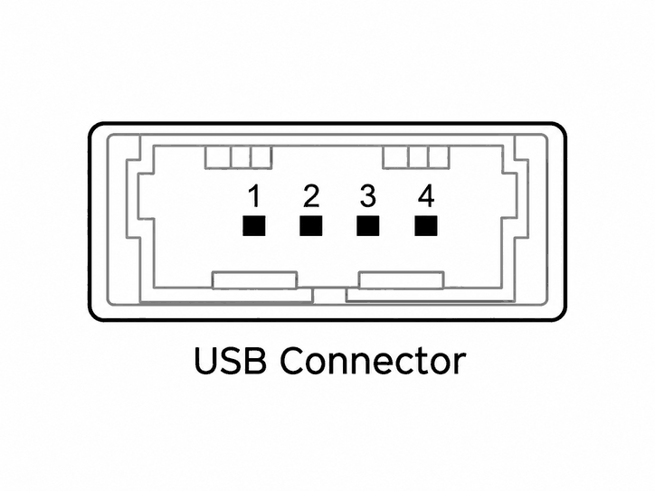

**The radio's connectors.** Left to right: connector A (18 pins), connector B (24 pins) and the USB connector, with their pin numbers. On connector B, the separate block on the right holds the power pins (ACC, B+ and the grounds).

Entries marked * differ between model years or radio variants; a dash means not assigned.

| Pin | Connector A (18-pin): speakers, illumination | Connector B (24-pin): power, CAN bus, camera, AUX, microphone, steering wheel |
|---|---|---|
| 1 | RL+ | CAN-H |
| 2 | FL+ | – |
| 3 | FR+ | – |
| 4 | RR+ | SWC |
| 5 | – | REAR REM* |
| 6 | – | CAM VIDEO* |
| 7 | IGN* | CAM B+* |
| 8 | ILL+ | AUX R |
| 9 | DETENT* | AUX GND |
| 10 | RL− | MIC+ |
| 11 | FL− | ACC |
| 12 | FR− | B+ |
| 13 | RR− | CAN-L |
| 14 | – | – |
| 15 | – | AUTO LIGHT |
| 16 | DOOR UNLOCK* | VSS |
| 17 | ILL− | SWC GND |
| 18 | ANT REM | CAM GND* |
| 19 |  | REVERSE / CAM REQ* |
| 20 |  | AUX DET |
| 21 |  | AUX L |
| 22 |  | MIC− |
| 23 |  | CAM PWR GND* |
| 24 |  | PWR GND |

RL, FL, FR, RR: rear left, front left, front right, rear right speaker. IGN: ignition. ANT REM: remote (power) antenna. SWC: steering wheel controls. REAR REM: rear remote controls, if equipped. VSS: vehicle speed. AUX DET: AUX input detection. CAM REQ: camera request.

**USB connector.** The standard USB order:

| Pin | Signal |
|---|---|
| 1 | +5 V |
| 2 | D− |
| 3 | D+ |
| 4 | GND |

Measure +5 V and ground before you connect anything.

**Steering wheel buttons.** The resistive ladder from [§4](#4-the-rabbit-hole-of-installation-can-box): each button shows its own resistance, presumably between SWC (B4) and SWC GND (B17).

| Button | Resistance |
|---|---|
| Seek up | 430 Ω |
| Seek down | 1.11 kΩ |
| Mode | 2.11 kΩ |
| Mute | 3.11 kΩ |
| Volume up | 4.61 kΩ |
| Volume down | 6.81 kΩ |

> [!NOTE]
> **Last resort.** These resistances let your HU **learn** the steering wheel buttons over the old analog channel ([§4](#4-the-rabbit-hole-of-installation-can-box)): it reads them on its own steering wheel inputs on the 16-pin plug, and in its steering wheel settings you teach it which button does what. Use this only if your CAN box doesn't work for some reason. Don't rush to it: give up on your CAN box setup completely first.

### Putting it all together

Now you know what the CAN box does and what your car's connectors provide (well, not your car: mine, in this story). Then again, if you've made it this far, it's *our* car by now. Let's get on with it. What's still missing? Tons of stuff, of course, but next up: the HU's ports and how we bridge everything together.

Remember the redundant wires you can trim off the supposedly universal CAN box harness? For that, we need a preliminary battle plan:

  <a href="images/connection-plan-draft.png">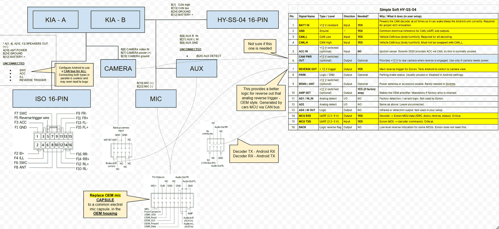</a>

**My connection plan (draft).** The car's connectors A and B, the HU's 16-pin plug, camera, AUX and microphone, and the Simple Soft HY-SS-04's 16-pin port with a table of what each pin does and whether I need it; the lines show which wire goes where. Click it for the full size.  *A clean, complete diagram will replace this draft.*

 *Coming here: the main connections of my setup, once I've double-checked them behind the dash.*

**Do a dry run on your desk.** I strongly suggest putting your HU and CAN box together on your desk BEFORE anything goes into the dashboard. You'll spot the redundant wires, decide what to trim, and see what this whole mess looks like.

  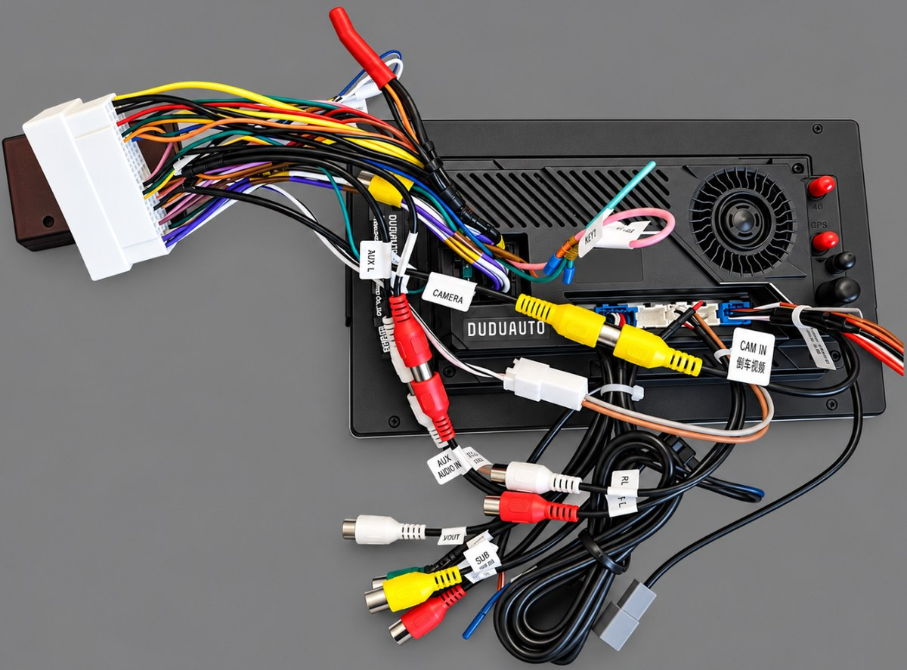

**The whole set, connected.** My DUDU 4 from the back with the CAN box harness plugged in. The large white plug on the left goes to the car; the labels on the leads tell you what's what (KEY1, CAMERA, CAM IN, AUX, RL/FL, SUB, VOUT).

## 6. The rabbit hole of installation: field test

Remember what this whole project is about? Buttons. Buttons over USB. Time to add more tentacles to your already Cthulhu-looking creature, wrapped in wires and connectors from every side. Are we ready yet? You must be kidding me: NO!

I'll deliberately skip the details of the mechanical work, which I believe WILL intimidate many of us. The short version:

1. **Open the dashboard:** remove the OEM HU bezel and take out the OEM HU.  *A link to a video walkthrough will be added.*
2. **Mind the metal frame.** In the KIA Sorento, an extra metal frame INSIDE the dash holds the HU box. **Important:** if your HU is deep enough to hit that frame, you'll have to CUT IT! It's considered a "normal" step: Crutchfield's fit guide, for example, has a rating for units that fit only after trimming inside the dash. That's why **short-depth units** like Mekede, Eonon and others are your best bet: no frame cutting. Ohh… save your energy for the next steps.
3. **Drill the holes** for the encoders and buttons in the top of the replacement bezel (yep, still remember what this whole project is about?). Measure carefully. An example: [my dashboard](../README.md#why-i-built-it).
4. **Move the bezel clips and the AC vent ducts** from the original bezel to the replacement one. Not trivial: it takes some fine motor skills.  *A link to a video walkthrough will be added.*
5. **Install your HU** and bring it all into the car. Put the buttons project on hold for now: first make sure your HU works.

## 7. The rabbit hole of installation: setting up the HU

Beyond the connection plan in [§5](#5-the-rabbit-hole-of-installation-do-your-homework), I deliberately skipped step-by-step instructions on which wire goes where. First, the general idea is all above: once you get it, you'll figure out the rest yourself. Second, I'd get lost in explanations and photos, and so would you. I hope you now have enough tools and detail to apply the concept to your own situation, whether it's a KIA Sorento or another car.

Once the HU has power (yes, turn the ignition ON), go straight to its settings.

 *This part is still being written. It will cover:*

- *the CAN box setup;*
- *the backup camera image;*
- *the microphone setup.*

## 8. KB-E2B6, finally

I assume you made it! Congrats, your brand-new Android HU works! Goodbye, slow 7" OEM display; welcome, big new Mr. "not a single button to push" tablet. I bet your hand keeps reaching for the volume knob that just disappeared, and your spouse keeps telling you that their favourite radio station is buried several touches deep and they just can't get to it while driving.

**KB-E2B6 to the rescue!**

1. **Configure it and plug it in.** [Configure it](configuring.md), then plug it into the HU's USB port. Yes, the one you use for Android Auto or Apple CarPlay. Carefully, with the encoders and buttons still loose, not mounted yet. If your USB cable is too short, use a longer one for now, just for the first setup (make sure it is a data cable).
2. **Try it.** KB-E2B6 is just a keyboard, so the HU accepts its keys straight away. Try <kbd>Volume up</kbd>, <kbd>Volume down</kbd>, <kbd>Play/Pause</kbd> or whatever you configured.
3. **Install Key Mapper.** I assume you WILL install THE Key Mapper app ([why I love it](story.md#key-mapper-the-other-half-of-the-setup)). Download its APK ([releases on GitHub](https://github.com/keymapperorg/KeyMapper/releases)) to a USB stick and install it manually: the HU is an Android mini-PC after all, and your favourite AI chatbot can help you with it.

If you left some keys for Key Mapper, play around with it. Note: some media keys can't be configured in Key Mapper until you give the app extra permissions. Do it: it's worth it. A few keys go even further and need a higher access level than the standard Android UI can grant (I bet hacking Android over ADB is the last thing you want after everything you've just been through; same here). So experiment: start with standard key codes on your buttons, and if they don't work, try Key Mapper.

**Where Key Mapper is absolutely invaluable.** I mean it. Say an HU feature (theme swap, standby mode, the audio equalizer…) is reachable ONLY through a few touches on the screen. No single key will do it: it's a custom sequence of UI actions. Key Mapper lets you catch a key of your choice and give it a sequence of actions: here, literally tapping points on the screen, as your finger would. With delays where needed, and with screenshots to help, so you don't have to guess the coordinates. ABSOLUTELY TREMENDOUS FEATURE. It solves pretty much anything on your HU that regular key codes don't cover.

I won't go into the Key Mapper setup (dust off your favourite AI chatbot and ask it to walk you through it). More examples: [Doing more with Key Mapper](getting-started.md#doing-more-with-key-mapper-android) and [my own setup](configuring.md#car-head-unit-with-key-mapper-my-setup).

## 9. What I didn't get back

Remember my math in [§4](#4-the-rabbit-hole-of-installation-can-box), about 95% of the OEM head unit's functions back? Here's the other 5%, what my car lost on the way:

- **The OEM microphone.** The KIA's microphone is differential (MIC+ and MIC− on connector B, see [§5](#5-the-rabbit-hole-of-installation-do-your-homework)), and it expects a matching input on the head unit side. Plug it straight into a regular aftermarket mic input, and the sound quality is poor. To keep the OEM mic, you need something in between: an amplifier IC, or the factory microphone adapter I mentioned in [§1](#1-why-an-aftermarket-head-unit-at-all). Or you simply replace the mic with a regular one. That's what I did: I installed my own electret capsule (a few cents apiece on AliExpress) and wired it directly to the HU's external mic input.
- **Track names on the instrument cluster.** Radio stations show up, but anything else just says "USB Music": no track name, no other details. Probably a common issue with CAN box setups: the HU has to send the track info to the CAN box, and the box has to translate it for the car (car ⇄ CAN box ⇄ HU). It can break anywhere on that path.
- **Dashboard brightness.** As expected, the car's brightness control dims all its illuminated controls but doesn't touch the Android HU. Technically, it's possible: the brightness level should be available on the CAN bus, but both the CAN box and the HU would have to know how to read it.

Safe driving!
