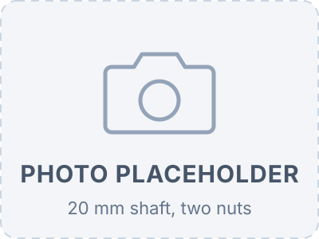
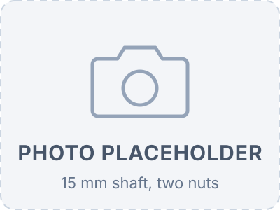
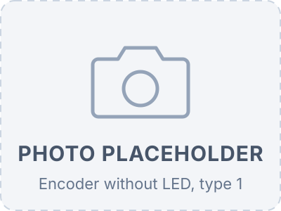
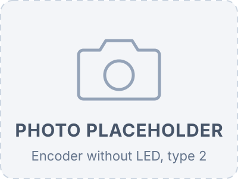
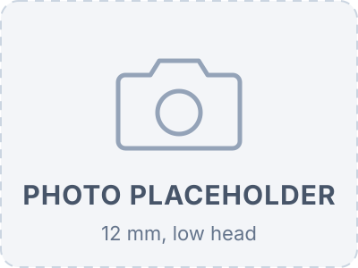
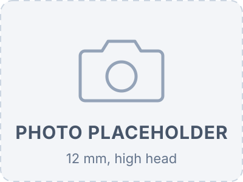
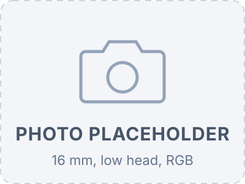
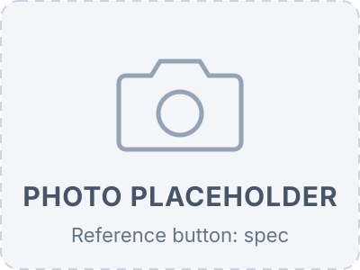

# Choosing encoders and buttons

What I learned while picking controls for my dashboard: why good ones are hard to find, how to mount an encoder so its light looks right, and which buttons worked for me. The electrical side (what any control needs to work with the [KB-E2B6](../README.md) controller) is in [Preparing and wiring the controls](wiring.md).

## Why good controls are hard to find

The controller takes almost any encoder or button, with or without LEDs. The hard part, for encoders and buttons alike, is the feel, the light and the mounting:

- **Professional parts are out of reach.** Encoders and buttons from makers such as Grayhill, ALPS Alpine, EAO or APEM are expensive for a hobby project (you'd be surprised how much), and most of them aren't made for "push it through a hole and tighten a nut": they need extra mounting parts. These makers work in high volumes for manufacturers, not for the consumer market.
- **Cheap parts vary.** The ones on AliExpress and Alibaba (I tried several vendors) work, but their feel is far from an OEM control: the click and travel of the buttons, the detents and the push of the encoders. Even the same type from different vendors feels different, to the touch and in rotation.
- **Photos don't show the feel.** Not for an encoder, not for a button. The only way is to buy a few and try them.

## Rotary encoders

**Dashboard encoders should be illuminated.** Any encoder works, of course, but a backlit one gives the look and feel of an OEM control, and it's a great feature in the dark.

The [reference kit](kit.md) (the controller with the encoders, buttons, adapter boards and cables I tested together) has **two RGB encoders of a model whose quality I found reasonable** after trying several manufacturers. I haven't found better. You'll find many similar-looking encoders on the web, but most of the ones I tried feel far worse than this one.

  
  

**The reference encoder and knob (in the kit).** Left: the encoder's specification; right: the knob's.  *Photos to come, with the manufacturer and part number of the reference encoder and the knob.*

The [encoder adapter](hardware.md#encoder-adapter) fits EC12-style encoders with a single-colour LED; the [RGB encoder adapter](hardware.md#rgb-encoder-adapter) is for RGB ones. Both have jumpers for the LED current. The RGB one also has colour jumpers, which all come open: **bridge exactly one, or its LED stays dark** ([how they work](hardware.md#rgb-encoder-adapter)).

### Mount it low: two nuts

This is for the simplest mounting: the encoder through a flat panel. (Many OEM dashboards set an illuminated encoder into a dedicated recess; that isn't covered here.)

On an illuminated encoder the shaft is transparent, with the LED inside, so the whole shaft glows. Every bit of shaft left showing between the knob and the panel shines brightly and drowns the knob's own light ring. With the single nut that usually comes with an encoder, you may end up fixing it too high, with a glowing piece of shaft under the knob.

So keep the knob as close to the panel as the push allows. The encoders I tested travel 0.5 mm when pushed, so a gap of 1–1.5 mm is just right. Some light still shows under the knob's skirt, and that's fine: a soft glow there looks nice as long as it's no brighter than the knob's light ring. The aim is to keep it from competing with the ring, not to hide it completely. That takes two nuts: the one behind the panel sets how far the encoder sticks out, the one in front clamps it. Choose the shaft length and the knob's depth for that distance too.

  
  
  

**The same knob on three mountings.** Left to right: 20 mm shaft with a single nut, 20 mm shaft with two nuts, 15 mm shaft with two nuts.  *Photos to come.*

### Encoders without LEDs

Without a backlight, the common EC11 or EC12 types work just as well. Choose the shaft length and the knob's depth by the same rule: the knob as close to the panel as the push allows. One with a push switch doesn't fit the encoder adapters (its switch pins don't line up with the adapter's pads): wire it [without an adapter](wiring.md#wiring-controls-without-the-adapter-boards) ([which encoders fit](hardware.md#why-encoders-sit-on-the-adapter-and-buttons-dont)).

  
  

**Encoders without LEDs.**  *Photos to come, with the model and shaft length of both types.*

## Buttons

Buttons are chosen by size (diameter), feel and body length. The feel needs trying: vendor photos don't show it. The body length can decide it too: a short button won't reach through thick dashboard plastic. Buttons without LEDs work as well; they just stay dark.

  
  
  
  

**My final four.** Left to right: 12 mm low head, 12 mm high head, 16 mm high head, 16 mm low head with an RGB LED.  *Photos to come.*

Of everything I looked at, only these four made it to my final comparison:

| Button | Verdict |
|---|---|
| **12 mm, high head**, with a click | **Best fit.** This is what I use |
| 16 mm RGB, low head | Second best: much better colour control, wiring and feel. But it's too short for thick dashboard plastic (fine for many other uses), and in my car there was no room for 16 mm: the buttons sit in a row, squeezed in by the head-unit frame |
| 12 mm, low head | Looks neat, but isn't ergonomic at all |
| 16 mm, high head | Terrible haptic experience |

  

**The reference button (in the kit): 12 mm, high head.** Its specification.  *Photo to come, with the model and its LED rating.*

The reference buttons connect through the [button adapter](hardware.md#button-adapter), whose solder jumpers set the LED current.

