# Configuring the controller

The **configurator** is a web page in the project's `web_config` folder. You open it from disk in a browser on a computer, connect the controller with a USB cable, choose what each control does from dropdowns and click **Save to device**. The controller stores this **setup** and works with it on any host; the computer is only needed again to change it.

The first part is a quick start. The second part explains every part of the page, and the last part has example setups.

---

## Quick start

### Before you start

> [!IMPORTANT]
> **Use Google Chrome, Microsoft Edge, Brave or Opera on a computer**, and **on Linux install the udev rule first** (below). Other browsers, and every browser on a phone, tablet or head unit, can't reach the board.

- **A computer with Google Chrome, Microsoft Edge** (already on every Windows PC), **Brave** or **Opera** (other Chromium-based browsers should work too). Firefox, Safari and every browser on a phone, tablet or head unit can't talk to USB devices this way. Windows and Mac aren't tested yet.
- **A USB cable that carries data**, with USB-C on the controller side. A charge-only cable powers the board, but the browser won't find it.
- **A copy of this project**: on the [project's GitHub page](https://github.com/dmitry-lif/kb-e2b6), green *Code* button → *Download ZIP*, then unzip it (Windows: right-click → *Extract All*). The page doesn't work from inside the ZIP.
- **Linux only, once:** open a terminal in the project folder and run the following (it asks for your password), then unplug and re-plug the board. Without it, the board may appear in the browser's list, but connecting fails ([still can't connect?](troubleshooting.md#linux-still-cant-connect)).

  ```bash
  web_config/linux/install-udev-rule.sh
  ```

### 1. Open the page

Double-click `web_config/index.html`. If it opens in Firefox or Safari, right-click it → *Open with* → one of the browsers above. Everything runs on your computer; nothing is sent anywhere.

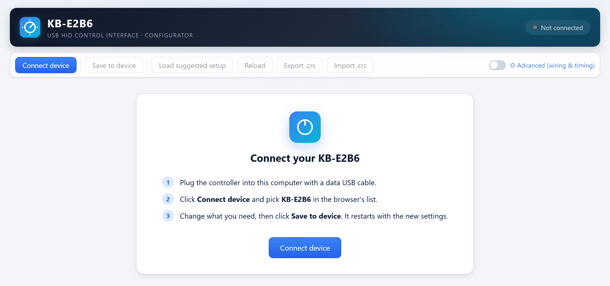

**Before connecting.** Only **Connect device** is active; the welcome panel repeats the three steps.

### 2. Connect

Plug the controller into the computer and click **Connect device**. The browser opens its own list of USB devices: pick **KB-E2B6** and click *Connect*. (The list appears every time you click **Connect device**. A board you've allowed before is marked *Paired*.)

<p align="center">
  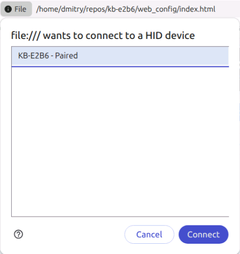
</p>

**The browser's device list** with KB-E2B6 in it, here already *Paired*. The address bar shows the page opened as a local file.

The page reads the board and shows its status strip and the form:

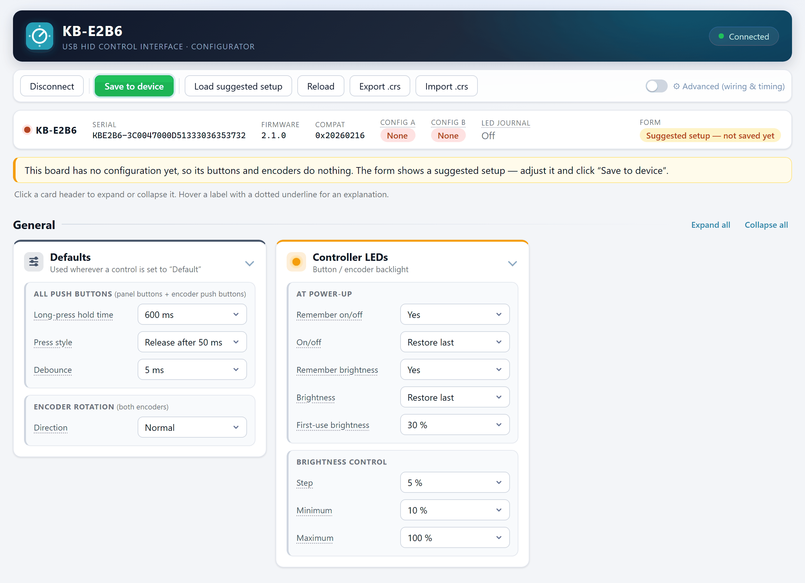

**A new board.** The red dot, *Config A: None* and *Config B: None* mean the board has no setup: its controls do nothing. The form is pre-filled with the **suggested setup**, a ready-made starting point that only becomes active once you save it. A board that already has a setup shows a green dot, one slot *Active*, and the form shows that setup.

### 3. Choose what each control does

The form has three sections: **General** (settings for all controls and the backlight), **Encoders** and **Panel buttons**. The encoder and button cards start collapsed and show a one-line summary; click a card header to open it (each section also has *Expand all* / *Collapse all*).

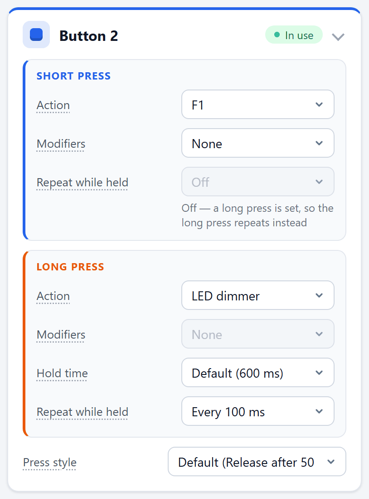

**A button card.** Each button has a *Short press* and a *Long press* action. Here: a short press sends F1, holding it dims the backlight and keeps dimming every 100 ms.

Pick an action from the list for every control you use; leave the others at *— Not used —*. The card number is the port number: *Button 3* is whatever is plugged into `BTN 3`, *Encoder 1* is `ENC 1`.

### 4. Save

As soon as the form differs from the board, the status strip says *Changed — not saved yet* and **Save to device** turns green:

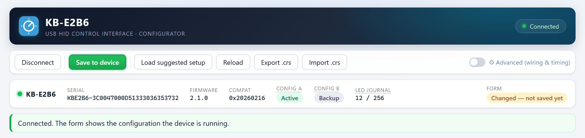

**Changes not saved yet.** Nothing on the board changes until you click **Save to device**.

Click **Save to device**. The board checks the setup, stores it and restarts (a couple of seconds); the page reconnects by itself:

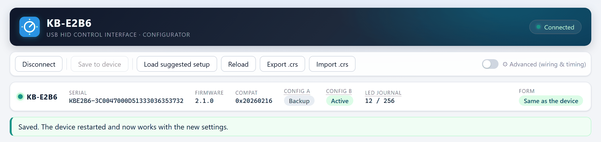

**Saved.** The new setup went into the slot that wasn't active (here *Config B: Active*), and the previous one is kept as *Backup*. After the very first save on a new board, you see *Config A: Active* and *Config B: None*. If the page doesn't reconnect by itself, click **Connect device** again.

### 5. Try it

Press your controls: the computer receives the keys. Unplug and re-plug the board: the setup stays. Then continue with [Getting started](getting-started.md#3-turn-on-the-backlight): the backlight starts off after the first save.

---

## How it works

- **The setup lives in the controller.** The configurator only reads and writes it. Once saved, the controller works the same on any host, with no app or driver.
- **Saving restarts the board.** A setup takes effect only at startup, so **Save to device** checks it, writes it to flash and restarts the board with it. If the form equals what the board already runs, nothing is written.
- **Two setup slots, A and B**: the current setup and the previous one. A save always writes the slot that isn't active and switches to it only once it's fully written and checked, so a failed save (or a cable pulled during one) leaves the previous setup in place.
- **An invalid setup is refused.** The page blocks saving while it lists problems, and the board checks everything again. A refused save changes nothing.
- **No setup, no actions.** A board without a valid setup keeps its controls silent and its LEDs off instead of guessing a mapping. The suggested setup is only a template for the form; the board never switches to it on its own.
- **"Default" means the General card.** Many fields offer *Default (…)*, which uses the value from *General → Defaults*, shown in brackets. Change it there once instead of on every control.

## The page in detail

### Toolbar

| Button | What it does |
|---|---|
| **Connect device** / **Disconnect** | Open or close the connection to a board |
| **Save to device** | Check, store and restart with the form (enabled only when something changed and nothing is wrong) |
| **Load suggested setup** | Fill the form with the suggested setup built into the firmware. Only the form changes |
| **Reload** | Throw away unsaved changes and read the board again (asks first) |
| **Export .crs** / **Import .crs** | Save the form to a small file or load one into the form, for a backup or to share a setup. Import only fills the form |
| **⚙ Advanced (wiring & timing)** | Show the wiring and timing settings, marked in purple with ⚙. You normally don't need them |

Closing the tab with unsaved changes asks for confirmation. Labels with a dotted underline have a tooltip: hover over them for an explanation.

### Status strip

| Field | Meaning |
|---|---|
| Dot | Green: the board runs a saved setup. Red: no setup, controls silent |
| *Serial* | The board's own serial number, `KBE2B6-` + its chip's factory ID |
| *Firmware* / *Compat* | Firmware version and its setup compatibility ID |
| *Config A* / *Config B* | The two setup slots: **Active** = in use, **Backup** = the previous setup, **None** = empty or invalid |
| *LED journal* | How many backlight changes are stored in the current flash page, e.g. *12 / 256* (*Off* if nothing is remembered). Only for diagnostics |
| *Form* | *Same as the device*, *Changed — not saved yet*, or *Suggested setup — not saved yet* |

### General → Defaults

Settings used by every control that says *Default*:

- **All push buttons** (panel buttons and encoder push buttons): *Long-press hold time* (how long you hold before it counts as a long press, 400–1000 ms), *Press style* (below) and *Debounce* (ignore contact bounce shorter than this; raise it if one press sometimes counts twice).
- **Encoder rotation:** *Direction*, *Normal* or *Reversed*, for both encoders.

The default *Press style* is also used by the on-board button.

### General → Controller LEDs

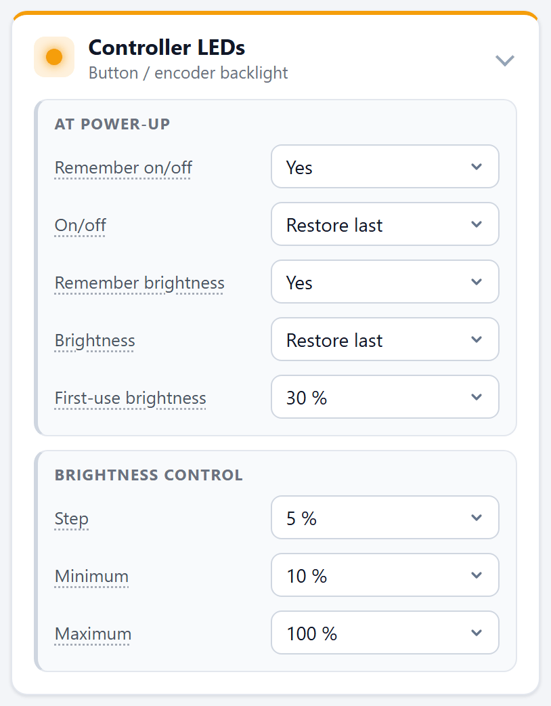

**The backlight settings** of the suggested setup. All LEDs share one supply, so these settings apply to all of them together.

- **At power-up** decides what the backlight does every time the board starts:
  - *Remember on/off* = *Yes* and *On/off* = *Restore last*: the board comes back on or off as you left it. *On* or *Off* starts it like that every time, whatever you did before.
  - *Remember brightness* = *Yes* and *Brightness* = *Restore last*: the board comes back at the last brightness. A percentage starts it at that brightness every time.
  - *First-use brightness*: used while nothing has been remembered yet.
- **Brightness control** sets the range for the on-board button and the LED actions: *Step* (how much one step changes), *Minimum* and *Maximum*.

With *Remember* = *Yes*, the board saves on/off and brightness about 1.5 s after the last change (⚙ *Save delay*), so wait a moment before unplugging. With *No* it never saves them, and *Restore last* then starts the backlight off and at the *First-use brightness*. How this plays out with the on-board button: [Getting started → Turn on the backlight](getting-started.md#3-turn-on-the-backlight).

### Encoder cards

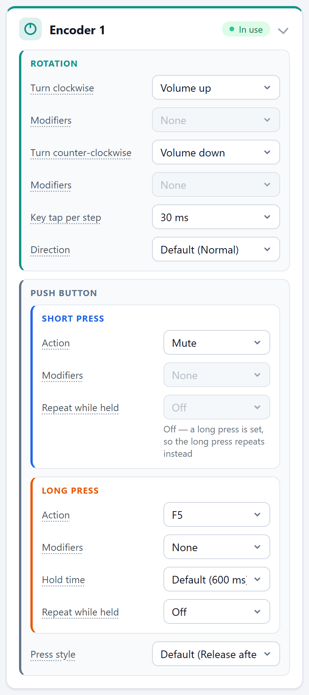

**An encoder card.** *Rotation* and the encoder's *Push button*.

- **Turn clockwise** / **Turn counter-clockwise:** one action per click (detent) in each direction. Each has its own *Modifiers* row.
- **Key tap per step:** how long each step holds the key down. Raise it if the host misses fast turns.
- **Direction:** *Reversed* if clockwise acts like counter-clockwise.
- **Push button:** works exactly like a panel button (next section).

### Button cards

See the button card picture in the [quick start](#3-choose-what-each-control-does).

- **Short press / Long press:** a button sends exactly one of them: the short action when released before the hold time, or the long action when held past it. With only a short action, it's sent as soon as you press; with a long action set too, the short action is sent on release.
- **Modifiers:** Ctrl, Shift, Alt, Win and their combinations, under each action, e.g. short = F1, long = Ctrl + F1. They only work with keyboard keys and are greyed out for media, system and LED actions.
- **Hold time:** per button, or *Default*.
- **Repeat while held:** keeps sending the action while you hold the button, e.g. volume up. A button has one repeat setting: it repeats the long action if one is set (after the hold time), otherwise the short action. That's why the *Short press* box shows it as *Off* and greyed out once a long action is set; setting or clearing the long action resets repeat to *Off*.
- **Press style:** *Release after 30 / 50 / 100 ms* presses and releases the key by itself; *Hold while pressed* keeps the key down for as long as you hold the button. Repeat needs a *Release after* style.

The action lists: media keys (volume, mute, play/pause, next/previous…), Android and system keys (Home, Back, Menu, Search, voice assistant…), screen brightness, navigation keys (arrows, Enter, Esc, Page Up/Down…), F1–F24, letters, digits, and the backlight actions (*LED on/off (toggle)*, *LED on*, *LED off*, *LED brighter*, *LED dimmer*, *LED brightness step (wraps)*). Keys that aren't in the lists can still be used: [A key that isn't in the lists](../web_config/README.md#a-key-that-isnt-in-the-lists).

### Advanced (wiring & timing)

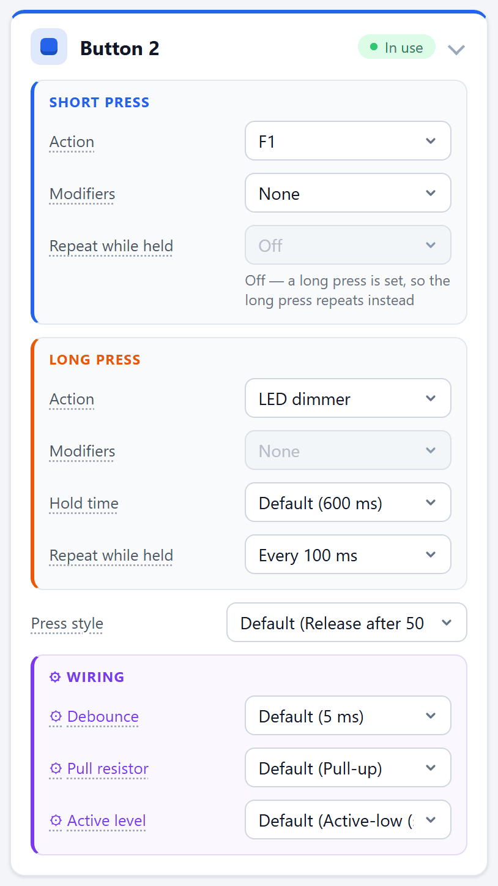

**Advanced on.** Purple fields marked ⚙ appear on the cards.

Per button *Debounce*, *Pull resistor* and *Active level*; *Scan rate* (how often the inputs are read), *Pull resistor* and *Active level* for all inputs, *Detent guard* for the encoders, and the LED *Save delay*. The KB-E2B6 wiring needs *Pull-up* and *Active-low*, the defaults; the other values are for unusual controls.

### Problems and messages

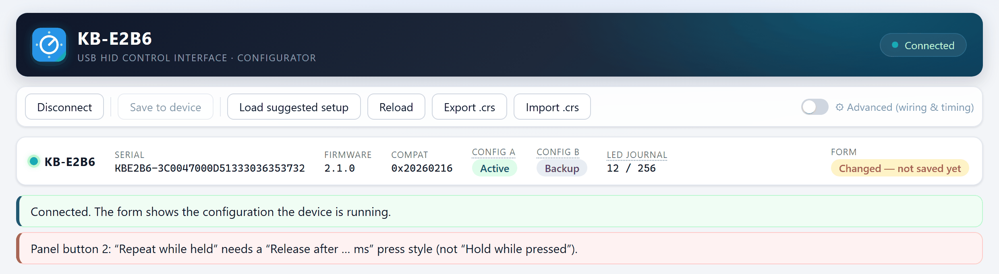

**A problem in the form.** Problems are listed in red, and **Save to device** stays disabled until they're fixed. Warnings in yellow (e.g. an encoder with only one direction set) don't block saving.

Every message, what it means and what to do: [Troubleshooting → Configurator messages](troubleshooting.md#configurator-messages). Values set by other tools that aren't in a list are shown as *(current)* and kept.

---

## Examples

### Media controller (the suggested setup)

**Load suggested setup**, then **Save to device**:

| Control | Action |
|---|---|
| Encoder 1 | Clockwise *Volume up*, counter-clockwise *Volume down*, push *Mute* |
| Encoder 2 | Clockwise *Arrow Down*, counter-clockwise *Arrow Up*, push *Enter / OK* |
| Buttons 1–6 | *Play / Pause*, *Next track*, *Previous track*, *Escape (Back)*, *Home*, *Menu key* |
| Backlight | Comes back as you left it; on-board button steps 10–100 % in 5 % steps |

### Car head unit with Key Mapper (my setup)

The controls send F-keys, and the free Android app [Key Mapper](https://github.com/keymapperorg/KeyMapper) on the head unit decides what each F-key does. When I want a button to do something else, I change it on the head unit's screen, without taking the controller out from behind the dashboard. Long presses control the backlight, because the on-board button is out of reach once it's installed.

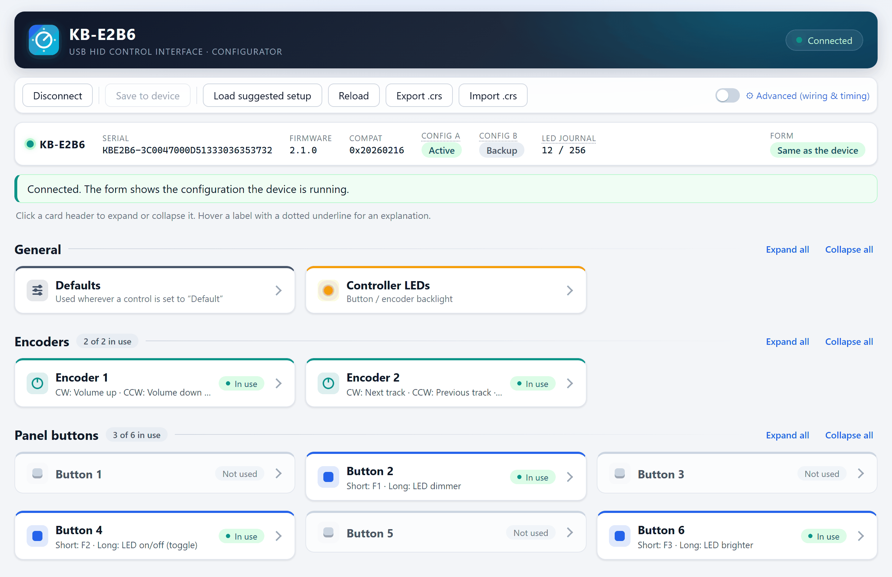

**My car's setup** with all cards collapsed: each card's summary shows its actions.

| Control | Short press / turn | Long press |
|---|---|---|
| Encoder 1 | *Turn clockwise* = *Volume up*, *Turn counter-clockwise* = *Volume down*; push *Mute* | *F5* |
| Encoder 2 | *Turn clockwise* = *Next track*, *Turn counter-clockwise* = *Previous track*; push *Play / Pause* | *F7* |
| Button 2 | *F1* | *LED dimmer*, repeat every 100 ms |
| Button 4 | *F2* | *LED on/off (toggle)* |
| Button 6 | *F3* | *LED brighter*, repeat every 100 ms |
| Backlight | *Step* 1 %, *Minimum* 1 %, *Maximum* 50 % (fine steps for night driving), remembered | |

### PC desk panel

| Control | Action |
|---|---|
| Encoder 1 | *Volume up* / *Volume down*, push *Mute* |
| Encoder 2 | *Page Down* / *Page Up* |
| Button 1 | *M* with *Ctrl+Shift* (mute the microphone in Microsoft Teams) |
| Button 2 | *S* with *Shift+Win* (Windows screenshot tool) |
| Buttons 3–6 | *F13* … *F16* |

F13–F24 exist on no ordinary keyboard, so nothing reacts to them until you map them with a key-remapping tool (for example AutoHotkey on Windows). That's the PC version of the Key Mapper trick: the controller stays as it is, and you change what the keys do on the computer.
