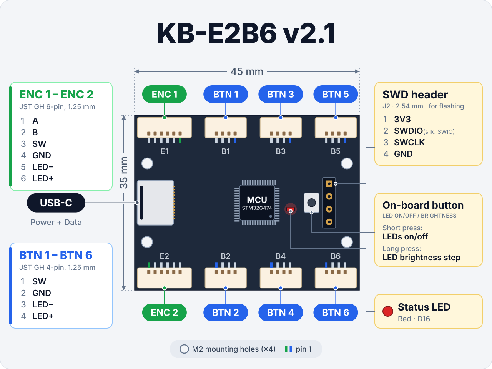
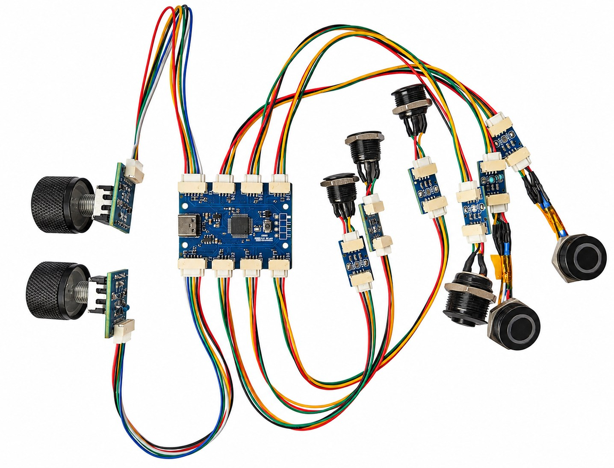

# Getting started

This page starts once your controls are ready: every encoder and button wired up and fitted with its JST GH plug. Getting them ready:

- **With the [reference kit](kit.md)** (the controller with tested encoders, buttons, adapter boards and cables): [Preparing the kit's controls](kit.md#preparing-the-kits-controls).
- **With your own controls or cables:** [Preparing and wiring the controls](wiring.md).
- **Making the boards yourself:** [Building your own](building.md), then come back once the board is flashed.

Then it's four steps:

1. Connect the controls to the controller.
2. Configure it once, on a computer.
3. Turn on the backlight with the button on the board.
4. Plug it into your head unit, PC or phone.

Something not working? [Troubleshooting](troubleshooting.md).

---

## What you need

- **The controller** with firmware 2.1.0 or newer. Controllers from the kit come flashed.
- **Your controls**, each with its plug: 6-pin for encoders, 4-pin for buttons.
- **A USB cable that carries data**, with USB-C on the board side. A charge-only cable powers the board but the computer won't see it.
- **To configure it (once): a computer** (Linux, Windows or Mac; Windows and Mac aren't tested yet) with **Google Chrome, Microsoft Edge** (already on every Windows PC), **Brave** or **Opera** (other Chromium-based browsers should work too). Firefox and Safari don't work, and neither does any browser on a phone, tablet or head unit, so this step needs a computer.
- **A copy of this project** for the configurator: on the [project's GitHub page](https://github.com/dmitry-lif/kb-e2b6), green *Code* button → *Download ZIP*. Unzip it (Windows: right-click → *Extract All*); the configurator doesn't work from inside the ZIP.

## 1. Connect the controls

Unplug USB first, then plug the controls into the controller.



**Ports and pinouts.** Top view of the controller, drawn to scale from the KiCad layout: encoder ports `ENC 1` / `ENC 2` and button ports `BTN 1` … `BTN 6` along the long edges (odd numbers on one edge, even on the other), USB-C on the left, the SWD header (for flashing only) on the right, and the on-board button and red status LED next to the MCU. The pinouts are on the left, and pin 1 of every port is drawn in the port's colour; more in [Preparing and wiring the controls](wiring.md#the-ports).

- The port number is the number in the configurator: whatever you plug into `BTN 3` is "Button 3".
- The port names are printed on the **back** of the board. The component side shows the short names B1–B6 and E1–E2.
- The plugs are keyed and only go in one way. Don't force them. Each cable goes in with its red wire on `LED+`, at the controller and at the adapter ([why](wiring.md#cables-to-the-adapter-boards)).
- You don't have to use every port. Empty ports simply do nothing.

<p align="center">
  
</p>

**All plugged in.** The controller with two encoders on their adapter boards and six buttons, each through its button adapter; one cable per port.

## 2. Configure it

Plug the board into the computer with the data cable.


1. The red [status LED](troubleshooting.md#the-status-led) **blinks fast** (about five times a second): the board is running and has no setup yet. A board that already has one shows a heartbeat instead (two short flashes every second). Steadily on or steadily off means it isn't running.
2. The computer finds a USB device called **KB-E2B6** (a keyboard, plus a serial port and the configuration interface). No driver is needed. On Windows the serial port shows up as a new COM port; you can ignore it: it's a debug console.

> [!IMPORTANT]
> **A new board does nothing until you save a setup**, including a controller from the kit: its controls stay silent and the LEDs stay off. That's deliberate: it never guesses what your buttons should do.

Then, in short (every screen and option, and example setups: [Configuring the controller](configuring.md)):

1. **Linux only, once:** open a terminal in the project folder you unzipped and run the following, then unplug and re-plug the board. Without it, the board may show up in the browser's list, but connecting to it fails ([still can't connect?](troubleshooting.md#linux-still-cant-connect)).

   ```bash
   web_config/linux/install-udev-rule.sh
   ```

2. In the project folder you unzipped, open the `web_config` folder and double-click **`index.html`** (in one of the browsers above).
3. Click **Connect device** and pick **KB-E2B6** in the browser's list. A new board has no setup: the page shows a red dot and *Config A: None*, *Config B: None*. To give you a start, the configurator fills its form with a suggested setup, which you can use as it is or change. It does nothing until you save it.
4. Choose what each control does, or keep the actions that are filled in. On Android, a control can do much more than the lists offer, up to a chain of screen taps: [Doing more with Key Mapper](#doing-more-with-key-mapper-android).
5. **Backlight:** to start with, use the backlight settings recommended in [step 3](#3-turn-on-the-backlight) (step size, brightness range, remembering and restoring on/off and brightness). The suggested setup in the form already uses them.
6. Click **Save to device**. The board checks the setup, stores it and restarts (a couple of seconds); you should see *"Saved. The device restarted and now works with the new settings."*, and the status LED switches from fast blinking to the heartbeat.
7. Try your controls: the computer gets the keys. Unplug and re-plug the board: the setup stays.

## 3. Turn on the backlight

> [!IMPORTANT]
> **After the first save, the backlight is off**: the board has nothing to remember yet. Press the button on the board once to turn it on.

**The button on the board** (labelled *LED ON/OFF / BRIGHTNESS*) lets you try out the backlight (brightness, range, step size) without giving up one of your own controls for it. And if you'd rather not put backlight control on your own controls at all, you can set the brightness once with this button: with the recommended settings below, the board saves it and brings it back at every power-up. This saving is separate from **Save to device**: the board stores on/off and brightness by itself, and your setup decides whether it does (*Remember …*) and whether power-up uses them (*Restore last*).

**Its actions are built in.** They are two of the backlight actions you can also give any of your own controls in the configurator:

- **Short press:** *LED on/off (toggle)*.
- **Long press:** *LED brightness step (wraps)*: one *Step* brighter, up to the *Maximum*, then back to the *Minimum*. Keep holding and it steps again about every 0.1 s (fixed).

**Everything else comes from the general settings**, just like for your own buttons. The ones that matter, and the values I recommend to start with (the configurator's suggested setup uses them):

| Setting in the configurator | Recommended | What it does |
|---|---|---|
| *Defaults → All push buttons → Long-press hold time* | 600 ms | How long you hold before a press counts as long |
| *Defaults → All push buttons → Press style* | Release after 50 ms | Lets a held press keep stepping (with *Hold while pressed* it steps only once) |
| *Controller LEDs → Brightness control → Step* | 5 % | How much brighter one step makes it |
| *Controller LEDs → Brightness control → Minimum* / *Maximum* | 10 % / 100 % | The range the steps go through |
| *Controller LEDs → At power-up → Remember on/off* and *Remember brightness* | Yes | The board saves on/off and brightness by itself. With *No* it never saves them |
| *Controller LEDs → At power-up → On/off* and *Brightness* | Restore last | At power-up it comes back as you left it. Needs *Remember* = *Yes*: without it, the backlight starts off and at the *First-use brightness* |
| *Controller LEDs → At power-up → First-use brightness* | 30 % | The brightness the first time you turn it on |

With these settings, the board saves a change a moment after you make it, so wait a couple of seconds before you unplug it.

**Set the backlight before you install the board.** Once the board is behind a dashboard you can't reach the button. To control the backlight after that, give one or more of your own controls backlight actions. A single button is enough to do what the on-board button does: short press *LED on/off (toggle)*, long press *LED brightness step (wraps)* with *Repeat while held* every 100 ms. All backlight actions: [Configuring → Button cards](configuring.md#button-cards).

Other choices (always on at power-up, a fixed brightness, nothing saved at all): [Configuring → Controller LEDs](configuring.md#general--controller-leds). LEDs dim, uneven or flickering? [Troubleshooting](troubleshooting.md#symptoms).

## 4. Plug it into your host

Once the backlight is set, fit the cover plate (the 45 × 35 mm PCB lid) if you use one.

Then plug the controller into your head unit, PC, phone or tablet. **USB power (5 V) only: never connect it to the car's 12 V directly** ([Safety](troubleshooting.md#safety)). Phones and tablets need a USB-C to USB-C data cable or a USB OTG adapter. The board draws little: 17 mA on its own, about 30 mA with 8 controls lit well enough for daylight (measured with my controls). The setup lives in the controller, so it works straight away, with no app or driver.


What you should see:

- **Every host:** the status LED shows its heartbeat (two short flashes every second), as it did on the computer after the save, and the backlight comes on as your setup says (see [step 3](#3-turn-on-the-backlight)). Press a control: an encoder set to volume should move the host's volume bar.
- **Windows** (not tested yet): a short "Setting up a device" notice at most. Device Manager lists a *HID Keyboard Device*, a *HID-compliant consumer control device* (media keys), a *USB Serial Device (COMx)* (the debug console) and a *HID-compliant vendor-defined device* (the configuration interface).
- **Linux:** nothing to set up; the keyboard works at once. `lsusb` lists the board as `cafe:4002` (the serial console is `/dev/ttyACM0` or similar).
- **macOS** (not tested yet): the *Keyboard Setup Assistant* may pop up to identify the new keyboard; you can close it.
- **Android head units, phones and tablets:** no message; it simply works as a physical keyboard.

**On Android**, a few keys behave differently from unit to unit, mostly Home, Back and Menu. If one does something odd, try the alternatives in the configurator's *Android / system* and *Navigation keys* lists.

**The on-screen keyboard disappeared?** Android treats the controller as a physical keyboard, and many devices then stop showing the on-screen keyboard. Look for *Physical keyboard → Show on-screen keyboard* (or similar) in the language and input settings.

Installing it all in a car: [car integration guide](car-integration.md) (a work in progress).

### Doing more with Key Mapper (Android)

Many functions can't be reached with a key press at all. For those, use [Key Mapper](https://github.com/keymapperorg/KeyMapper), a free, open-source Android app. The idea: in the configurator, give the control a key that Android doesn't otherwise use, for example F1; then, in Key Mapper, decide what F1 does. That can be much more than opening an app:

- **A whole chain of actions from one press.** A single press, a long press or a combination of presses can trigger a sequence of actions, one after the other.
- **Screen taps, as if your finger did them.** Key Mapper can tap the screen at set positions, with pauses in between so the screen has time to react. That reaches settings that are only a few taps deep but have no shortcut and no app to launch.

One of my favourite uses: the sound equaliser on my head unit sits behind *Settings → Sound*. It isn't an app I could start from a button, only a sequence of taps on the screen. Key Mapper does those taps for me, so one button press opens the equaliser. I do the same for switching the theme and for suspending the head unit, which also take several taps each.

Some of this needs extra permissions for Key Mapper; its in-app guides walk you through them. Taps go to fixed positions on the screen, so if a system update moves the controls, adjust the taps.

**Plan for changing your mind later.** Once the controller is installed behind a dashboard, getting it back to a computer means reaching its USB cable. If you give the controls F-keys in the configurator and let Key Mapper decide what they do, you can change any of them later on the head unit's screen, without taking anything apart. Backlight actions (*LED brighter* and so on) run inside the controller, so set those up before you install it. My own setup works like this: [Configuring → Examples](configuring.md#car-head-unit-with-key-mapper-my-setup).
