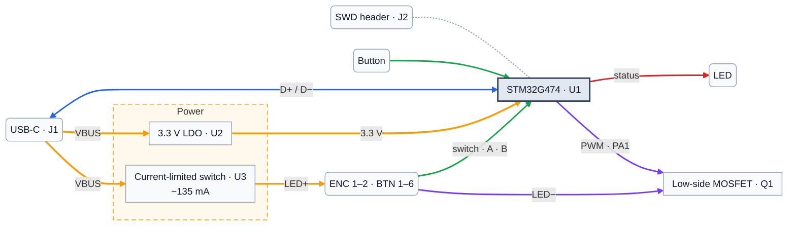
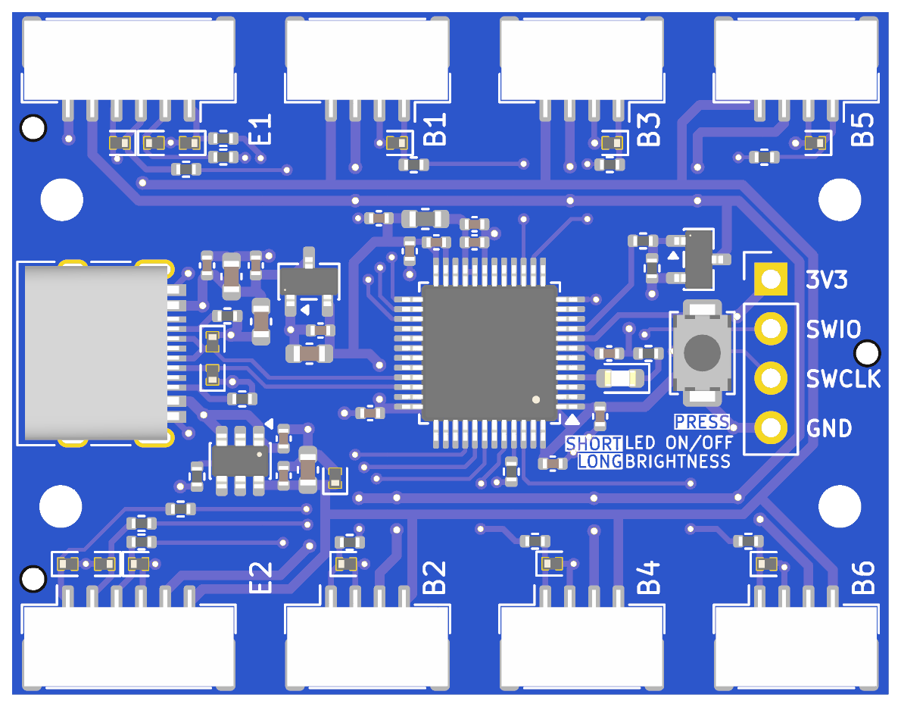
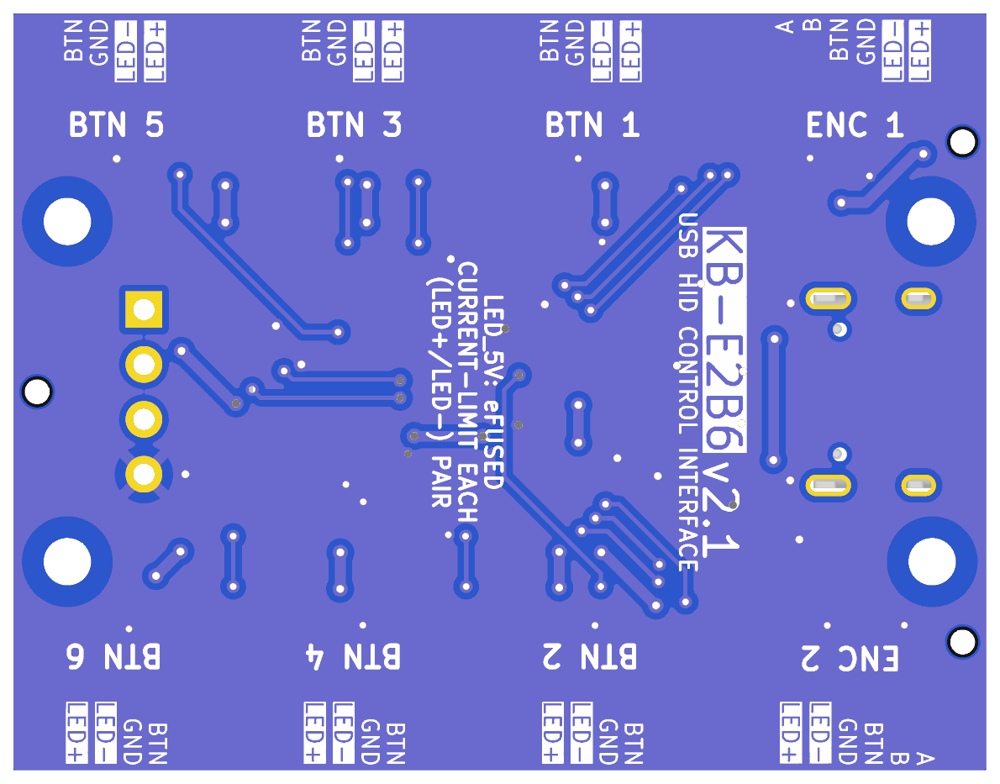
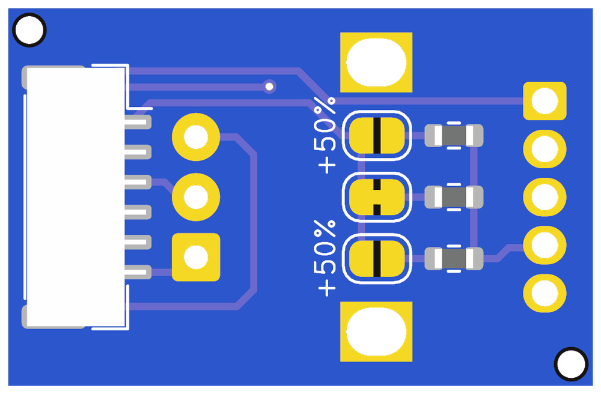
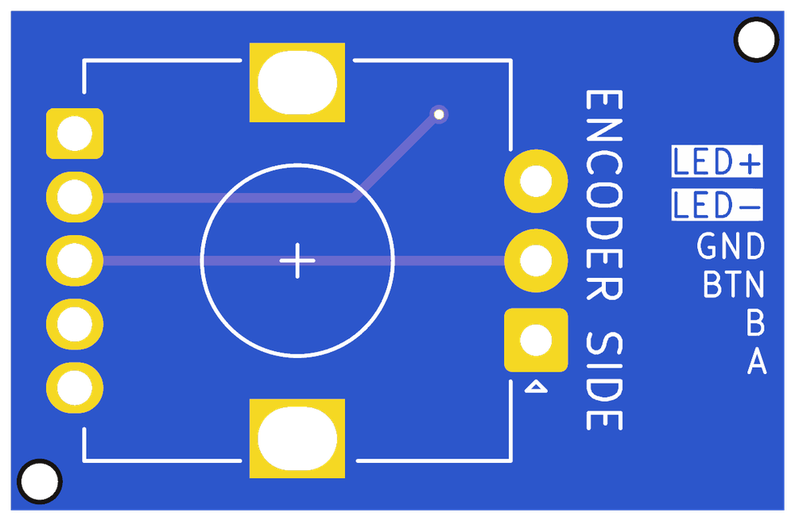
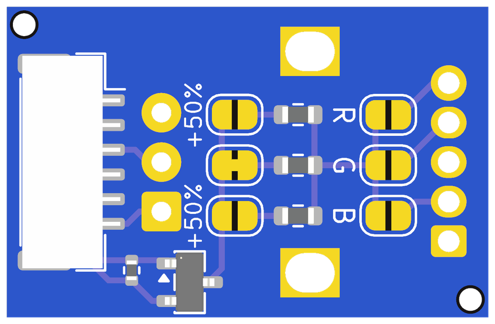
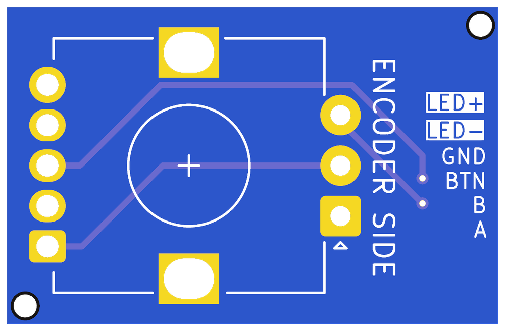
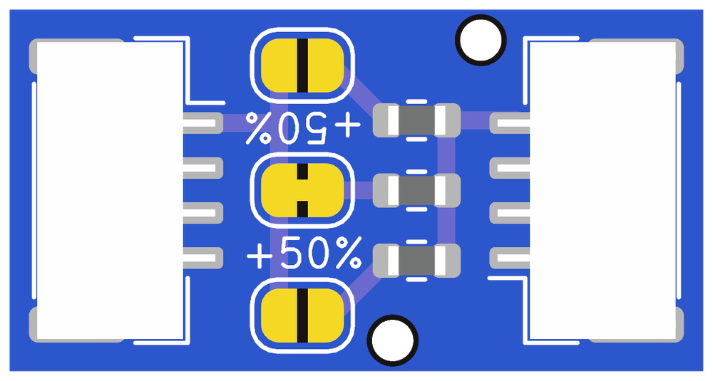
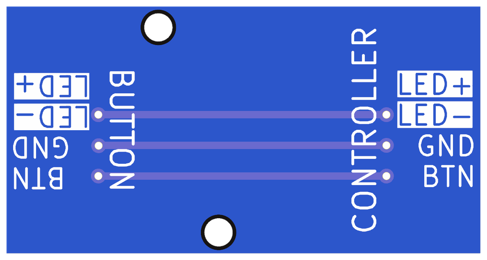

# Hardware notes

How the controller and the adapter boards work, and what was chosen and why. The KiCad projects in [`hardware/`](../hardware/) are the source of truth; this page explains them. Reference designators (U3, Q1, JP2…) match the schematics.

- [Block diagram](#block-diagram)
- [Controller (rev 2.1)](#controller-rev-21)
- [Adapter boards (rev 2.0)](#adapter-boards)
- [Cover plate](#cover-plate)
- [LED current budget](#led-current-budget)
- [Firmware view of the hardware](#firmware-view-of-the-hardware)

---

## Block diagram



**Controller block diagram.** USB VBUS feeds the 3.3 V regulator for the MCU and, through the current-limited switch, the shared `LED+` supply on every port. The switch and encoder lines reach the MCU through ESD diodes and 220 Ω resistors. The MCU dims all LEDs at once by switching their common `LED−` return with one MOSFET (PWM on PA1). Line colours: amber = power (thick), blue = USB data, green = inputs, red = status LED, violet = LED dimming, grey dotted = debug (SWD).

## Controller (rev 2.1)

45 × 35 mm, two copper layers, 1.6 mm, four M2 holes. Schematic sheets: `01_mcu_core`, `02_usb_power`, `03_led_pwm`, `04_inputs`, `05_status_and_dbg` (schematic and PCB rev 2.1). JLCPCB-ready BOM, pick-and-place and Gerbers are in `hardware/manufacturing/`.

<p align="center">
  
  
</p>

**Controller, top and bottom.** KiCad renders of rev 2.1. The top carries the parts and the short port names E1–E2 and B1–B6; the bottom has the port names `ENC 1`, `ENC 2`, `BTN 1` … `BTN 6`, the pin labels of every port and the LED supply note.

### MCU, clocks and programming

- **STM32G474CBT6** (LQFP-48, 128 KiB flash, 128 KiB RAM, −40…+85 °C). The firmware is built for this part. A pin-compatible 256 KiB STM32G474CCT6 would fit the footprint, but the firmware has no board profile for it.
- **No crystal**. The system clock is the internal 16 MHz HSI through the PLL (170 MHz). USB uses the internal 48 MHz HSI48 oscillator. The firmware has HSI48 trimmed by the clock recovery system (the STM32's CRS peripheral, unrelated to the CRS configuration format) from the USB start-of-frame packets, as USB full speed needs a ±0.25 % clock.
- `BOOT0` (PB8) is pulled down by R1 (10 kΩ), so the MCU always boots from flash.
- **SWD header J2** (Serial Wire Debug, the STM32's programming and debug port; 2.54 mm, 1×4): 1 `3V3`, 2 `SWDIO` (silkscreen "SWIO"), 3 `SWCLK`, 4 `GND`. `NRST` is not on the header; it relies on the MCU's internal pull-up. "Connect under reset" is therefore not possible; see [recovery](../firmware/docs/recovery.md#4-the-probe-cannot-attach).
- Decoupling: 100 nF per supply pin group plus 1 µF bulk; VDDA is fed through ferrite bead FB1 (BLM18PG121SN1D) with its own 1 µF.
- **Flash bank mode.** The STM32G474CB leaves the factory in dual-bank mode; the firmware supports single bank only (option byte `DBANK=0`). Set it once per chip ([details](../firmware/docs/recovery.md#2-first-time-provisioning-set-single-bank-mode-dbank0)):

  ```bash
  cd firmware/tools
  ./flash_set_single_bank.sh
  ```

### USB and power

- **USB-C J1** (HRO TYPE-C-31-M-12), USB 2.0 full speed. CC1/CC2 each have a 5.1 kΩ pull-down (R3, R4), so any USB-C host or USB-A-to-C cable treats the board as a device. The shield pads are not connected.
- **ESD:** H5VU10BB (D1, D2) on D− and D+, an H4S5N10B (D3) on the LED rail, and an H3V3U10B on every input (below). These are cheaper JLCPCB alternatives to the parts the schematic symbols are named after (KPESD5V0S1UL, SMF5V0A, KPESD3V3S1UL); the values and part numbers in the schematic and BOM are the fitted ones.
- **3.3 V** from an ME6209A33M3G LDO (U2) on VBUS, for the MCU only. The LEDs never run from 3.3 V.
- The firmware declares **250 mA** in its USB descriptor: the LED rail up to its eFuse limit (~135 mA nominal, ~158 mA worst case) plus the board itself (17 mA measured), with margin to spare.
- **Power comes only from USB (5 V).** There is no other supply input and no 12 V path.

### LED supply and dimming

Every connector carries the same LED pair: **`LED+`** (net `LED_5V`) and **`LED−`** (net `LED_PWM_RET`).

- **`LED+`** is VBUS through a **TPS2553** current-limited power switch (U3; "eFuse" in the schematic). R5 (200 kΩ) on `ILIM` sets the limit to about **135 mA** nominal; the datasheet equations give roughly 116–158 mA over tolerance. In a hard short it holds that current and, if it gets too hot, switches off and retries (datasheet behaviour). The enable pin is tied to VBUS (always on); the `FAULT` output is not connected. A TVS diode (D3, H4S5N10B) protects the rail, which leaves the board on every connector.
- **`LED−`** goes to ground through a **low-side N-MOSFET** (AO3400A, Q1). PA1 drives its gate with 1 kHz PWM (TIM2 channel 2) through R6 (220 Ω). The schematic note says 100 Ω would work as well; 220 Ω is the same value as the input resistors, which saves a BOM line. R7 (100 kΩ) pulls the gate low, so the LEDs stay dark while the MCU is in reset or not yet configured.
- The MCU never sources LED current itself. Each LED assembly must limit its own current (the adapter boards have the resistors). The design budget for all LEDs together is **100 mA**, which keeps some margin below the switch's minimum limit.

Why one shared, low-side-switched rail: it needs one MOSFET and one PWM channel for any number of controls, and the cable stays at four or six wires. The cost is that all LEDs dim together; the relative brightness of each control is set by hardware (resistors and jumpers on its adapter).

### Inputs

- Six button ports **`BTN 1`…`BTN 6`** (JST GH-compatible 4-pin, SM04B footprint, side entry): 1 switch, 2 GND, 3 `LED−`, 4 `LED+`.
- Two encoder ports **`ENC 1`**, **`ENC 2`** (JST GH-compatible 6-pin, SM06B footprint, side entry): 1 A, 2 B, 3 push switch, 4 GND, 5 `LED−`, 6 `LED+`.
- The BOM's connectors are XYECONN GH-compatible parts (e.g. XY-SM04B-GHS-TB, LCSC C51940118), rated −25…+85 °C; JST GH plugs and leads mate with them.
- Each of the 12 signal lines has an **ESD diode** (H3V3U10B) at the connector and a **220 Ω series resistor** to the MCU pin.
- All inputs are **active-low**: the switch connects the line to GND, and the MCU's internal pull-ups (configurable, default on) do the rest. There are no external pull-ups or RC filters; debouncing is done in firmware.
- Port names `BTN 1`…`ENC 2` are on the **bottom** silkscreen, together with the pin labels of every port (`BTN` or `A`/`B`, `GND`, `LED−`, `LED+`) and the LED rail note (*LED_5V: eFUSED, CURRENT-LIMIT EACH (LED+/LED−) PAIR*); the top shows B1–B6 / E1–E2.
- The connectors sit on two opposite edges, so the two rows face opposite directions. The schematic note reads: "Pin numbering and connector orientation must match physical perimeter mounting. Verify mirrored orientation before replication." That matters only if you change the layout; for plugging in, see the pin-1 note in [Preparing and wiring the controls](wiring.md#the-ports).

### Status LED and on-board button

- **Status LED D16** (red, 0603) on PC15 through R20 (5.1 kΩ) to GND, so a high pin turns it on. The firmware shows two patterns: a heartbeat (two 60 ms flashes every second) when it runs with a valid setup, and a fast blink (100 ms on, 100 ms off) when it runs without one (what they mean: [troubleshooting](troubleshooting.md#the-status-led)). Either way, a steady LED (on or off) means the firmware isn't running.
- **On-board button SW1** (TS-1088) on PA0, active-low, silkscreen *LED ON/OFF / BRIGHTNESS — SHORT / LONG PRESS*. Its function is fixed in firmware: short press = LEDs on/off, long press = next brightness step, repeating every 100 ms while held. Its long-press time and press style come from *Defaults → All push buttons*; with *Press style* = *Hold while pressed*, a long press steps only once. It's there so the backlight can be set up on the bench, before installation, without spending one of the external controls on it. Once the board is mounted out of reach, the brightness is remembered across power-ups (configurable), or an external control gets a backlight action (e.g. on a long press). With no saved setup the LEDs stay off, whatever you press.

### Pin map

| Function | MCU pin | | Function | MCU pin |
|---|---|---|---|---|
| `BTN 1` | PA7 | | `ENC 1` A / B / push | PB12 / PB13 / PB11 |
| `BTN 2` | PB15 | | `ENC 2` A / B / push | PB4 / PB5 / PB3 |
| `BTN 3` | PA6 | | On-board button | PA0 |
| `BTN 4` | PB7 | | LED PWM (TIM2_CH2) | PA1 |
| `BTN 5` | PA4 | | Status LED | PC15 |
| `BTN 6` | PB9 | | USB D− / D+ | PA11 / PA12 |
| BOOT0 | PB8 | | SWDIO / SWCLK | PA13 / PA14 |

The firmware hardcodes this map in `firmware/kb_firmware/src/main.rs`.

## Adapter boards

The adapters turn an encoder or button, your own or one from the [reference kit](kit.md) (the controller with tested encoders, buttons, adapter boards and cables), into a plug-in part for a ready-made JST GH cable, and set its LED current. All three are rev 2.0, two layers, with JLCPCB files in their `manufacturing/` folders. Outlines: encoder adapters 24.3 × 15.7 mm, button adapter 19.3 × 10.05 mm, all 1.6 mm thick.

A **solder jumper** is a pair of pads on the board: you bridge it with a blob of solder, or open a bridged-by-default one by cutting the thin trace between its pads. The current-setting scheme is the same on all of them: one resistor is in circuit through a solder jumper that is **bridged by default** (JP2), and two more can be added in parallel by bridging their (open) jumpers JP1 and JP3. Each one adds about 50 %, which is what the **+50%** silkscreen marks refer to. For less than the default, cut JP2 and bridge JP1 or JP3 instead: that resistor alone is about twice the default one, so the LED gets about half the current.

LED current ≈ (5 V − LED forward voltage) / R. For example, a red LED with 2 V forward voltage behind 150 Ω draws about 20 mA.

**Connector pin order.** The adapters' socket for the controller cable is numbered the other way round from the controller's ports: its pin 1 is `LED+`. That is on purpose: with a standard same-direction cable (straight, not reversed), the wire on the controller's last pin arrives on the adapter's first pin, so a mirrored pinout lands every signal on its own name without a crossed cable. In practice: each wire joins the same label at both ends ([Cables to the adapter boards](wiring.md#cables-to-the-adapter-boards)).

### Encoder adapter

`hardware/encoder_db/`. For an EC12-style encoder with a single-colour LED, mounted on the side marked **ENCODER SIDE**. Connector J1 is JST GH-compatible, 6-pin, side entry: 1 `LED+`, 2 `LED−`, 3 GND, 4 push switch, 5 B, 6 A (the controller's `ENC` order reversed, see [Connector pin order](#adapter-boards)); the labels are printed next to it on the encoder side.

<p align="center">
  
  
</p>

**Encoder adapter, rev 2.0.** KiCad renders. Left: the parts side with the connector, the current resistors and the jumpers JP1–JP3 (JP2 bridged). Right: the encoder side with the pin labels.

| Jumpers bridged | Resistance from `LED+` | Current (relative) |
|---|---|---|
| JP2 (default) | 150 Ω (R2) | 1× |
| JP2 + JP1 or JP3 | 100 Ω (150 ∥ 300) | ≈ 1.5× |
| JP2 + JP1 + JP3 | 75 Ω | ≈ 2× |

The LED's cathode goes to `LED−`, so it dims with the PWM. The encoder common and the switch return go to GND.

### RGB encoder adapter

`hardware/encoder_rgb_db/`. For an EC12-style RGB encoder. Connector, pinout and encoder side are the same as on the encoder adapter.

<p align="center">
  
  
</p>

**RGB encoder adapter, rev 2.0.** KiCad renders. Left: the parts side with the connector, Q1, the current jumpers and the colour jumpers R, G, B, all open. Right: the encoder side with the pin labels.

This one needed a different circuit: the RGB encoders I found have the LED cathode and the switch common on one shared pin. That pin must go to GND for the switch to work, so the LED can't be dimmed on its minus side like on the other adapters.

The fix is a P-MOSFET (AO3401A, Q1) on the adapter that switches the LED **supply** instead:

- Q1's source is on `LED+`, its gate on `LED−`, and R4 (10 kΩ) pulls the gate up to `LED+`.
- When the controller's low-side MOSFET turns on, `LED−` goes low, Q1 turns on and the LED gets power. When it turns off, R4 pulls the gate up and Q1 turns off. The PWM polarity is preserved, so the firmware doesn't need to know which adapter is connected.
- The LED current returns through the cable's **GND** wire instead of `LED−`. Only R4's ~0.5 mA flows through `LED−`.

Current jumpers JP1–JP3 work as on the single-colour adapter (150 Ω default, +50 % per extra 300 Ω). **Colour jumpers JP4–JP6** (silkscreen B, G, R respectively) connect the resistor to the blue, green or red LED. Bridge one only: colour mixing isn't supported. All three colours share the same current resistors, and LEDs of different colours have different forward voltages (red about 2 V, green and blue about 3 V). With two or more bridged, the red LED clamps the shared node near 2 V, below where green and blue start to conduct, so red takes nearly all the current.

> [!IMPORTANT]
> **Colour jumpers: bridge exactly one.** All three are open on a new adapter, by design: you choose the colour, and the LED stays dark until you bridge one. Colours can't be mixed: they share one set of current resistors, so with two or more bridged the red LED takes nearly all the current. One shared resistor network instead of one per colour was a deliberate simplification.

### Button adapter

`hardware/button_db/`. Sits in the cable between a `BTN` port and an LED push button. Both connectors are JST GH-compatible 4-pin SM04B, side entry: B1 (silkscreen **CONTROLLER**) takes the cable from the `BTN` port and is numbered the other way round (1 `LED+`, 2 `LED−`, 3 GND, 4 switch, see [Connector pin order](#adapter-boards)); B2 (**BUTTON**) takes the button's lead and has the controller's order (1 switch, 2 GND, 3 `LED−`, 4 `LED+`). The labels are printed next to both connectors on the side without parts. The switch, GND and `LED−` lines pass straight through; `LED+` to the button goes through the current resistors.

<p align="center">
  
  
</p>

**Button adapter, rev 2.0.** KiCad renders. Left: the parts side with the two sockets, the current resistors and the jumpers. Right: the other side with the pin labels next to the CONTROLLER and BUTTON sockets.

The button itself connects to B2 with a 4-wire JST GH lead, wired as the labels next to the BUTTON socket say: `BTN` (pin 1) to the switch's normally-open contact, `GND` (pin 2) to the switch common, `LED−` (pin 3) to the LED cathode, `LED+` (pin 4) to the LED anode. There are no colour jumpers: the adapter doesn't hold the button, so with an RGB button you choose the colour by wiring that colour's LED lead to the lead (common anode: anode to `LED+`, the colour's cathode to `LED−`; common cathode: the colour's anode to `LED+`, cathode to `LED−`). The kit's buttons come with their leads unsoldered: you solder them ([Preparing the kit's controls](kit.md#preparing-the-kits-controls)).

| Jumpers bridged | Resistance from `LED+` | Current (relative) |
|---|---|---|
| JP2 (default) | 6.8 kΩ (R2) | 1× |
| JP2 + JP1 or JP3 | ≈ 4.5 kΩ (6.8 k ∥ 13 k) | ≈ 1.5× |
| JP2 + JP1 + JP3 | ≈ 3.3 kΩ | ≈ 2× |

The values are deliberately high: at night the backlight has to go very low, and the PWM alone isn't enough with bright button LEDs. They come from trying several buttons; with the default jumper a button LED draws well under 1 mA.

### Why encoders sit on the adapter and buttons don't

An encoder is soldered straight onto its adapter: one board, one socket, one cable to the controller, no loose wires. The button adapter has two sockets instead, and the button needs a lead soldered to it (pre-crimped JST GH leads make that easy). Two reasons:

- **Mounting (the main one).** An encoder is fastened to the panel from behind: its body stays behind the panel and only the shaft goes through the hole, so the adapter rides on its back and never has to pass through anything. A panel-mount button goes in from the front and is held by a nut from behind, so whatever is soldered to its pins has to pass through the mounting hole and then through the nut. A 4-wire lead with its small GH plug does, even with a 12 mm button and its nut; an adapter board doesn't.
- **One footprint for encoders, none for buttons.** The illuminated EC12-style encoders I chose all have the same pinout and size, even from different vendors, so one footprint fits them all (so far I haven't seen one that doesn't). Buttons differ, first in diameter, then in their pins. A lead fits any of them.

**Meant for your own controls too.** I tried to make the adapters useful outside the [reference kit](kit.md), with illuminated encoders and buttons of your own: the button adapter takes any LED button on a 4-wire lead, and the encoder adapters take encoders with the footprint above.

**Which encoders fit.** Compared with KiCad's stock footprints for the Alps EC11E and EC12E (not tried with real parts):

- The rotation pins (A, C, B at 2.5 mm pitch) and the two mounting tabs are in the same places on both encoder adapters.
- The push-switch pins aren't. On an EC11/EC12 they are 5 mm apart; the adapters have a row of five pads at 2 mm pitch for the switch and LED pins of the illuminated encoders, and the two nearest pads are 4 mm apart and carry LED signals, on the RGB adapter too.
- So a plain EC11/EC12 without a push switch fits either adapter (it turns, with no light); one with a push switch doesn't. Wire that one [without an adapter](wiring.md#wiring-controls-without-the-adapter-boards): with no LED, there is no current to limit.

## Cover plate

`hardware/cover/`. A 45 × 35 mm PCB used as a lid for the controller, with matching holes. Gerbers only.

## LED current budget

All LEDs together share the TPS2553 limit (about 135 mA nominal, 116–158 mA over tolerance) and the 100 mA design budget. Add up the current of every lit control at full brightness and keep the total under 100 mA. PWM lowers the average current at lower brightness but not the peak, and the eFuse sees the peak.

With the default jumpers, an encoder adapter gives a red LED (2 V) about 20 mA and a button adapter well under 1 mA, so the encoders take most of the budget: about 42 mA for two encoders and six buttons, and about 85 mA with both **+50%** jumpers bridged on both encoders. Measured with my own controls (2 encoders, 6 buttons), the whole board draws 17 mA on its own, about 19 mA with all 8 lit at the lowest brightness and about 30 mA at a brightness clearly visible in daylight. Other LEDs are not tested.

## Firmware view of the hardware

- Inputs are sampled at 1, 2 or 3 kHz (configurable) and debounced in firmware. Encoder A/B are decoded as quadrature: one action per full cycle (four transitions), which is one detent on encoders with as many pulses as detents. Half-cycle-per-detent encoders (e.g. 15 pulses / 30 detents) give one action every second detent; there's no setting for that in 2.1.0.
- LED brightness is the PWM duty cycle in percent (1–100 %, linear, no gamma correction), limited to a configurable minimum and maximum.
- With no valid saved setup, the firmware holds the PWM pin low, so the LEDs stay off.

Details: [firmware architecture](../firmware/docs/ARCHITECTURE.md).

