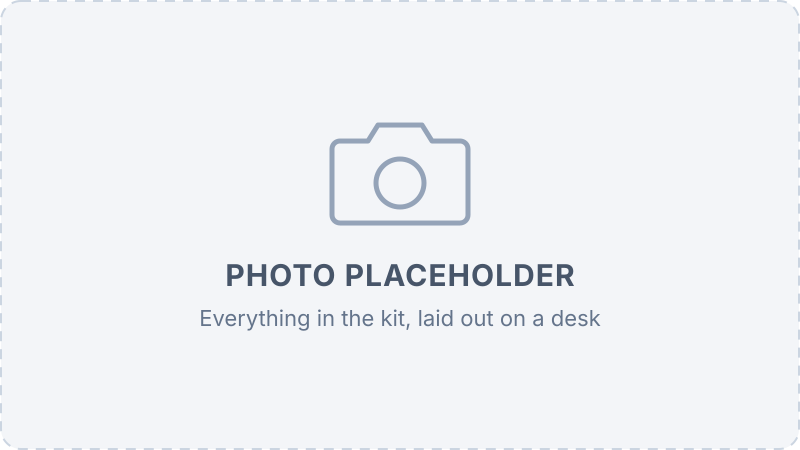
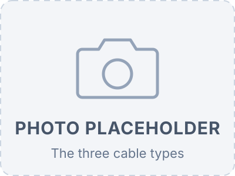
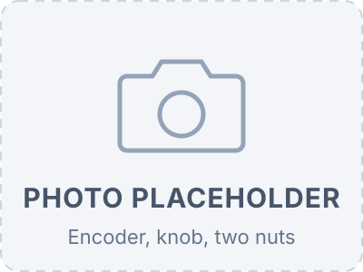
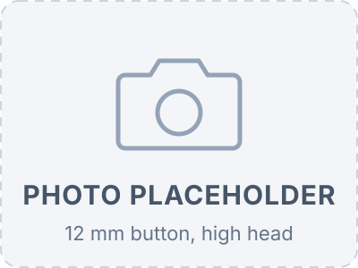
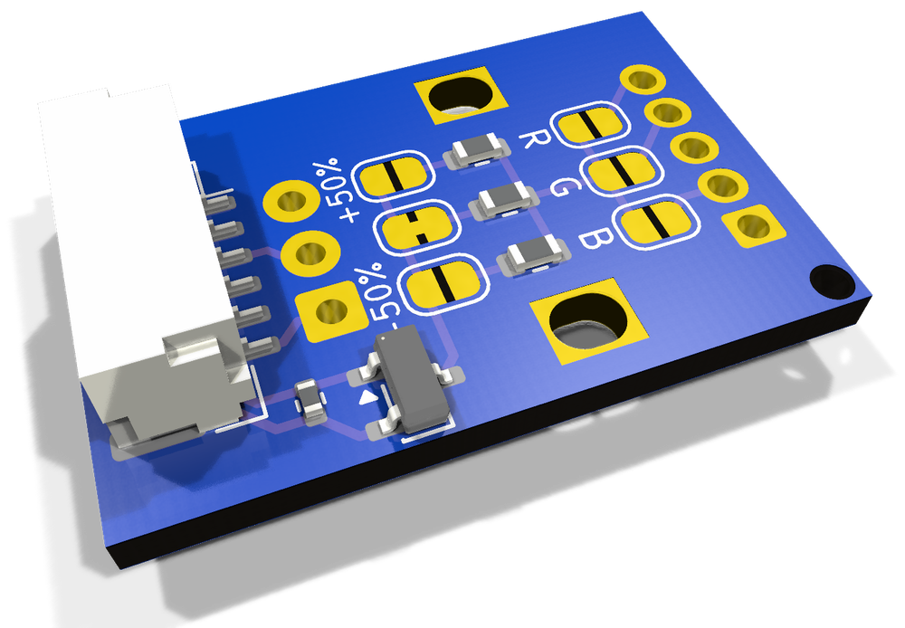
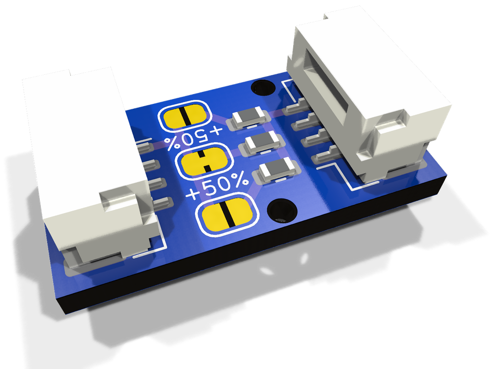

# The reference kit

[KB-E2B6](../README.md) is a small USB controller for up to two rotary encoders and six push buttons; the host sees it as a keyboard. It works with any encoders and buttons that switch to ground (encoders with as many pulses as detents), so you can build everything yourself. The reference kit is the other way in: the controller together with the encoders, buttons, [adapter boards](hardware.md#adapter-boards) (small boards that give each control its plug-in cable and set its LED current) and cables I use in my own car, tested together. Use it as it is, adapt it, or treat it as a starting point for your own parts.

## Why a kit

Not because the controller needs special parts:

- **Controls.** Good encoders and buttons are surprisingly hard to find. The kit has the RGB encoders and the buttons I settled on after trying many ([why it's hard, and what I tried](choosing-controls.md)).
- **Brightness.** Different LEDs at the same current don't look equally bright. The [adapter boards](hardware.md#adapter-boards) carry the series resistors and solder jumpers (pairs of tiny pads you join with a blob of solder) that match one control to another and cap its current.
- **Cables.** The 1.25 mm JST GH connectors come with ready-made cables, so there's no crimping.

## What's in it

**Everything in the kit.**  *Photo to come, numbered to match the # column of the table.*

| # | Item | Qty | Notes |
|---|---|---|---|
| 1 | KB-E2B6 controller, rev 2.1 | 1 | Flashed with firmware 2.1.0. **No setup saved**: nothing is assigned to the controls yet, so they stay silent and the LEDs off until you save a setup once from the [configurator](configuring.md), a web page you open from the downloaded project ([Getting started](getting-started.md#what-you-need)).  *Whether each controller is tested before shipping: to be confirmed.* |
| 2 | RGB rotary encoders, with a black knob and two nuts each | 2 | Two nuts so you can set the encoder's height in the panel ([why](choosing-controls.md#mount-it-low-two-nuts)).  *Model to be added* |
| 3 | RGB encoder adapters | 2 | One per encoder. Not soldered: you solder each encoder onto its adapter and choose its colour ([below](#preparing-the-kits-controls)) |
| 4 | Push buttons: 12 mm, high head, red LED, one normally-open contact | 4 |  *Model to be added* |
| 5 | Button adapters | 4 | One per button |
| 6 | Cables, 6-pin JST GH 1.25 mm, plugs on both ends | 2 | Controller to RGB encoder adapter, 15 cm, same direction ([why](wiring.md#cables-to-the-adapter-boards)) |
| 7 | Cables, 4-pin JST GH 1.25 mm, plugs on both ends | 4 | Controller to button adapter, 15 cm, same direction |
| 8 | Leads, 4-pin JST GH 1.25 mm, plug on one end, bare wires on the other | 4 | Button adapter to button: you solder the wires to the button ([below](#preparing-the-kits-controls)) |
| 9 | Heat-shrink tubing |  *Quantity to be added* | Insulates and secures the solder joints on the buttons.  *Size to be added* |
| 10 | Cover plate (45 × 35 mm), with M2 × 12 mm screws, M2 washers (5 mm outside, 0.3 mm thick) and M2 nuts | 1, 4 of each fixing |  *Nut size to be added* |
| 11 | USB-C data cable | 1 | 25 cm |

  
  
  

**Close-ups.** Left to right: the three cable types (6-pin and 4-pin with plugs on both ends, the 4-pin button lead); an RGB encoder with its knob and two nuts; a 12 mm high-head button.  *Photos to come.*

The current jumpers on the adapter boards are set so all the kit's controls look equally bright. The RGB encoder adapters come with no colour selected.

## What you supply

- **A computer to configure it once** (Linux, Windows or Mac; Windows and Mac aren't tested yet, and **Linux needs a udev rule**), with Google Chrome, Microsoft Edge, Brave or Opera. Phones, tablets and head units can't do this step. Details: [Getting started](getting-started.md#what-you-need).
- **A longer USB cable**, if the kit's 25 cm one doesn't reach in your installation: it must carry data, with USB-C on the controller side.
- **Whatever mounting needs**: a panel or dashboard, drill, the right hole sizes ( *hole diameters, maximum panel thickness and the depth needed behind the panel will be added*). Setting the encoders at the right height: [Mount it low: two nuts](choosing-controls.md#mount-it-low-two-nuts).
- **A soldering iron**: to solder the encoders onto their adapters and the leads onto the buttons, to choose the encoders' colour, and to change a control's brightness. Plus a heat gun (or a lighter) for the heat-shrink.

## Preparing the kit's controls

The kit's encoders and buttons come unsoldered and connect through the adapter boards (why the encoders sit on their adapters and the buttons get a lead: [Hardware notes](hardware.md#why-encoders-sit-on-the-adapter-and-buttons-dont)). Soldering them and plugging in the cables is the same as for any controls on the adapter boards: [Preparing controls with the adapter boards](wiring.md#preparing-controls-with-the-adapter-boards). What's specific to the kit:

- **Leave the current jumpers as they are**: the kit comes matched. To make one control brighter or match a control of your own: [Set the solder jumpers](wiring.md#3-set-the-solder-jumpers).
- **RGB encoder adapter: choose the colour** (below).
- **Cables:** the kit's cables are same-direction ones. Plug each one so its red wire is on `LED+` at the controller (turn it round if it isn't); it then lands on `LED+` at the adapter too ([why](wiring.md#cables-to-the-adapter-boards)).

> [!IMPORTANT]
> **RGB encoder adapter: choose the colour before you install it.** Its three colour jumpers, marked **R**, **G** and **B** on the back of the board, all come open, so the encoder's LED stays dark until you bridge at least one of them with a soldering iron. Bridge one only: colour mixing isn't supported ([why](hardware.md#rgb-encoder-adapter)).

  
  

**The kit's adapter boards.** KiCad 3D renders, rev 2.0. Left: the RGB encoder adapter (the encoder isn't modelled; it goes on the side marked ENCODER SIDE); right: the button adapter.

Then: connect, configure and use it, step by step in [Getting started](getting-started.md). Installing it in a car: [car integration guide](car-integration.md) (a work in progress).

## Compatibility

- **Hosts:** anything that accepts a USB keyboard should work. Quick check before you buy: plug any USB keyboard with media keys into the host; if the volume and arrow keys work, the controller should too. In my own car: a 10" Mekede DUDU 4 running Android 10.
- **Configurator:** tested with Brave on Ubuntu 24.04 Linux; Windows and macOS aren't tested.
- **Power:** 5 V from the host's USB port only, and not much of it: 17 mA for the board alone, about 30 mA with 8 controls lit well enough for daylight (measured with my controls; the kit has 6). Never connect it to a car's 12 V directly.

## Changing it

Everything in the kit can be swapped: use your own encoders and buttons on the adapter boards, or wire your own controls directly ([without the adapter boards](wiring.md#wiring-controls-without-the-adapter-boards)). Making the boards yourself: [Building your own](building.md).

## Getting one

 *Where and how to get a kit, and how support works, will be described here.* It's a one-person hobby project, built in small numbers; questions and problems go to the project's [GitHub issues](https://github.com/dmitry-lif/kb-e2b6/issues).
