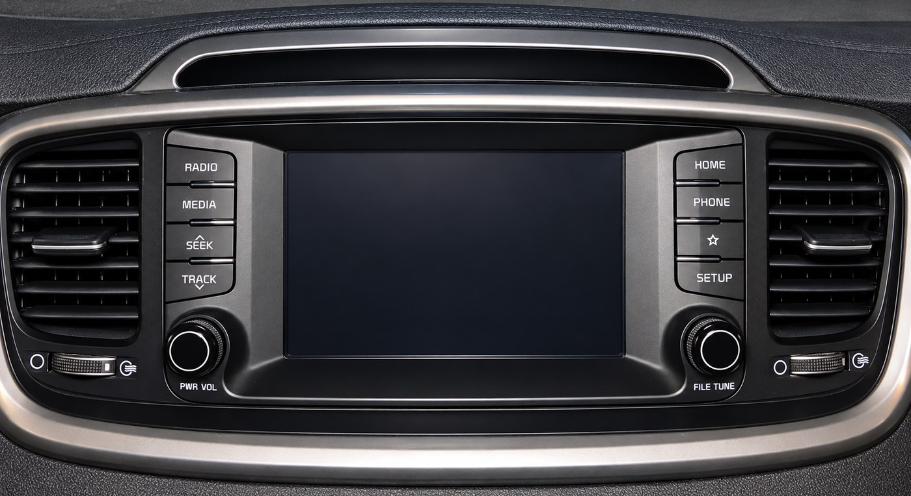
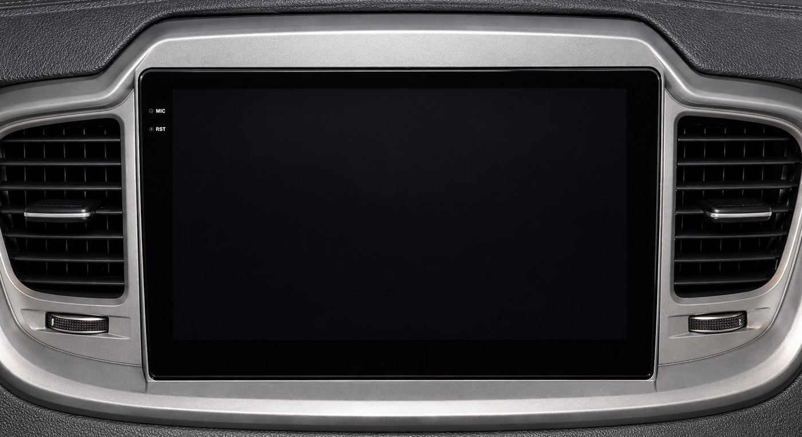
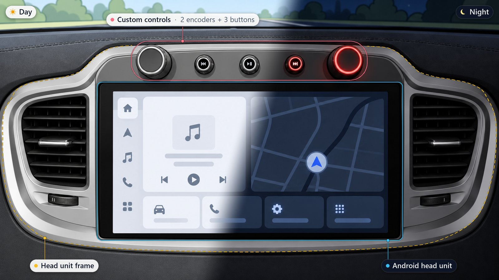

# The story behind KB-E2B6

KB-E2B6 is a small USB controller that turns up to two rotary encoders and six push buttons into a USB keyboard ([project page](../README.md)).

One disclaimer first: **this is a hobby project.** It may look trivial, like dozens of similar gadgets on the Internet. It turned out to have far more pieces than I expected before it was ready to publish, and I had to learn several of them along the way: PCB design, Rust for embedded systems, and microcontroller programming, which is a very different world from full-blown Linux SoCs.

## It started with a dead head unit

One day the infotainment system of my **2020 KIA Sorento** hung during boot, and it never came back.

Cheap pre-owned replacements are easy to find on eBay. But before I settled on one, I took a look at aftermarket head units, and oh boy: after that I didn't want just another boring OEM box.

Long story short, aftermarket head units are a huge area and, frankly, a bit of a wild west. It took real research to work out what I actually needed and to find a good balance of price and quality. I ended up with a **Mekede 10" DUDU 4**, an Android-based unit. It's OK-ish: a big screen, a modern UI and a few cool features here and there. It has drawbacks too, and the biggest one is that it has **no physical buttons**.

  
  

**Before and after.** Left: the factory OEM head unit of the 2020 KIA Sorento. Right: the 10-inch Android head unit with an aftermarket bezel. Both are original photos of the same dashboard, cleaned up and post-processed with graphics tools.

## Why not just buy a unit with buttons?

There are head units with buttons, but I didn't like any of them:

- A **single button** is the most common option, and it isn't enough.
- **Several buttons** take a lot of space away from the screen.
- Units with physical controls **cost more**.

What I wanted were **OEM-style buttons on the dashboard**. Not battery-powered remotes (there are plenty of those), but controls built into the dashboard, **with LED backlight**, like the ones on my original unit. I wanted:

- to **choose my own buttons**, ones that fit the frame around my new unit, where space is very tight;
- my own **backlight colour**, and control over its **brightness**;
- and most of all, to **control the head unit my way** with those new keys.

**Dashboard render, day and night.** An artificial day/night set.

That's how I got dragged into designing a USB HID interface: something that supports arbitrary physical controls and their backlight, is small, is powered by the head unit itself, and is easy to configure.

## What it turned into

The first working version read the controls, dimmed the backlight and sent keys. Its setup was a TOML file that I flashed over SWD. That was fine for me, but nobody without a programmer could change a single button. So firmware 2.1.0 got the browser configurator, and with it the parts that make a device usable by someone else: a setup format the board checks before saving, two slots in flash (the current setup and the previous one) so a save shouldn't leave it half-written, a clear "no setup yet" state, and documentation.

## Key Mapper: the other half of the setup

On the configuration side, I couldn't have finished this project without **[Key Mapper](https://github.com/keymapperorg/KeyMapper)**, an absolutely amazing open-source Android app.

On many Android devices, keys alone are not enough: lots of functions are hidden behind UI flows that a bare key press can't reach. Key Mapper solves this. It has a friendly interface and an outstanding range of things you can do with your inputs. It has grown a lot over the years, and most people probably use it for other things than I do, but it fits dashboard keys just right.

It solves a second problem too, one I only appreciated after the installation: the controller sits behind the dashboard. The web configurator is easy, but getting the board out again to reach a laptop is not. So in my car three of the panel buttons send F1, F2 and F3 on a short press, and the two encoder push buttons send F5 and F7 on a long press. What those keys actually do is decided in Key Mapper, on the head unit. When I change my mind about a button, I remap it on the screen without touching the dash.

More about my Key Mapper setup: [my car's setup](configuring.md#car-head-unit-with-key-mapper-my-setup) and the [car integration guide](car-integration.md#8-kb-e2b6-finally).

---

I'd love to hear what you think of this project, and what you end up building with it.

Next: [choosing encoders and buttons](choosing-controls.md) · [car integration guide](car-integration.md) · [getting started](getting-started.md)
