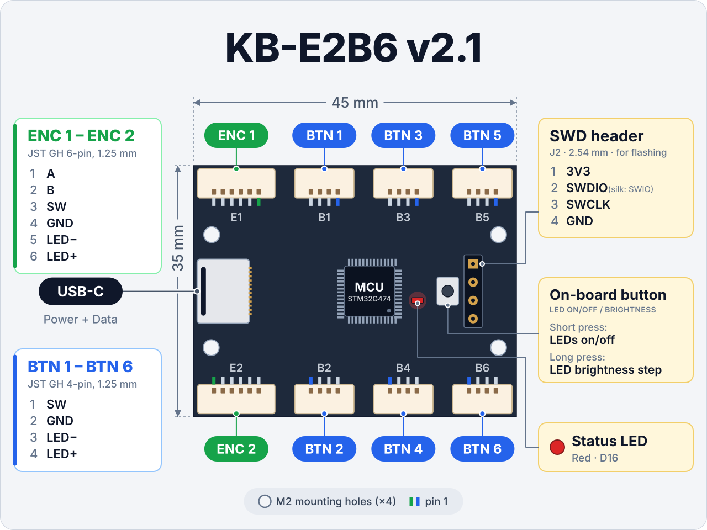
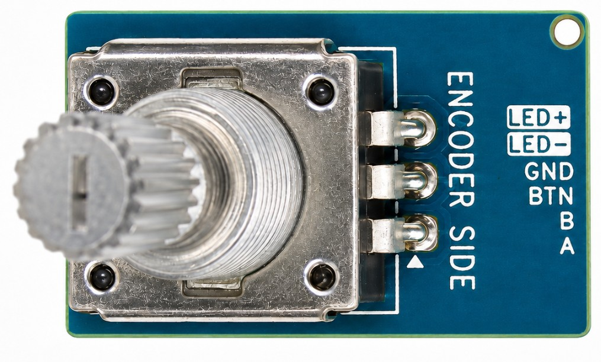
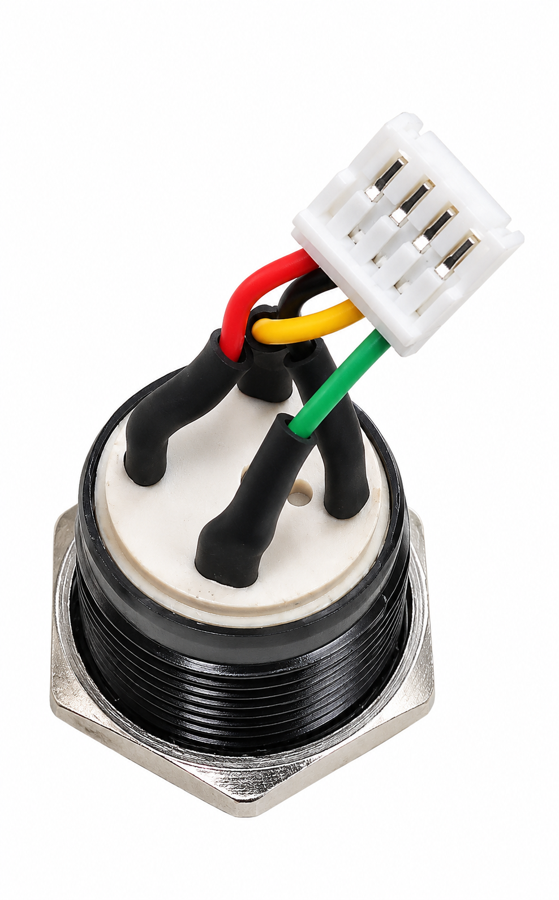
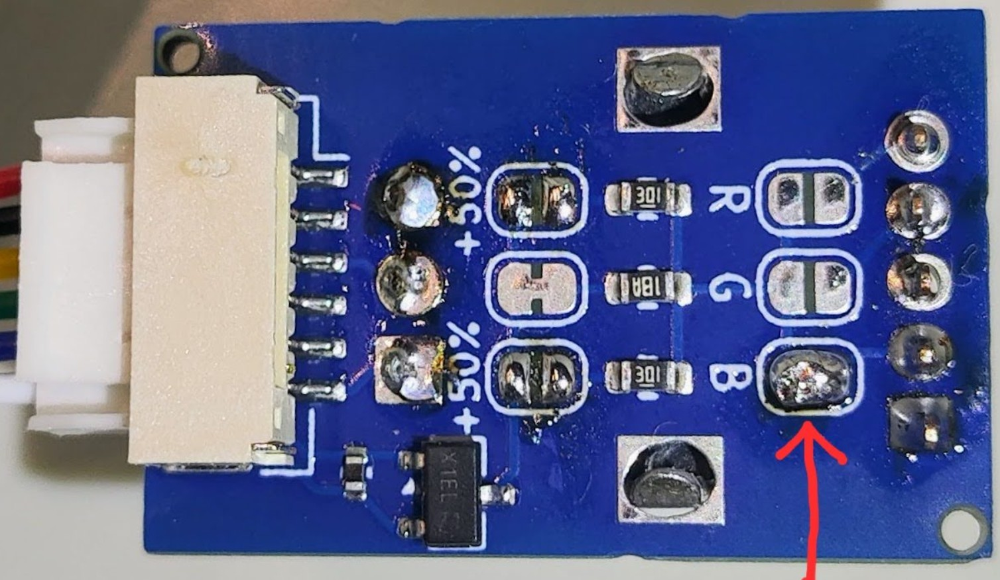
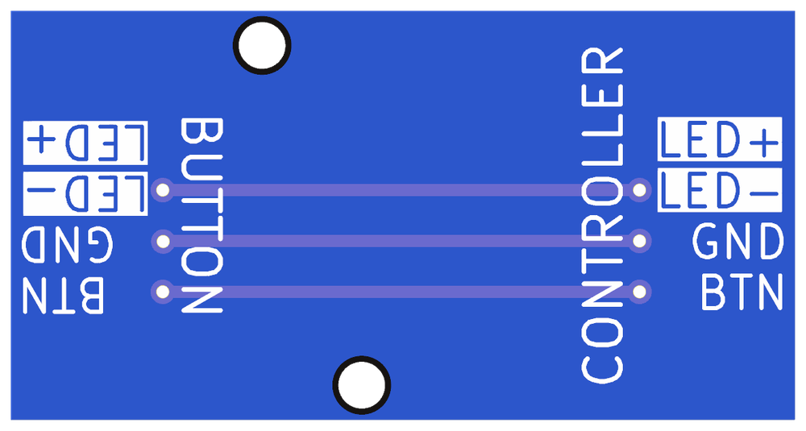
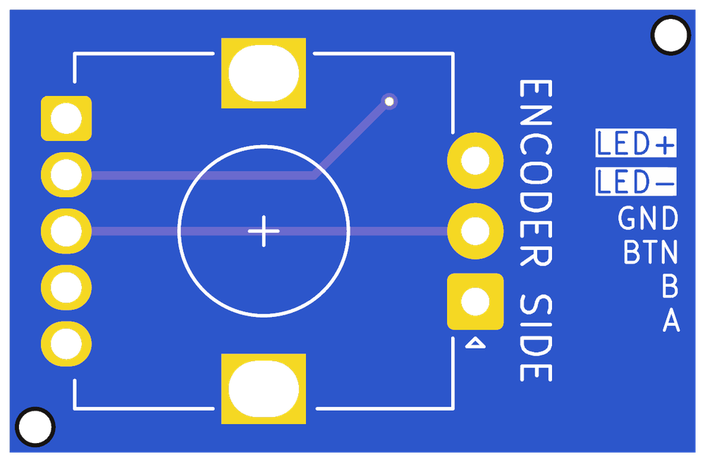
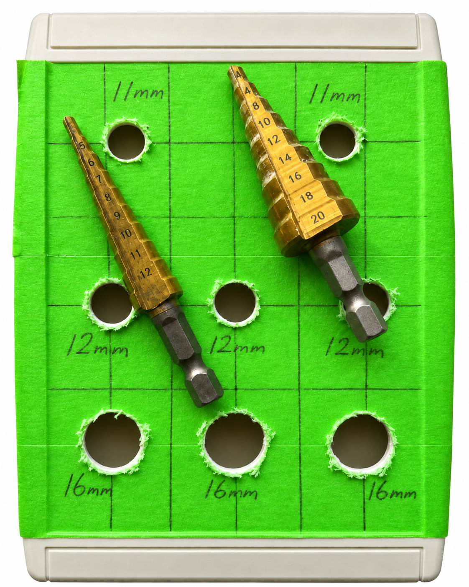
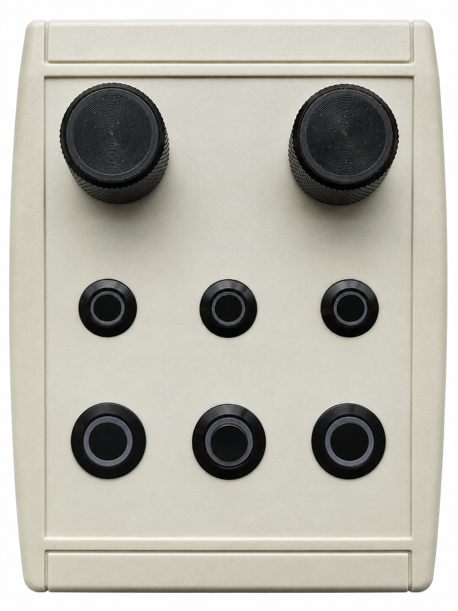
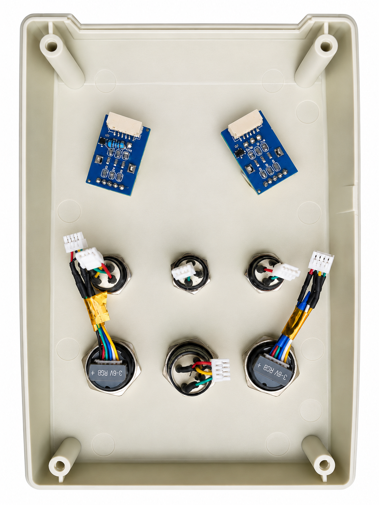

# Preparing and wiring the controls

The controller works with any rotary encoder or momentary push button that connects a contact to ground. This page gets every control ready with its plug, whether it comes from the [reference kit](kit.md) (the controller with tested encoders, buttons, adapter boards and cables) or you put your own together: soldering, cables, and controls wired without the adapter boards. Do it on your desk, before anything goes into a panel. Once every control has its plug, continue with [Getting started](getting-started.md).

## The ports

| Port | Connector | Pin 1 … pin N |
|---|---|---|
| `ENC 1`, `ENC 2` | JST GH 1.25 mm, 6-pin | **1** A · **2** B · **3** push switch · **4** GND · **5** LED− · **6** LED+ |
| `BTN 1` … `BTN 6` | JST GH 1.25 mm, 4-pin | **1** switch · **2** GND · **3** LED− · **4** LED+ |

**Ports and pinouts.** Top view of the controller, drawn to scale from the KiCad layout, with the pinouts on the left and pin 1 of every port drawn in the port's colour.

Pin 1 is on the left when you look into a socket with the component side up. (The sockets in the top row face the other way, so on the drawing their pin 1 is on the right.) The port names are printed on the **back** of the board; the component side shows the short names E1–E2 and B1–B6. The 4-pin SWD header is for programming only; see [Building your own](building.md).

## The rules

- **Switches and encoder contacts** connect their signal pin to **GND** when closed. The controller provides the pull-ups.
- **Encoders** need as many pulses per turn as detents (clicks), e.g. 20 pulses / 20 detents; the firmware sends one action per full pulse. An encoder with half as many pulses as detents gives one action every second click.
- **`LED+`** is the shared 5 V LED supply, **`LED−`** is the dimmed return. Every LED needs its own series resistor; the controller limits only the total. The current is roughly (5 V − LED forward voltage) / resistor.
- Keep the total of all LEDs under 100 mA ([LED current budget](hardware.md#led-current-budget)). For scale: my 8 controls, lit well enough for daylight, add about 13 mA to the board's own 17 mA.
- **Keep `GND` and `LED−` apart.** `LED−` is where the dimming happens. An LED returned to `GND` instead stays on at full brightness and ignores the brightness setting.
- On long runs, twisting each signal wire with a ground wire helps keep noise out.

What I learned picking encoders and buttons, and the models I use: [Choosing controls](choosing-controls.md).

## Preparing controls with the adapter boards

The adapter boards from the `hardware/` folder (also in the kit) carry the series resistors, so they save you the resistor maths:

- **Encoder adapter** / **RGB encoder adapter**: holds an EC12-style encoder (with a single-colour or an RGB LED); its cable goes to `ENC 1` or `ENC 2`.
- **Button adapter**: sits in the cable between a `BTN` port and the button: the cable from the port goes into the socket marked **CONTROLLER**, the button's lead into the one marked **BUTTON**.

The encoders and the button leads are soldered by hand: the board house doesn't fit them, and the kit's controls come unsoldered too. Why the encoder sits on its adapter but the button gets a lead: [Hardware notes](hardware.md#why-encoders-sit-on-the-adapter-and-buttons-dont).

### 1. Solder each encoder onto its adapter

Insert the encoder from the side marked **ENCODER SIDE** and solder all its pins on the other side.

  

**An encoder soldered onto its adapter,** on the side marked ENCODER SIDE.

### 2. Solder a lead onto each button

The plug of a 4-wire JST GH lead goes into the button adapter's socket marked **BUTTON**. Solder its wires to the button as the labels next to that socket say: `BTN` to the switch's normally-open contact, `GND` to the switch common, `LED−` to the LED − (cathode), `LED+` to the LED + (anode). With an RGB button, you pick the colour by soldering that colour's LED lead ([details](hardware.md#button-adapter)). Crimping GH 1.25 mm contacts needs a fine crimp tool; pre-crimped leads are easier.

Slide a piece of heat-shrink tubing over each wire before you solder it, then shrink it over the joint: it insulates the four joints from each other and secures them.

  

**A finished button.** The four solder joints under heat-shrink.

### 3. Set the solder jumpers

The **solder jumpers** (pairs of tiny pads you join with a blob of solder, or separate by cutting the thin trace between them) set each control's LED current, so controls can be matched to each other. The kit's adapters come matched: leave them as they are unless you add a control of your own.

- The default is JP2 bridged. A jumper marked **+50%** gives that control about 50 % more LED current; bridging both gives about twice the current. For less than the default, cut JP2 and bridge one of the other two instead (about half the current).
- **RGB encoder adapter:** the jumpers marked **R**, **G** and **B** on the back pick the colour. They all come open, so the LED stays dark until you bridge one. Bridge one only: colour mixing isn't supported (the red LED would take nearly all the current).

  

**Choosing the colour.** The back of an RGB encoder adapter with one colour jumper bridged. The arrow points to the blue colour jumper.

Every jumper and resistor value, and why the RGB adapter switches the LED supply instead of the return: [Hardware notes → Adapter boards](hardware.md#adapter-boards).

## Cables to the adapter boards

The cables I use, and suggest for your own build too, are the kit's: **same-direction** cables (straight, not reversed) with JST GH 1.25 mm plugs, 4-pin for buttons and 6-pin for encoders; the kit's are 15 cm long.

> [!WARNING]
> **Match the labels, not the pin numbers.** Each wire between the controller and an adapter board must join the same label at both ends: `LED+` to `LED+`, `LED−` to `LED−`, `GND` to `GND`, `BTN` to `BTN`, and on encoders `A` to `A` and `B` to `B`. The plugs only fit one way, but the cable decides which pin meets which, and a wrong cable can put the 5 V LED supply on a switch line.

Plug each cable so its red wire is on `LED+` at the controller; if it isn't, turn the cable round. The red wire then sits on `LED+` at the adapter too. If it doesn't, the cable is a reversed one: don't use it.

The labels are printed next to every connector: on the back of the controller, on the side without parts of the button adapter (for both its CONTROLLER and BUTTON sockets), and on the encoder side of the encoder adapters. Why the adapters are numbered the other way round: [Hardware notes](hardware.md#adapter-boards).

  
  

**Pin labels on the adapter boards.** KiCad renders, rev 2.0. Left: the button adapter, with the labels for its BUTTON and CONTROLLER sockets. Right: the encoder side of the encoder adapter, with the labels for its socket.

## Wiring controls without the adapter boards

The adapter boards are optional. You can solder a lead with a JST GH plug straight onto an encoder or a button and plug it into the port; its wires then follow the port's pinout ([The ports](#the-ports)). The LED current is up to you then: give every LED its own series resistor ([The rules](#the-rules)).

## Check it before mounting

Once you have saved a setup ([Getting started](getting-started.md#2-configure-it)), ideally a test setup in which each input sends a different key, check everything on the bench. Each line should take seconds.

| Check | Expected |
|---|---|
| Each button and encoder, using its own cable | The right key on the PC, once per press or detent, both directions |
| On-board button: short / long press | LEDs on/off / brightness steps; every LED follows |
| Unplug, re-plug | Setup still there; brightness as you left it if *Controller LEDs → At power-up → Remember brightness* = *Yes* and *Brightness* = *Restore last* |

## Example: installing the controls into an enclosure

Once the controls pass the bench check, they go into whatever holds them: a dashboard panel, a desk panel or a box. Here is one example of installing controls into an enclosure, a small plastic box (the box and these controls are not part of the [reference kit](kit.md)).

  
  
  

**Controls in an enclosure, step by step.** Left: the holes marked on masking tape and drilled with step drills. Middle: the encoders and buttons fitted, from the front. Right: the same box from the inside, each button with its lead and JST GH plug, and two encoder adapter boards.

## Common mistakes

- An LED without a resistor. The controller only limits the total LED current, so nothing protects that one LED.
- `GND` and `LED−` mixed up in a self-made cable: the LED ignores the brightness setting, or the button behaves erratically.
- A reversed cable between the controller and an adapter. Use same-direction cables: the red wire is on `LED+` at both ends ([Cables to the adapter boards](#cables-to-the-adapter-boards)).
- Plugging or unplugging controls with USB connected.
