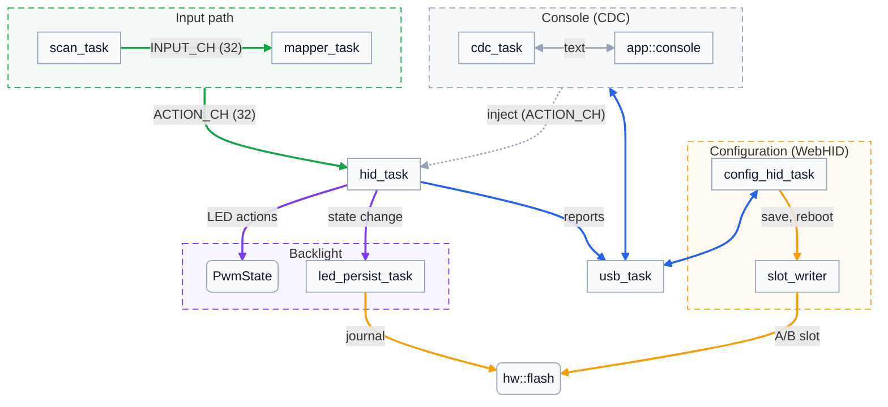
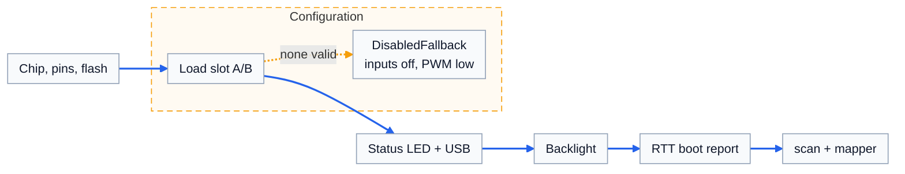

# Firmware architecture and design rules (STM32G474 + Embassy)

This document is for whoever changes the firmware: the rules it must keep, the reasons behind them, and where they live in the code (execution flow, module boundaries, flash layout, pitfalls). Byte layouts and parameters are in the [specs](specs/); the code is the final truth.

How firmware, `crs_tools`, scripts and the web configurator depend on each other: [firmware/README.md](../README.md). Source paths below (`src/...`, `build.rs`, `boards/...`) are relative to `firmware/kb_firmware/`.

Hardware: **STM32G474CB** (128 KiB flash, 128 KiB RAM, crystalless: HSI-based PLL at 170 MHz).

What the firmware does:
- Boot-time config load from flash (**two 4 KiB config slots A/B; the valid one with the higher sequence number `seq` wins; none valid → DisabledFallback: inputs off, USB still enumerates**)
- Deterministic input scan (**bounded channels, no allocation, no blocking in scan loop**)
- Gesture mapping (short / long press, repeat, encoder steps) to HID keyboard, HID consumer control and internal backlight actions
- USB device (**HID keyboard + HID consumer control**, with optional **CDC ACM console** via Cargo feature `usb_cdc`, enabled by default)
- Flash-backed LED state persistence (journal page)
- **WebHID configuration** (vendor HID interface): read the config; "Save to device" validates a new config, saves it to the A/B slots and reboots into it ([Spec - WebHID Config Protocol](specs/Spec%20-%20WebHID%20Config%20Protocol.md))
- Persistent identity + banner (at boot over RTT, the debug log read through the SWD probe, and on every reconnect of the USB serial (CDC ACM) console)

---

## 0. Non-negotiable constraints

Keep these true in every change:

- `#![no_std]`, no heap allocations (`no alloc`).
- **The device never parses TOML.** Anything complex happens on the host (`crs-pack`); the firmware only decodes and checks fixed binary structures (CRS, [§0.1](#01-design-decisions-at-a-glance)).
- **Deterministic scan loop** ("scan is sacred", [§1.2](#12-key-architecture-choice-scan-is-sacred)):
  - fixed-period ticker derived from `scan_hz`
  - bounded work per tick
  - never blocks on I/O or channels; under overload it drops events rather than adding jitter
- **USB stability first:** input or config logic must not break enumeration. Whatever is wrong with the configuration, the firmware still boots and enumerates ([§2.3](#23-no-valid-configuration-disabledfallback)).
- **Configuration is applied only at boot:** running tasks never see a config change; saving a config means a reboot ([§2.2](#22-configuration-is-boot-time-only)).

### 0.1 Design decisions at a glance

| Decision | Why | Cost |
|---|---|---|
| Scan task never waits; drops the newest event when the input channel is full ([§1.2](#12-key-architecture-choice-scan-is-sacred)) | Scan timing stays bounded whatever the host or the mapper does | Event loss under extreme overload (very fast encoder spins) |
| Configuration applied only at boot; a WebHID save reboots ([§2.2](#22-configuration-is-boot-time-only)) | One startup path for pulls, scan rate, PWM, LED restore and task spawn; no half-applied state | A restart per save (a couple of seconds); inputs pause meanwhile |
| Fixed-size binary config (CRS v1: the project's 288 B config format, [Spec - CRS Format](specs/Spec%20-%20CRS%20Format.md); not the STM32's clock recovery system (CRS) mentioned in the hardware notes); TOML only on the host | No parser, no heap on the device; trivially checked (magic, schema, length, compat ID, CRC) | Schema changes need a new CRS version |
| One validator (`crs_format::validate_payload`) used by `crs-pack`, WebHID saves and a compile-time check of the built-in template | Host and device can't disagree about what is valid | Slots loaded at boot get the structural checks only |
| A/B slots, `seq` + commit marker written last, read-back verify ([§3.11](#311-srcconfigslot_writerdefaultsruntimers-save--built-in-template--running-config)) | Designed so a power cut during a save leaves the old slot selected | Two 4 KiB pages for 320 B of data each |
| No valid slot → DisabledFallback, not the built-in template ([§2.3](#23-no-valid-configuration-disabledfallback)) | A missing or corrupted setup shows as silent controls instead of an unexpected mapping | A new board does nothing until it is configured |
| Single-bank flash, `DBANK=0` ([§4.0](#40-flash-banking-stm32g474cb--read-this-first)) | The flash layout needs one contiguous 128 KiB bank; dual bank's read-while-write is unusable with more than 64 KiB of code | One-time `tools/flash_set_single_bank.sh` per chip; erases stall the CPU |
| One shared flash owner + ECC NMI handler ([§3.9](#39-srchwflashrs-shared-flash-owner--ecc-checked-reads)) | LED journal and config saves never interleave; a torn double word reads as "invalid" instead of hanging in the default NMI handler | Flash access is serialised |
| Compiler set to optimise for size, not speed: `opt-level = "s"` + fat LTO + `codegen-units = 1` | Flash is the bottleneck: the firmware gets 116 KiB. With the speed settings (`opt-level = 3`, no LTO) it needs ~108 KiB, leaving almost no room. Size optimisation plus whole-program optimisation (LTO) brings it to ~79 KiB, ~37 KiB free | The code runs somewhat slower (the compiler no longer inlines and unrolls for speed). The input scan has plenty of time per tick (~330 µs at 3 kHz), so it shouldn't matter. Builds take longer |
| Own small CRC-32 (`crs_format`, one 1 KiB table) instead of the `crc32fast` crate | `crc32fast` spends 16 KiB of flash on lookup tables to be fast with large data, but the firmware only checks 288 B setups and 12 B LED records: ~15 KiB saved. Same algorithm and results, so setups packed on the PC (`crs-pack` still uses `crc32fast`) check out on the device | Slower per byte, but a 288 B check still takes only microseconds (estimate). One more small piece of own code (about 40 lines, checked at build time against the standard CRC-32 test value) |
| Configurator = a plain web page: double-click `web_config/index.html`; no install, no build step, no web server (classic `<script>` files, opened from `file://`) | The user needs nothing but a browser. ES modules (`import`/`export`), the modern way to split the code into files, are blocked by browsers on a page opened from disk; classic scripts load fine. WebHID still works, because browsers treat `file://` as a secure context | The browser doesn't remember the USB permission for a local file: pick **KB-E2B6** in the **Connect device** chooser each time the page is opened, and again after a save if the restarted board isn't reconnected automatically |

---

## 1. High-level runtime pipeline

### 1.1 Dataflow overview



**Firmware data flow.** Input path: the scan task turns GPIO changes into events and the mapper turns them into HID actions, linked by two bounded channels (`INPUT_CH`, `ACTION_CH`, 32 events each). `hid_task` sends the actions to the host as USB reports and carries out the backlight actions. The serial console and the WebHID configuration path talk both ways with the host over the same USB device; the LED journal and the slot writer share one flash owner. The console can also inject HID events for testing. Line colours: green = input events, blue = USB, violet = backlight, amber = flash writes, grey = console.

### 1.2 Key architecture choice: “scan is sacred”

- `scan_task` **never awaits on channels**.
- When the input channel is full, `scan_task` drops the newest event:
  - implemented via `INPUT_CH.try_send(ev)`.
- This keeps scan timing bounded, at the cost of possible event loss under overload. The loss is intentional.
- Action throughput is limited by the host poll rate and by the configured press/release timing (button `pulse_ms`, encoder `encoder_pulse_ms`), so fast encoder rotation plus repeats can fill the channels and drop events. When `ACTION_CH` is full, `mapper_task` waits ([§3.6](#36-srcinputmapperrs-gesture--mapping)).

---

## 2. Boot sequence and execution flow

### 2.1 Boot flow (what runs first)

Source: `src/main.rs`.



**Boot sequence.** What `main()` does at power-up, left to right. The input scan and mapper start last, after the boot report. Without a valid slot the board boots in DisabledFallback: USB and the configurator work, the inputs are off, the backlight PWM is held low and the status LED blinks fast. Blue = normal boot, amber = no valid configuration.

### 2.2 Configuration is boot-time only

"Save to device" never changes the config live: the validated config is written to the inactive A/B slot and the MCU reboots, so the whole boot path (pulls, scan rate, PWM, LED restore, task spawn) runs again with the new config.

- `ActiveCfg` is stored in `config::runtime::ACTIVE_CFG` (a `Mutex`), set once at boot and treated as immutable afterwards.
- `scan_task` and `mapper_task` each receive a **by-value copy** of `ActiveCfg` at spawn time.
- Runtime state that *can* change is intentionally limited (notably PWM state).
- No command or other mechanism changes the button/encoder config at runtime. Applying a config live would mean re-architecting the scan/mapper config access, GPIO pulls, debounce/scan timing, PWM limits, the LED persistence settings and the boot status cached in `hid_task` ([§7.3](#73-bootstatus-cached-in-hid-task)), and re-validating determinism.

### 2.3 No valid configuration: DisabledFallback

If no slot is valid, committed and compatible ([Spec - CRS Slots §7](specs/Spec%20-%20CRS%20Slots.md#7-slot-selection-algorithm-boot)), the board boots in DisabledFallback, a supported mode rather than an error state:

- USB enumerates; the configurator and the console keep working.
- The panel buttons and encoders are disabled (no events, no actions). The on-board button is still scanned, but `hid_task` ignores LED actions.
- The PWM task and the LED persistence task are not spawned; `pwm_hold_low_task` holds the backlight pin low.
- The status LED blinks fast (100 ms on / 100 ms off) instead of the heartbeat (two 60 ms flashes per second), so "no setup" is visible without a computer. `cfg status` on the console shows why each slot was rejected.

**Why the built-in template is not used as a fallback.** If only the newest slot is damaged, the board boots the other, older slot: that is still a setup the user saved, so DisabledFallback applies only when no slot is usable. Then it is better for the controls not to respond at all, which exposes the problem at once, than to respond in a way the user did not choose (a button that was *Home* suddenly sending *Play/Pause* while driving). The built-in template (`config/defaults.rs`) only pre-fills the configurator's form and takes effect once the user saves it. The same applies when a firmware with a different `FW_COMPAT_ID` rejects the old config: the inputs stay off until a new config is saved.

---

## 3. Major modules and responsibilities

### 3.1 `src/main.rs` (system integration)

Responsibilities:
- MCU init, pin ownership (Embassy move semantics).
- Boot-time config selection (Slot A/B by `seq` → DisabledFallback).
- Spawning the long-running tasks:
  - USB composite
  - status LED (heartbeat; fast blink in DisabledFallback)
  - PWM or hold-low
  - LED persistence (if enabled)
  - scan + mapper

Hardcoded decisions here:
- Physical pin mapping — all GPIO pins are owned and configured directly in `main.rs` (local variables numbered 1-based like the PCB silkscreen: `pin_btn1..pin_btn6`, `pin_enc1_*`, `pin_enc2_*`).
- PWM output pin (`PA1`), status LED pin (`PC15`), and the on-board button (`PA0`, `PCB_BTN`: active-low, fixed pull-up, hardcoded LED actions; see [§3.6](#36-srcinputmapperrs-gesture--mapping)).

### 3.2 `src/config/*`: config load and decode, flash layout, build features

**Flash layout + constants**: `config/fw.rs`
- Two fixed slots at end of flash (board-dependent addresses):
  - Slot A: `CFG_SLOT_A_BASE` (one erase page)
  - Slot B: `CFG_SLOT_B_BASE` (one erase page)
- Build-time selection:
  - Flash constants are generated by `kb_firmware/build.rs` from `kb_firmware/boards/<board>/flash_layout.rs`.
  - Linker reserves the last 12KiB (3 erase pages of 4KiB: LED journal page + Slot A + Slot B) via `kb_firmware/boards/<board>/memory.x`, preventing firmware overlap.

**Cargo features** (all four on by default; build commands for other combinations: [firmware/README, Build options](../README.md#build-options-cargo-features)):
- `board_e2b6_128k` (required): the only board, STM32G474CB with 128 KiB flash, crystalless; selects `boards/e2b6_128k/` (flash layout, `memory.x`).
- `flash_single_bank` (required): single-bank flash driver; must match the chip's `DBANK=0` ([§4.0](#40-flash-banking-stm32g474cb--read-this-first)).
- `hw_pwm`: backlight PWM in hardware (TIM2/PA1, 1 kHz); without it, software PWM at 100 Hz (GPIO toggle, 10 ms period).
- `usb_cdc`: the CDC ACM debug console, a debug-only channel; without it, USB enumerates as HID only (keyboard, consumer control, vendor config interface).

**Loader**: `config/loader.rs`
- Reads both slots with `hw::flash::read_checked` (volatile reads + ECC check, [§4.2](#42-how-slots-are-read-and-written)).
- Validates using `crs_format::parse_and_validate_with_compat(bytes, FW_COMPAT_ID)`.
- Selects a slot by the rules in [Spec - CRS Slots §7](specs/Spec%20-%20CRS%20Slots.md#7-slot-selection-algorithm-boot); none valid → DisabledFallback ([§2.3](#23-no-valid-configuration-disabledfallback)).

**Boot status**: `config/status.rs`
- Stores and formats `BootStatus` (selected source + per-slot result).
- Used by:
  - RTT boot dump
  - `cfg status` (detailed)
  - `cfg show` (compact)

**Decode to runtime config**: `config/active.rs`
- Converts CRS payload into `ActiveCfg`.
- Supports inheritance from globals for per-button/per-encoder overrides.

**Runtime store**: `config/runtime.rs`
- `ACTIVE_CFG` is a global `Mutex` with getter/setter.

### 3.3 `src/hw/usb_composite.rs` (USB device + CDC console + HID)

Tasks:
- `usb_task`: runs the USB device core forever.
- `cdc_task`:
  - waits for CDC DTR
  - prints the persistent banner and a prompt
  - reads packets, does CR/LF line discipline, calls `app::console::handle_line()`
- `hid_task`:
  - receives `HidEvent` from `ACTION_CH`
  - emits HID reports or applies internal actions

Notable decisions:
- HID emission is explicit **press then release**.
  - Button press duration is configuration-driven (`pulse_ms`; `0` enables tracked-release).
  - Encoder rotation is always pulsed (`encoder_pulse_ms > 0`).

Identity:
- USB product/serial (no manufacturer string, on purpose) and the human-facing banner live in `src/text.rs`.
- USB VID/PID are constants in `src/text.rs`, used by `src/hw/usb_composite.rs`.

### 3.4 `src/app/console.rs` (command engine)

Commands:
- `help`, `info`
- `cfg status` (detailed per-slot)
- `cfg show` (compact: globals + PWM boot/now)
- `hid kbd <mods_hex> <usage_hex>` injects a keyboard action
- `hid cc <usage16_hex>` injects a consumer action

Transport:
- Returns a `Response` enum so the caller (CDC frontend) decides how to write.

The console is for diagnostics and never changes the configuration: that goes through the WebHID configurator or an SWD flash ([§4.3](#43-flashing-a-config-slot-host-side-swd)).

### 3.5 `src/input/scan.rs` (deterministic sampling + conditioning)

Responsibilities:
- Ticker-based sampling at `scan_hz`.
- Debounce for:
  - 6 panel buttons (event IDs `0..5`)
  - encoder push buttons (event IDs `6..7`)
  - on-board button `PA0` (event ID `8` = `PCB_BTN_ID`; always scanned, even in DisabledFallback)
- Encoder decode for 2 encoders (event IDs `0..1`) producing `InputEvent::Encoder { step: ±1 }`.

**ID spaces (do not mix):** these internal event IDs are 0-based and differ from both the 1-based TOML IDs (panel `1..6`, encoder `1..2`) and the CRS buttons array order (encoder buttons at `0..1`, panel at `2..7`). `config/active.rs` converts CRS → `panel_buttons[0..6]` / `encoder_buttons[0..2]`.

Determinism:
- Emits via `INPUT_CH.try_send()` and drops newest on full.

**Direction / wiring note**:
- Encoder A/B direction can be flipped via `[global].encoder_swap_ab_default` (TOML global, inherited by each encoder) or overridden per-encoder via the `swap_ab` field in the encoder block. When set, the firmware swaps A/B sampling, reversing the CW/CCW sense.
- Encoder push buttons are configured through a separate `ButtonCfg` entry (in the `encoder_buttons` array) — not `EncoderCfg`. This gives each push button its own `pull` and `active_low` settings, independent of the encoder's rotation config.
- Debounce timing (`debounce_ms`) is converted to scan ticks at init time (ceiling, minimum 1 tick regardless of the requested ms value).

### 3.6 `src/input/mapper.rs` (gesture + mapping)

Responsibilities:
- Consumes `INPUT_CH` and produces `HidEvent` (explicit press/release events).
- Implements:
  - short-only buttons (emit on press)
  - short+long buttons (emit long at threshold; if long never fired, emit short on release)
  - repeat behavior
  - the on-board button (`PCB_BTN_ID`), with hardcoded actions: short = `LED_TOGGLE`, long = `LED_SWING`, repeat every 100 ms while held (only if the global `pulse_ms_button_default` > 0; no repeat when the global press style is *Hold while pressed*); long-press time, debounce and press style from the global defaults
- Emits by awaiting `ACTION_CH.send()`.

Timing model:
- A 5ms ticker (`Ticker::every(5ms)`) performs long-press thresholds and repeat scheduling.

**Pitfall**:
- If `ACTION_CH` becomes full (e.g., HID is slow), `mapper_task` blocks on `send()`.
  - Scan continues, but input events may start dropping when `INPUT_CH` fills.

### 3.7 `src/hw/pwm.rs` (LED PWM output + state)

Responsibilities:
- Maintains `PwmState` in a `Mutex` (`on`, `level`, `min_level`, `max_level`, `step`), initialized once at boot by `init_from_cfg()`.
- Provides the state operations used by internal actions: `toggle`, `set_on`, `level_next` (swing/wrap), `level_inc`, `level_dec`.
- Default (feature `hw_pwm`, enabled by default): hardware PWM via TIM2/PA1 (channel 2) at 1 kHz.
- Fallback (built without `hw_pwm`): software PWM task runs at 100 Hz (10 ms period), toggling a GPIO.

In DisabledFallback the PWM task is not spawned and `pwm_hold_low_task` holds the pin low ([§2.3](#23-no-valid-configuration-disabledfallback)).

`hid_task` executes the internal actions (`LED_TOGGLE`, `LED_SWING`, `LED_ON`, `LED_OFF`, `LED_UP`, `LED_DOWN`, IDs `0x01..0x06`; exact behaviour: [Spec - Action Set §3](specs/Spec%20-%20Action%20Set.md#3-internal-actions)) with these operations.

LED runtime level is a percentage: `level` is `1..=100` (and clamped to `[global].led_level_min..led_level_max`).

`led_level_step`, `led_level_min`, and `led_level_max` are configured via `[global]` in TOML and packed into CRS.

### 3.8 `src/hw/led_persist.rs` (LED runtime state persistence)

Implements [Spec - LED Runtime State Persistence](specs/Spec%20-%20LED%20Runtime%20State%20Persistence.md):
- `scan_restore()` (boot, synchronous): scans the journal page and applies the boot policy (`led_state_on_boot`, `led_level_on_boot`, clamping) → initial PWM on/level.
- `notify_pwm_state()` (called by `hid_task` after every LED action): marks changed fields dirty and pushes the commit deadline out by `led_autosave_delay_ms`.
- `led_persist_task`: the single writer. Appends 16-byte records, erases the page when full, caps retries and suspends persistence for the boot after repeated flash failures.
- Spawned only if `led_state_persist` or `led_level_persist` is enabled. Not spawned in DisabledFallback. Uses the shared flash owner ([§3.9](#39-srchwflashrs-shared-flash-owner--ecc-checked-reads)), locked per operation.
- A torn journal record (ECC error) is skipped and forces a page erase on the next commit.

### 3.9 `src/hw/flash.rs` (shared flash owner + ECC-checked reads)

- Owns the `FLASH` peripheral in one async mutex (`with_flash`), shared by the LED journal writer and the WebHID config save, so erase/program operations never interleave.
- `read_checked()`: reads reserved-page bytes and reports uncorrectable ECC errors. A double word torn by a power loss mid-program raises an ECC NMI when read; the `NonMaskableInt` handler here records/clears it (atomics only) so the loader/journal treat the data as invalid instead of hanging (cortex-m-rt's default NMI handler loops forever).
- `quiesce()`: waits for any in-progress flash operation before the post-save reboot.

### 3.10 `src/webhid/mod.rs` (WebHID configuration channel)

- `config_hid_task` serves the vendor HID interface (usage page `0xFF00`, 64-byte in/out reports, no report IDs; created in `hw/usb_composite.rs`). One request in, one response out.
- Framing, statuses and the chunked write session come from `crs_format::webhid` (host-testable).
- Commands: GET_INFO, READ_CONFIG (running config / built-in template, selector `FACTORY_DEFAULTS`, shown as the suggested setup), WRITE_BEGIN/CHUNK/END, PING.
- WRITE_END = "Save to device": CRS header + `crs_format::validate_payload` (same rules as `crs-pack`) → `slot_writer::commit` → reply `REBOOTING` → system reset. Any failure: no change (by design).

### 3.11 `src/config/{slot_writer,defaults,runtime}.rs` (save / built-in template / running config)

- `slot_writer.rs`: A/B save into the non-selected slot (`seq = max + 1`, committed double word programmed last, read-back verify, boot selector must pick the new slot).
- `defaults.rs`: compile-time-validated built-in template (the configurator's suggested setup), served over READ_CONFIG.
- `runtime.rs::{set,get}_running_crs`: raw bytes of the config selected at boot.

---

## 4. Flash + linker layout (config slots)

### 4.0 Flash banking (STM32G474CB) — READ THIS FIRST

This board **must run the MCU in single bank (option byte `DBANK=0`)**; chips leave the factory in dual bank. Set it once per chip before flashing anything (why, and recovering a stuck board: [recovery §2](recovery.md#2-first-time-provisioning-set-single-bank-mode-dbank0)):

```bash
cd firmware/tools
./flash_set_single_bank.sh
```

`flash_single_bank`, `FLASH_ERASE_PAGE_SIZE = 4096` and `DBANK=0` must agree ([Spec - Flash Banking](specs/Spec%20-%20Flash%20Banking.md)).

### 4.1 Reserved region

- Board-specific `memory.x` defines `FLASH` length as `(<flash size>) - 12K`.
- This reserves the top 12KiB (3 erase pages of 4KiB) for the LED journal page and the two config slots, preventing firmware overlap at link time.

Address ranges:
- 128KiB flash (STM32G474CB, single bank / DBANK=0, 4KiB erase page):
  - Firmware flash region: `0x0800_0000 .. 0x0801_D000`
  - LED journal page:      `0x0801_D000 .. 0x0801_E000`
  - Slot A CFG slot:       `0x0801_E000 .. 0x0801_F000`
  - Slot B CFG slot:       `0x0801_F000 .. 0x0802_0000`

### 4.2 How slots are read and written

`config/loader.rs` reads slot bytes with `hw::flash::read_checked` (volatile reads + ECC check):
- Assumes those addresses are valid flash and the linker reservation is correct.
- An ECC error makes the slot invalid (`SlotError::FlashEcc`), never a hang.

The firmware writes slots only through `config/slot_writer.rs` (WebHID "Save to device"). Single-bank flash has no read-while-write: the 4 KiB erase stalls the CPU (and therefore scan/USB) for tens of ms.

### 4.3 Flashing a config slot (host-side, SWD)

For host-side flashing, the firmware build emits the flash layout artifact:
- `kb_firmware/target/crs_artifacts/flash_layout.env` (exports `KB_BOARD`, `PROBE_RS_CHIP`, `FLASH_END`, `FLASH_ERASE_PAGE_SIZE`, `CFG_SLOT_SIZE`, `CFG_SLOT_A_BASE`, `CFG_SLOT_B_BASE`, `LED_STATE_FLASH_PAGE_BASE`, `LED_STATE_FLASH_PAGE_SIZE`)

`FLASH_ERASE_PAGE_SIZE` is chip/board-specific and is defined centrally in the selected board's flash layout module (e.g. `kb_firmware/boards/<board>/flash_layout.rs`).

Configs are flashed host-side with `../tools/embed_with_cfg.sh` (probe-rs **0.32.x** only; usage and example TOMLs: [tools/README.md](../tools/README.md#flash-a-config-over-swd)). It packs the TOML with `crs-pack pack-slot` into a slot image (format: [Spec - CRS Slots](specs/Spec%20-%20CRS%20Slots.md)), checks read-only that the MCU is single-bank, and writes the whole reserved region `[LED journal | Slot A | Slot B]` in one `probe-rs download --verify --reset`. The chosen slot gets `seq = 1`; the other slot and the LED journal are wiped, so only one slot is in use after an SWD flash and WebHID saves then alternate A/B.

The script must be run from `firmware/tools/` and does **not** build `crs-pack` (it expects a prebuilt binary, repo-local or on `PATH`).

---

## 5. Hardcoded vs configurable settings

### 5.1 Hardcoded

- Physical pin mapping: local pin assignments at the top of `main()` in `main.rs`.
- On-board button (`PA0`) behavior (see [§3.6](#36-srcinputmapperrs-gesture--mapping)).
- USB identity in `text.rs`: VID/PID `0xCAFE`/`0x4002` (hobby/test IDs), per-unit serial `KBE2B6-<96-bit UID hex>`; bcdDevice 2.00 and the interface set (CDC, HID keyboard + consumer, vendor HID config) in `hw/usb_composite.rs`.
- USB strings + the banner in `text.rs`.
- HID report descriptors in `hid/reports.rs` (keyboard + consumer) and `webhid/mod.rs` (vendor config interface).

- Channel capacities:
  - `INPUT_CH`: 32
  - `ACTION_CH`: 32
- Mapper tick rate: 5ms.
- Encoder decode algorithm (accumulate quarter-steps → emit per detent).

### 5.2 Configurable via CRS (boot-time)

Everything else, read into `ActiveCfg` at boot: scan rate, pulls and active levels, debounce / long-press / repeat timing, press/release timing, the actions of every button and encoder, and the backlight and LED persistence settings. All parameters with their defaults: [Spec - Configuration Reference §2](specs/Spec%20-%20Configuration%20Reference.md#2-configuration-tables-parameters--defaults).

---

## 6. Observability

- Startup:
  - after CDC DTR (if `usb_cdc` enabled), firmware prints the banner and shows a prompt.
  - on RTT: the one-line banner is emitted immediately at boot start (before tasks are spawned). After the USB, LED persistence and PWM tasks are up and before scan/mapper are spawned, `rtt_boot_dump()` emits `info`, `cfg status`, and `cfg show` as separate sections.
- Console:
  - `cfg status`: detailed per-slot decode + header details when available.
  - `cfg show`: compact “what’s active” globals + current PWM state.

---

## 7. Pitfalls, warnings, and “gotchas”

### 7.1 Encoder A/B swap (direction) configurability

- Encoder A/B are sampled using `is_high()`.
- The encoder push button (via `ButtonCfg`) uses `active_low`; A/B rotation lines do not.
- If rotation direction is inverted due to wiring, set `[global].encoder_swap_ab_default = true` (or the per-encoder `swap_ab` override).

### 7.2 HID Consumer is “usage array”, not bitmask

- `HidEvent::CcPress { usage: u16 }` is a literal Consumer Page usage ID.
- The report descriptor expects a single 16-bit usage value (and 0 for release).

### 7.3 BootStatus cached in HID task

- `hid_task` reads `BootStatus` once at startup and caches `pwm_allowed`.
- That is safe because the configuration only changes through a reboot ([§2.2](#22-configuration-is-boot-time-only)): in DisabledFallback the PWM and LED persistence tasks are not spawned at all, and the reboot with a valid config spawns them normally. Anything that applies a config live must refresh this gating.

---

## 8. Extension points (safe places to evolve)

- Add new internal actions:
  - extend `config/action.rs` with IDs
  - handle them in `hid_task`
- Add new console commands:
  - implement in `app/console.rs`
- Add WebHID commands: extend `crs_format::webhid` (opcodes/statuses) and `webhid/mod.rs`, mirror in `web_config/js/protocol.js`, document in the protocol spec

---

## 9. File map (quick navigation)

- Boot integration: `src/main.rs`
- Config:
  - flash layout: `src/config/fw.rs`
  - load/validate: `src/config/loader.rs`
  - decode: `src/config/active.rs`
  - boot status: `src/config/status.rs`
  - runtime store: `src/config/runtime.rs`
  - A/B commit: `src/config/slot_writer.rs`
  - built-in template (suggested setup): `src/config/defaults.rs`
- WebHID config channel: `src/webhid/mod.rs` (protocol core: `crs_tools/crs_format/src/webhid.rs`)
- Shared flash + ECC NMI: `src/hw/flash.rs`
- USB + tasks: `src/hw/usb_composite.rs`
- HID descriptor/helpers: `src/hid/reports.rs`
- Inputs:
  - scan: `src/input/scan.rs`
  - debounce: `src/input/debounce.rs`
  - encoder decode: `src/input/encoder.rs`
  - mapping/gestures: `src/input/mapper.rs`
- Event channels/types:
  - `src/events/bus.rs`
  - `src/events/types.rs`
- PWM: `src/hw/pwm.rs`
- LED state persistence: `src/hw/led_persist.rs`
- Console + diagnostics text: `src/app/console.rs`, `src/app/diag.rs`
- Identity strings / banner: `src/text.rs`
- Status LED patterns: `src/hw/led.rs`, `src/app/led_patterns.rs`
