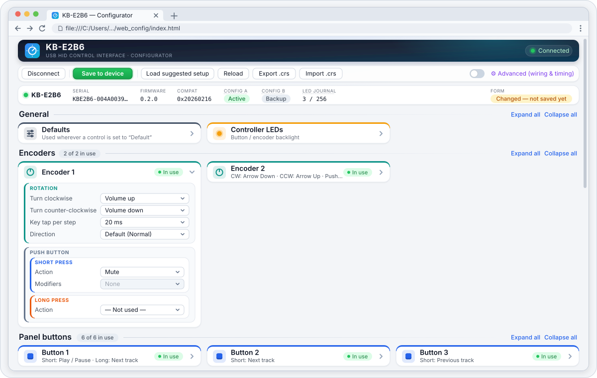

# KB-E2B6 web configurator (WebHID)



**The configurator.** A sketch of the page after connecting a board: the toolbar, the status strip, and the General, Encoders and Panel buttons sections. The labels match the real page; the layout is approximate. Screenshots of the real page: [Configuring the controller](../docs/configuring.md).

Configure a KB-E2B6 from a web page, using WebHID (the browser's way of talking to USB devices): no app, no driver, no server, no internet. **Just open `index.html` in Google Chrome, Microsoft Edge, Brave or Opera** on a computer. It runs locally. Settings are picked from dropdowns (a curated list of actions, a few sensible values per setting), so most mistakes can't be made; the page flags the rest, and the board checks everything again anyway.

**One button: Save to device.** The board checks the setup, stores it in flash and restarts with it (a couple of seconds). If anything is wrong or the write fails, the board keeps its previous setup.

> [!TIP]
> To give it to someone: zip this `web_config` folder (or copy it to a USB stick); they unzip it and double-click `index.html`.

**How to use it, step by step with screenshots, and example setups: [Configuring the controller](../docs/configuring.md).** Wiring, first start and the backlight: [Getting started](../docs/getting-started.md). Problems: [Troubleshooting](../docs/troubleshooting.md). Protocol and design: [Spec - WebHID Config Protocol](../firmware/docs/specs/Spec%20-%20WebHID%20Config%20Protocol.md).

---

## Requirements

> [!IMPORTANT]
> **Use Google Chrome, Microsoft Edge, Brave or Opera on a computer**; Firefox, Safari and browsers on phones, tablets or head units can't reach the board. **On Linux, install the udev rule first** ([below](#open-the-page)): without it the board may still appear in the browser's list, but connecting to it fails, because Linux doesn't let the browser open it.

- **Google Chrome, Microsoft Edge** (already on every Windows PC), **Brave** or **Opera** on a Linux, Windows or Mac computer (other Chromium-based browsers should work too; only Linux is tested). Firefox and Safari don't support WebHID, the USB access the page needs, and neither does any browser on a phone, tablet or head unit, so configure on a computer.
- Mac: not tested, and it may not work: the firmware ignores configuration messages sent over the USB control channel, which macOS may use. Configure on Linux to be sure (it's the system I tested on).
- **Linux only:** a udev rule so the browser may open the board (below). Windows and macOS need nothing.
- **A USB cable that carries data**, USB-C on the board side. A charge-only cable powers the board, but the browser won't see it.
- Board firmware **2.1.0 or newer**. Controllers from the [reference kit](../docs/kit.md) (the controller with tested encoders, buttons, adapter boards and cables) already have it. Building your own or updating an older board: see [For tinkerers](#for-tinkerers).

## Open the page

1. **Linux only, once:**

   ```bash
   cd web_config/linux
   ./install-udev-rule.sh     # asks for your password; then unplug and re-plug the board
   ```

   Still can't connect: [Linux: still can't connect?](../docs/troubleshooting.md#linux-still-cant-connect).

2. Double-click **`index.html`** (or drag it into the browser window). If it opens in Firefox or Safari, right-click it → *Open with* → Chrome, Edge, Brave or Opera.

**Connect device** always opens the browser's device list. The browser remembers the board once you've allowed it, and marks it *Paired* there: just pick **KB-E2B6** and click *Connect*. After a save the page reconnects by itself; if it doesn't, click **Connect device** again.

---

## Using it

Connecting, the status strip, every card and option, saving, and example setups: [Configuring the controller](../docs/configuring.md).

---

## Troubleshooting

Messages, what they mean and what to do: [Troubleshooting → Configurator messages](../docs/troubleshooting.md#configurator-messages).

---

## For tinkerers

### Firmware 2.1.0 or newer

Building your own board or updating an older one: flash the firmware over SWD ([firmware/README.md](../firmware/README.md#flash)).

- Next to the keyboard, media keys and the serial console, the firmware has a vendor-defined HID "configuration" interface. On Windows a new "HID-compliant vendor-defined device" appears under Device Manager → Human Interface Devices.
- Each board reports a unique USB serial number, `KBE2B6-` + its chip's factory ID.

### Details

- Status strip, full list: board name, serial, firmware version, config compatibility ID (*compat*), *Config A/B*, *LED journal* (records used / records per page, e.g. *3 / 256*), and *Form* (*Same as the device* / *Changed* / *Suggested setup*).
- A `.crs` export is the 288-byte binary setup the firmware stores, in its CRS v1 format ([Spec - CRS Format](../firmware/docs/specs/Spec%20-%20CRS%20Format.md)). Inspect it as TOML (or write it over SWD, see [firmware/tools](../firmware/tools/README.md)):

  ```bash
  crs-pack dump --in file.crs --toml
  ```
- An imported `.crs` from another firmware version is re-stamped with this board's compatibility ID when saved; check the form before saving.
- The board's RTT log (read through the SWD probe) shows `webhid: …` lines for the configurator's main commands and `cfg commit: …` for the flash write; on the serial console, `cfg status` shows which setup slot is active and why a slot was rejected.
- Offline self-test (no board needed): open **`selftest.html`** the same way as `index.html`; it should report "All … checks passed" (CRC, config encoding, protocol client against a simulated device).

### A key that isn't in the lists

The dropdowns offer a curated set ([Spec - Action Set](../firmware/docs/specs/Spec%20-%20Action%20Set.md)). The firmware accepts any keyboard usage (8-bit) or consumer usage (16-bit). To use another one: write the setup as TOML (start from `firmware/tools/example.toml`; how the file is organised: [Spec - CRS Format §4.0](../firmware/docs/specs/Spec%20-%20CRS%20Format.md#40-file-organisation)), pack it into a `.crs` file ([crs_tools](../firmware/crs_tools/README.md)):

```bash
crs-pack pack --in my.toml --out my.crs
```

then **Import .crs** → **Save to device**. The page shows such values as "(current)" and keeps them.

### Files

| File | Purpose |
|---|---|
| `index.html`, `style.css` | The page |
| `js/app.js` | UI state machine, form rendering, Save flow |
| `js/catalog.js` | Curated actions (media, Android/system, brightness, navigation, F-keys, letters, digits, controller LEDs) and dropdown values |
| `js/crs.js` | CRS v1 encode/decode + CRC-32 (mirrors `firmware/crs_tools/crs_format`) |
| `js/protocol.js` | Protocol v1 client (frames, one request in flight, error texts) |
| `js/transport.js` | WebHID device discovery, open, reconnect after the post-save restart |
| `selftest.html`, `js/selftest.js` | Offline self-test (no board) |
| `linux/` | udev rule + installer (Linux hosts) |

No build step, no server and no third-party code.

License: MIT OR Apache-2.0 (see `LICENSE-MIT` / `LICENSE-APACHE` in the repository root). Copyright (c) 2026 Dmitry Lifshits. When sharing this folder on its own, include those two files.
